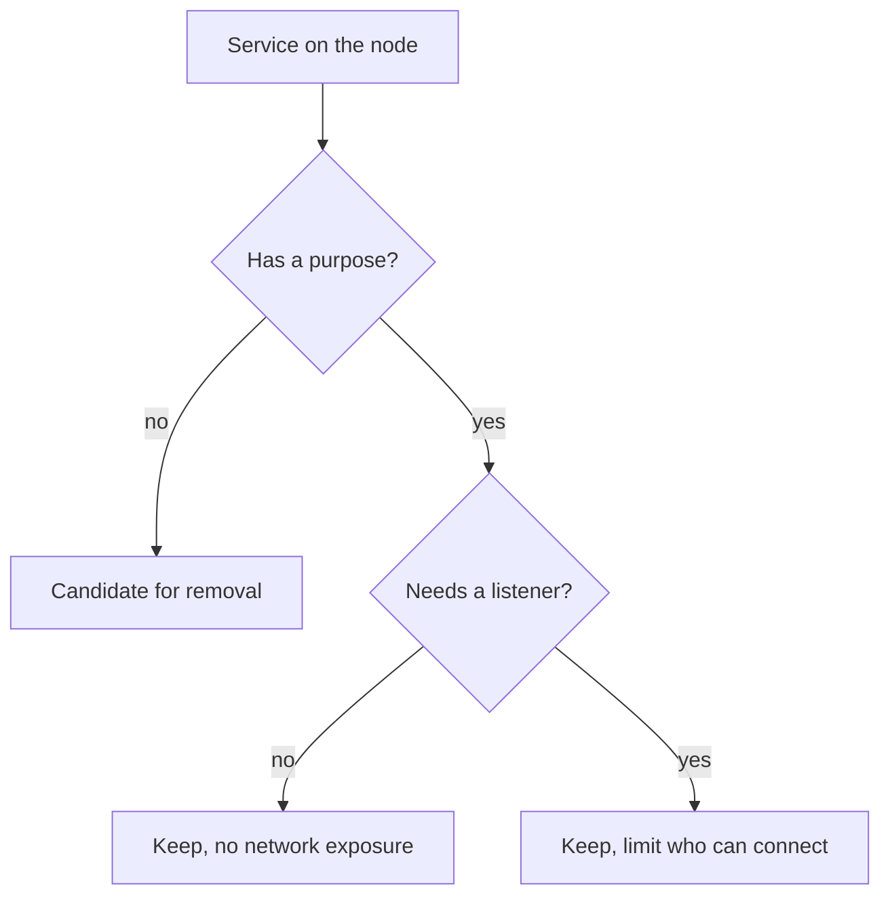

# Inventory Services And Listeners

You cannot reduce what you have not listed. A Kubernetes node is a Linux host, and most nodes start more software than the cluster needs: a remote administration agent, a file-sharing daemon, a development server left behind by an image builder. Each one is code that can contain a flaw and, if it listens on the network, code that other machines can reach. This part builds the inventory that every later decision depends on: which services run, which start at boot, and which ones listen.

## What a service is on a modern Linux node

systemd is the first process on most Linux distributions. It starts and supervises every other service. A **unit** is a description of one thing systemd manages. A unit of type `service` runs a program, and its file name ends in `.service`, for example `kubelet.service`. The command `systemctl` is the tool that asks systemd about units and changes their state.

Two separate facts describe a service, and mixing them up is the most common mistake in host hardening:

- **Active state** says whether the service is running right now. The values you will meet are `active` and `inactive`.
- **Enabled state** says whether systemd starts the service at boot. The values you will meet are `enabled` and `disabled`.

A service can be running and disabled, or stopped and enabled. Hardening needs both facts, because a service that is only stopped starts again at the next reboot.

## The node you will inspect

Each node of the playground is a Podman container that runs systemd. The control-plane node carries a seeded service named `training-extra.service`. It plays the role of a service that an image builder left behind. It runs `/bin/sleep 3600` and has no function in the cluster.

Select the environment, confirm that `kubectl` points at it, and define a helper that runs one command inside the control-plane node container:

<!-- astrona:playground:renew -->

```sh
export KUBECONFIG="$(astrona kubeconfig ats-033-playground-010-01)"
test "$(kubectl config current-context)" = "kind-astro-ats-033-playground-010-01" || exit 1
node_name="astro-ats-033-playground-010-01-control-plane"
run_on_node() { podman exec "$node_name" "$@"; }
```

The `test` line stops the shell if `kubectl` points at another cluster. The helper `run_on_node` sends a command to the node container, so `run_on_node systemctl status kubelet` is the same as logging in to the node and running `systemctl status kubelet`.

## List what is running and what starts at boot

Start with the running services. `systemctl list-units` shows the units that systemd has loaded, and the two filters keep only services that are running:

```sh
run_on_node systemctl list-units --type=service --state=running --no-pager
```

The `--no-pager` option prints the list directly instead of opening a pager. The list contains the services the node needs, for example `containerd.service` and `kubelet.service`, and it contains `training-extra.service`. A running list shows only the present moment, so also list what is set to start at boot:

```sh
run_on_node systemctl list-unit-files --type=service --state=enabled --no-pager
```

`list-unit-files` reads the unit files on disk, not the running state. The second command therefore shows what a reboot would start. Compare the two lists: a service that appears in the enabled list but not in the running list has stopped or failed since boot, and a service that appears in the running list but not in the enabled list was started by hand or by another service.

## Read one service in detail

Before you decide about a service, ask four questions: what program does it run, who started it, is it enabled, and does anything depend on it. `systemctl status` answers the first three:

```sh
run_on_node systemctl status training-extra.service --no-pager
```

The output shows the unit file path, the line `Loaded:` with the word `enabled` or `disabled`, the line `Active:` with the word `active (running)`, the process id and the command line. To see the unit file itself, use `systemctl cat`:

```sh
run_on_node systemctl cat training-extra.service
```

The file has a `[Service]` section with the line `ExecStart=/bin/sleep 3600` and an `[Install]` section with `WantedBy=multi-user.target`. The `WantedBy` line is what `enable` uses: it tells systemd to start this service whenever the system reaches `multi-user.target`, the normal boot target. The fourth question, what depends on the service, is answered by reversing the dependency list:

```sh
run_on_node systemctl list-dependencies --reverse training-extra.service --no-pager
```

The only unit that should appear is the target that wants the service. If other services appear below it, they need the service and stopping it can affect them.

## List the network listeners

A service with no network listener can only be attacked by someone who already has a shell on the node. A service that listens on a network address can be attacked from other machines, so listeners get the most attention. `ss` is the socket statistics tool. The options `-t` (TCP), `-l` (listening), `-n` (numbers instead of names) and `-p` (the owning process) together list every TCP socket that waits for connections:

```sh
run_on_node ss -tlnp
```

Read the `Local Address:Port` column. An address of `127.0.0.1` means the service accepts connections from the node itself only. An address of `0.0.0.0` or `*` means it accepts connections on every IPv4 interface, and `[::]` means every IPv6 interface. The last column shows the program that owns the socket. On a control-plane node you should find the API server on port 6443, `etcd` on ports 2379 and 2380, the kubelet on port 10250 and `containerd` on a loopback port.

Port 10250 is the kubelet API. It must be reachable by the API server, so it listens on all addresses, and its protection comes from authentication and authorization, which the last part of this module checks.

## Decide: required, justify or remove

Put every item on the inventory into one of three groups. A required service is part of how a node works: the container runtime, the kubelet, the networking and time services of the distribution, and on a control-plane node the API server, the scheduler, the controller manager and the datastore. A service that has a documented owner and purpose, such as a monitoring agent, stays only while that owner exists. A service without a purpose is a candidate for removal.



The diagram shows the decision for each service: no purpose means removal, and a purpose that needs a listener means the exposure must be limited. In this playground, `training-extra.service` has no purpose, so it is the candidate for removal.

You now have the three views of a node that every hardening task starts from: running services, enabled services and listeners. The open question is how to remove a service in a way that lasts, because stopping it is not enough. The next part shows what `stop`, `disable` and `mask` each change.

## Common pitfalls

> [!WARNING]
> - **Judging a service by its name.** An unfamiliar name does not mean the service is unneeded. Read its unit file with `systemctl cat` and check the reverse dependencies before you decide.
> - **Reading only the running list.** A service that is stopped now but enabled starts again at the next boot. Always compare the running list with the enabled list.
> - **Forgetting the other address family.** A service can listen on `0.0.0.0` and on `[::]` as two separate sockets. Check both in the `ss` output.
> - **Running `ss` without `-p`.** Without the owning process you see a port but not the program behind it.
