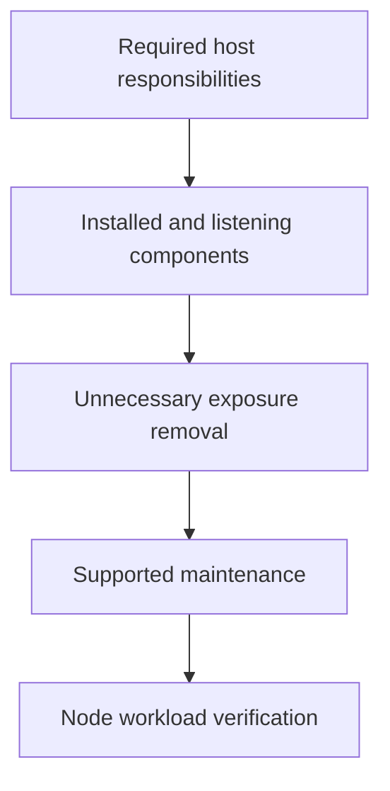

# Reducing The Host Operating-System Attack Surface

A worker hosts unused network services and development tools. Removing unnecessary components reduces exposed behavior, but removing a runtime dependency can also break legitimate workloads.

## Learning objectives

- Inventory services, packages and privileged interfaces by required function.
- Explain why host compromise affects container isolation.
- Evaluate persistent service configuration and patch ownership.

## Before you start

This chapter is standalone reading material; no running cluster or installed tools are required. A Pod is the Kubernetes unit for running one or more containers, and a namespace groups namespaced objects. Treat the worked configurations as teaching examples rather than recorded observations from a provisioned environment.

## Responsible components and behavior

Containers rely on the host kernel, runtime, storage and networking. A compromised node can undermine multiple workloads even if their Kubernetes objects appear properly configured. Minimizing the host operating-system footprint means reducing unnecessary software, services and authority while retaining the responsibilities required to operate the node safely.

## Build A Responsibility Inventory

Start with what the node must do. A worker needs a supported container runtime, kubelet, networking and storage dependencies, and operational services appropriate to its environment. A control-plane host may additionally run API, reconciliation and datastore components. Monitoring, time synchronization and recovery access also have justified roles. The exact set depends on the architecture rather than a universal list of packages to delete.

For each installed service, record its purpose, owner, network listener, privileges and dependencies. Unused database servers, development servers or administrative dashboards create exposure without supporting a node responsibility. Removing or disabling them can reduce reachable code and patch obligations. A package's absence is useful only when required functionality has not moved into another equally exposed process.

## Account For Privileged Interfaces

Runtime sockets, host-mounted files, administrative credentials and service configuration can expose authority without a public network listener. A user allowed to control the container runtime may be able to start a container with host access. That authority can be comparable to direct host administration and should not be treated as a minor convenience permission.

Protect component configuration and credential files from unnecessary writers and readers. A process that can rewrite a privileged service definition may obtain authority when the service reloads or restarts. Access to backups, diagnostic bundles and image caches can also expose sensitive state. Review both the normal execution path and the maintenance path.

## Reduce Services Without Breaking Dependencies

Imagine a node image inherited an unused remote administration agent. Before removing it, identify whether operational teams still depend on it for approved recovery. If it is unnecessary, remove its durable startup configuration and associated access, not only its currently running process. If it remains required, narrow its callers, identity and privileges and keep it within patch ownership.

A similar dependency review applies to kernel modules and networking services. Disabling a forwarding function or removing a required filesystem utility can break Pod connectivity or volume mounting. Hardening should preserve the known runtime contract. A setting that appears secure in isolation is unsuitable if it forces operators to restore broad privileges during every outage.

## Maintain Supported And Durable State

Updates close known defects, but package installation does not prove the running kernel or long-lived service uses the new code. Some changes require a supported restart or reboot procedure. Maintenance planning must include workload disruption, recovery and confirmation of the active component version.

Durable configuration should survive host replacement and reboot through the approved node image or provisioning process. Untracked manual edits can create drift between nodes, complicating incident response and future upgrades. Record the intended state, owner and review process so a replacement node receives the same protection.

## Interpret Minimality Correctly

A minimal host reduces attack surface, but it is not intrinsically invulnerable. Required software can contain defects, and narrow packages can still run with excessive privileges. Combine footprint reduction with restricted administration, network boundaries, audit evidence and timely updates. Retain a controlled diagnostic and recovery path rather than embedding unrestricted troubleshooting tools in every application container.

## Work through the decision

Begin with the node's required responsibilities: container execution, networking, storage and protected administration. Inventory listening services, installed software and privileged integrations against those requirements. An unused service with a reachable listener creates a different risk from a required service constrained to its intended callers.

Apply supported updates and remove or disable unnecessary behavior through managed configuration. Preserve logs and operating evidence before changing a suspect host. A reduced package count is not a complete security guarantee; required components can still be vulnerable or misconfigured. Verify both the reduced exposure and representative node operation after each meaningful change.

Host hardening removes unjustified behavior while preserving the platform functions workloads actually need.

Host hardening removes unjustified behavior while preserving the platform functions workloads actually need.

## Common pitfalls

> [!WARNING]
> Host minimization requires dependency knowledge. Stopping a process once does not remove persistent startup, and access to runtime sockets can bypass the protections expected from ordinary container configuration.
