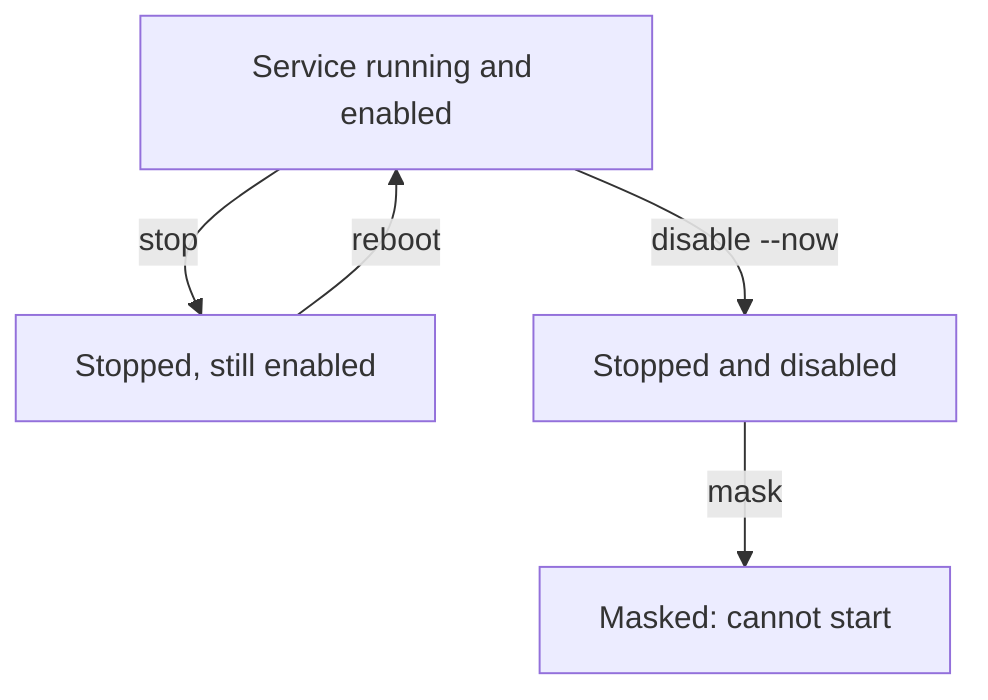

# Stop, Disable And Mask Services

An unneeded service is on your list. The obvious step is to stop it, and that step feels finished because the process disappears. At the next reboot the process comes back, because stopping a service does not change what systemd starts at boot. This part separates the three actions that change a service's state, shows which one lasts, and ends with a check that the node still does its job.

## Three actions, three different changes

systemd keeps the running state and the boot behavior of a service apart, so it has a separate command for each.

- `systemctl stop` stops the running process now. It does not change the boot behavior. After a reboot, an enabled service runs again.
- `systemctl disable` removes the boot behavior. It deletes the symbolic links that the `[Install]` section of the unit created, for example the link in `multi-user.target.wants`. It does not stop a service that is running now. The option `--now` adds the stop to the same command.
- `systemctl mask` links the unit name to `/dev/null` in `/etc/systemd/system`. A masked unit cannot be started by anything: not by a person, not at boot and not as a dependency of another unit. Masking is the strongest option and is meant for units that a package ships, because a package update can enable a disabled unit again but cannot start a masked one.



The diagram shows that `stop` alone returns to the running state after a reboot, while `disable --now` stays stopped and `mask` also blocks manual and dependency starts.

Two more commands matter. `systemctl daemon-reload` makes systemd read unit files again after you change one. `systemctl is-active` and `systemctl is-enabled` print one word each, which makes them good checks in scripts.

## See that stop is not enough

Select the environment again and define the helper. Then check the state of the seeded service before you change it:

<!-- astrona:playground:renew -->

```sh
export KUBECONFIG="$(astrona kubeconfig ats-033-playground-010-01)"
test "$(kubectl config current-context)" = "kind-astro-ats-033-playground-010-01" || exit 1
node_name="astro-ats-033-playground-010-01-control-plane"
run_on_node() { podman exec "$node_name" "$@"; }
run_on_node systemctl is-active training-extra.service
run_on_node systemctl is-enabled training-extra.service
```

The two commands print `active` and `enabled`. Now stop the service only, and ask again:

```sh
run_on_node systemctl stop training-extra.service
run_on_node systemctl is-active training-extra.service
run_on_node systemctl is-enabled training-extra.service
```

The first `is-active` answer is now `inactive`, and `is-enabled` still answers `enabled`. The process is gone, but the node would start it again at boot. Note that `is-active` exits with a non-zero status when the answer is `inactive`. That is normal for this command and is not an error in the node.

## Disable the service so it stays off

Disable the service. `--now` also stops it if it is running, so one command covers both facts:

```sh
run_on_node systemctl disable --now training-extra.service
```

The command prints a line that it removed a symbolic link from `multi-user.target.wants`. That link is the boot behavior. Check both facts again:

```sh
run_on_node systemctl is-active training-extra.service
run_on_node systemctl is-enabled training-extra.service
```

The answers are `inactive` and `disabled`. The unit file `/etc/systemd/system/training-extra.service` still exists, so an administrator can start the service by hand with `systemctl start`. When the service has no purpose at all, the file itself can go too, and that is the next level of removal.

## When to mask, and when to delete the unit file

Masking fits a service that a package ships in `/usr/lib/systemd/system` or `/lib/systemd/system` and that you cannot uninstall, because other software needs the package. Masking records your decision in `/etc/systemd/system`, where updates do not overwrite it. The command is `systemctl mask --now <unit>`, and `systemctl unmask <unit>` reverses it. It needs a free name in `/etc/systemd/system`, so a unit whose own file lives there, like the seeded one, is removed by deleting the file instead.

For a unit file that you or an image builder created, delete the file, then reload systemd:

```sh
run_on_node rm /etc/systemd/system/training-extra.service
run_on_node systemctl daemon-reload
```

After the reload, `systemctl status training-extra.service` reports that the unit could not be found. Only delete files you created or that belong to no package. A file that a package owns returns after the next update, so mask it instead.

## Check that the node still works

Hardening has a second half: proving that the node still does its job. The kubelet and the container runtime are services too, and a careless change can stop them. Check both, and then ask the API server whether it is ready:

```sh
run_on_node systemctl is-active kubelet.service containerd.service
kubectl get --raw=/readyz
kubectl get nodes
```

`is-active` prints one answer per unit, and both should be `active`. The `/readyz` endpoint answers `ok` when the API server is ready. `kubectl get nodes` shows both nodes, and the control-plane node must show the status `Ready`. The kubelet reports that status to the API server, so a node whose kubelet stopped would change to `NotReady` after a short delay.

You now know that persistence is a separate fact from the running state, and that `disable --now` and `mask` are the two actions that last. The next question is the case where the software cannot be turned off in a way that lasts, because the files themselves belong to an installed package. That is the job of the package manager.

## Common pitfalls

> [!WARNING]
> - **Stopping a service and calling it done.** `stop` leaves the service enabled, so it runs again after a reboot. Use `disable --now`.
> - **Editing a unit file and forgetting `daemon-reload`.** systemd keeps the old definition in memory until it reads the files again.
> - **Masking a unit that other units require.** A masked unit fails every unit that depends on it with a hard dependency. Check `systemctl list-dependencies --reverse` first.
> - **Verifying only the service you changed.** Also check `kubelet`, `containerd` and `/readyz`. A change that looks local can affect the node.
