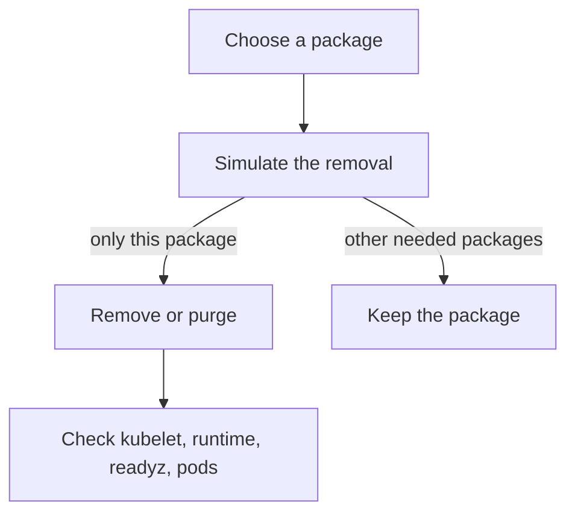

# Remove Packages And Keep The Node Working

A disabled service still has its files on disk, and its package still needs security updates. A tool that is installed but never used, such as a compiler, a network scanner or an old database client, gives an attacker who reaches the node a ready-made set of programs. Removing the package removes that code and the duty to patch it. Removing the wrong package can break the node, so this part teaches how to find what a package does, how to simulate a removal before you do it, and how to keep the result.

## Packages, the package manager and who owns a file

A **package** is an archive of files plus metadata, including the list of other packages it needs. On Debian and Ubuntu systems the low-level tool is `dpkg`, which installs and lists packages. `apt-get` is the higher-level tool that also resolves dependencies. A **dependency** is another package that must be installed for a package to work.

Two rules from the package system matter for hardening. First, a file that belongs to a package is patched when the package is updated. Second, a file that belongs to no package is invisible to the package manager, so no update ever patches it. Binaries that an image builder copies in by hand fall into the second group, and they need a manual update process or a replacement of the node image.

## Find out what is installed and who owns a file

Select the environment and define the helper:

<!-- astrona:playground:renew -->

```sh
export KUBECONFIG="$(astrona kubeconfig ats-033-playground-010-01)"
test "$(kubectl config current-context)" = "kind-astro-ats-033-playground-010-01" || exit 1
node_name="astro-ats-033-playground-010-01-control-plane"
run_on_node() { podman exec "$node_name" "$@"; }
```

List the packages that someone installed on purpose. `apt-mark showmanual` prints the packages marked as manually installed. Packages that were installed only as a dependency of another package are not in this list:

```sh
run_on_node apt-mark showmanual
```

The count of installed packages is one number to track over time. The command `dpkg-query --list` prints one line per package, so `wc -l` counts them:

```sh
run_on_node sh -c 'dpkg-query --list | wc -l'
```

To learn which package owns a file, use `dpkg -S`. The next command asks about the real path of `systemctl`. If the file belongs to a package, the output starts with the package name. If it belongs to none, `dpkg` says that no path matched:

```sh
run_on_node sh -c 'dpkg -S "$(readlink -f "$(command -v systemctl)")"'
```

Run the same command again with the path of another program, for example the kubelet. Compare the answers. A program that no package owns, such as a binary copied into the node image, shows the second case: no update from the package manager will ever patch it.

## Simulate before you remove

`apt-get remove` removes a package and keeps its configuration files. `apt-get purge` removes the package and its configuration files. `apt-get autoremove` removes dependency packages that nothing needs any more. All three can remove more than you expect, because removing a package also removes every package that depends on it.

The option `--simulate` (short form `-s`) prints what would happen and changes nothing. Choose a package name from the `showmanual` list that you do not recognise as part of Kubernetes or the container runtime, and put it in a variable:

```sh
PACKAGE_NAME="<PACKAGE>"
run_on_node apt-get remove --simulate "$PACKAGE_NAME"
```

Replace `<PACKAGE>` with the name you chose. Read the lines that start with `Remv`. The first one is the package you named. Every further `Remv` line is another package that the removal would take with it. If the list contains packages you need, such as `systemd`, `libc6` or `containerd.io`, stop: the package is a dependency of the node itself.

The same check works in reverse. `apt-cache rdepends --installed <package>` lists the installed packages that depend on a package. Use the simulation when you plan a removal, and use `rdepends` when you want to understand why something cannot go.

## Remove, then prove the node still works

When the simulation shows only the package you meant to remove, run `apt-get remove --yes <package>` or `apt-get purge --yes <package>` on the node, and run `apt-get autoremove --simulate` before you accept an autoremove. Do not remove a package in the playground unless you chose one that the simulation showed to be safe.

After any removal, check the same three things as after a service change. The kubelet and the container runtime must be active, the API must be ready, and the workloads must still run:

```sh
run_on_node systemctl is-active kubelet.service containerd.service
kubectl get --raw=/readyz
kubectl -n starfleet get pods
```

Every pod in `starfleet` should show `Running`, and the `probe` Deployment should still have two ready replicas. A pod that restarts right after a package change is a sign that the change affected the container runtime, the networking or the storage of the node.



The diagram shows the order that avoids outages: simulate first, remove only when the list is safe, and verify afterwards.

## Keep the result: updates and durable state

Removal is a point in time. Two habits keep the result. The first is patching. Installing a package update does not change a process that is already running, so a service keeps using the old code until it restarts. On Ubuntu the file `/var/run/reboot-required` exists after an update that needs a reboot, and the kernel stays old until the node restarts. Plan restarts through draining: `kubectl drain` moves pods away from the node before the restart, and `kubectl uncordon` allows scheduling again afterwards.

The second habit is durability. A manual change on one node is lost when the node is replaced, and it makes nodes differ from each other. Put the hardening steps into the node image or the provisioning tool, so a new node starts hardened. Record who owns each remaining service and package, so a later review can ask the owner whether it is still needed.

You can now inventory a node, turn a service off for good, and remove packages with a simulation as protection. What is left are the interfaces that need no open port at all: a socket file, a mounted host directory or a flag on a pod can hand out the same authority as a root shell. The last part reviews them.

## Common pitfalls

> [!WARNING]
> - **Running `apt-get remove` without `--simulate` first.** The command also removes every package that depends on the one you named, and `--yes` skips the confirmation.
> - **Assuming a package update fixes a running process.** The process keeps the old code until it restarts, and a kernel update needs a reboot.
> - **Trusting the package manager for every file.** A file that no package owns is never patched by `apt`.
> - **Hardening one node by hand.** The next replacement node starts without the change. Put the change into the node image or provisioning.
