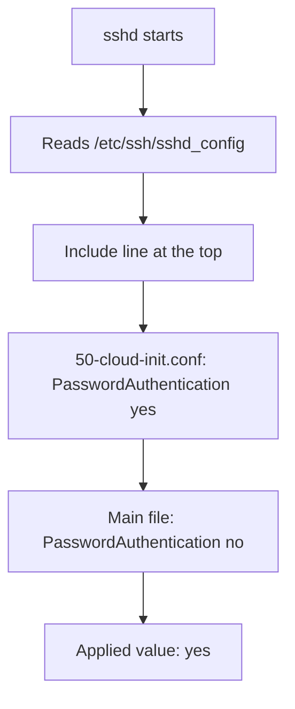

---
exam_objectives:
- Minimize host OS footprint (reduce attack surface)
---
# Read The sshd Settings That Decide Who Gets In

Anyone who can log in to a node over the network can run commands as a user of that node, and a root login runs them as the owner of everything. The SSH service is therefore one of the most important listeners on a node, and its settings are among the most important lines of text on it. This part shows which file the SSH daemon reads, how it picks a value when several files set the same option, and which three options decide whether root and passwords are accepted.

## The daemon, its file and the rule that the first value wins

SSH (Secure Shell) is a protocol for logging in to a remote machine over an encrypted connection. `sshd` is the SSH daemon: the service on the node that listens on TCP port 22, authenticates the user and starts the login shell. The daemon reads its settings from `/etc/ssh/sshd_config`. Each line is a keyword and a value, for example `PermitRootLogin no`.

A main file is often not the only file. The line `Include /etc/ssh/sshd_config.d/*.conf` tells the daemon to read the matching files of a directory at that position. Cloud images and installers use this directory to add settings without editing the main file. The daemon reads the files that match the pattern in alphabetical order.

The rule that causes most mistakes is this: **for each keyword, the daemon uses the first value it reads and ignores the later ones.** Most programs let a later line override an earlier one. `sshd` does the opposite. If the `Include` line is at the top of the main file, a drop-in file sets a value before the main file does, and the value in the main file never applies.



The diagram shows a drop-in file that wins over a later line in the main file because its value is read first.

## See the effective settings of the playground node

The playground is one Ubuntu 24.04 virtual machine (VM) that is a single Kubernetes node. It runs a real SSH daemon, and an old image build left extra lines in its configuration. Open a shell on the VM and confirm that `kubectl` points at this playground:

<!-- astrona:playground:renew -->

```sh
astrona ssh astro-ats-033-playground-010-02
kubectl config current-context
```

```text
kubernetes-admin@astro-ats-033-playground-010-02
```

You are logged in as the `student` user. The SSH files belong to root, and some of them only root may read, so commands that read or change them start with `sudo`, which runs one command as root. Read the main file first. `grep -v` with the pattern `^(#|$)` hides comment lines and empty lines, and `-n` prints the line numbers:

```sh
grep -n -v -E '^(#|$)' /etc/ssh/sshd_config
```

```text
12:Include /etc/ssh/sshd_config.d/*.conf
71:KbdInteractiveAuthentication no
94:UsePAM yes
99:X11Forwarding yes
103:PrintMotd no
121:AcceptEnv LANG LC_*
124:Subsystem	sftp	/usr/lib/openssh/sftp-server
134:PermitRootLogin yes
135:PasswordAuthentication no
137:Match User backup
138:    # The backup account may only copy files.
139:    ForceCommand internal-sftp
140:    AllowTcpForwarding no
```

The `Include` line is line 12, near the top. Lines 134 and 135 set `PermitRootLogin yes` and `PasswordAuthentication no`. Reading only this file suggests that passwords are off. Every line after `Match User backup` belongs to that block, a topic for later. Now list the drop-in files and read them in the order the daemon reads them. `grep -H .` prints every non-empty line with its file name in front:

```sh
ls -l /etc/ssh/sshd_config.d/
sudo grep -H . /etc/ssh/sshd_config.d/50-cloud-init.conf /etc/ssh/sshd_config.d/60-cloudimg-settings.conf
```

```text
total 8
-rw------- 1 root root 27 Nov 18 09:09 50-cloud-init.conf
-rw-r--r-- 1 root root 26 Aug  1 13:01 60-cloudimg-settings.conf
/etc/ssh/sshd_config.d/50-cloud-init.conf:PasswordAuthentication yes
/etc/ssh/sshd_config.d/60-cloudimg-settings.conf:PasswordAuthentication no
```

`50-cloud-init.conf` has the mode `600`, so only root can read it, which is why the command needs `sudo`. It sorts before `60-cloudimg-settings.conf`, and the `Include` line comes before line 135 of the main file. So the daemon reads `PasswordAuthentication yes` first, and the two later `no` lines change nothing.

Reading files by hand is easy to get wrong. The command `sshd -T` (test mode, extended) makes the daemon read all the files itself and print the effective value of every keyword, in lower case. `grep` keeps the four keywords of this part:

```sh
sudo sshd -T | grep -E '^(permitrootlogin|passwordauthentication|pubkeyauthentication|kbdinteractiveauthentication) '
```

```text
permitrootlogin yes
pubkeyauthentication yes
passwordauthentication yes
kbdinteractiveauthentication no
```

The daemon would accept root logins and passwords. `sshd -T` is the most reliable check, because it shows the values the daemon uses and not what one file says. It reads the files from disk, though, so it says nothing about the daemon that is running now.

## Three settings for the access path

`PermitRootLogin` controls whether the account `root` may log in over SSH. The value `yes` allows it with a password or a key. The value `prohibit-password` (the default in current OpenSSH versions) allows it with a key only. The value `forced-commands-only` allows a key that is restricted to one command. The value `no` refuses it. Root is the one account name every attacker knows, so `no` removes a login path that is always tried. Administrators log in as a named account and use `sudo` for administrator tasks, which also leaves a record of who did what.

`PasswordAuthentication` controls whether the daemon accepts a password. A password can be guessed by trying many candidates over the network. A key cannot be guessed in practice: the client proves that it holds a private key that matches a public key stored on the node, and the private key never travels over the network. `PubkeyAuthentication yes` turns key login on. Key-only access means `PasswordAuthentication no` together with `PubkeyAuthentication yes`.

Some systems also offer passwords through a second mechanism, keyboard-interactive authentication, which a setting called `KbdInteractiveAuthentication` controls. If you want key-only access, check this setting as well, because a prompt for a password can arrive through it even when `PasswordAuthentication` is `no`.

## Fix the value that applies

The running daemon itself can answer which methods it offers. A test login with `PreferredAuthentications=none` tries no method at all, so the daemon refuses it and lists the methods it would accept. `BatchMode=yes` stops the client from asking for a password, and the two `-o` options for host keys stop it from asking whether to trust the VM:

```sh
ssh -o BatchMode=yes -o PreferredAuthentications=none -o StrictHostKeyChecking=no -o UserKnownHostsFile=/dev/null opsadmin@127.0.0.1 true
```

```text
Warning: Permanently added '127.0.0.1' (ED25519) to the list of known hosts.
opsadmin@127.0.0.1: Permission denied (publickey,password).
```

The daemon offers `publickey` and `password`. The value to repair is the one that is read first, which is the line in the drop-in file. The `sed` command below replaces the whole line in place. The pattern `^PasswordAuthentication .*` matches a line that starts with the keyword, and `-i` writes the change into the file. Then ask `sshd -T` and the running daemon again:

```sh
sudo sed -i 's/^PasswordAuthentication .*/PasswordAuthentication no/' /etc/ssh/sshd_config.d/50-cloud-init.conf
sudo sshd -T | grep -E '^(passwordauthentication|pubkeyauthentication) '
ssh -o BatchMode=yes -o PreferredAuthentications=none -o StrictHostKeyChecking=no -o UserKnownHostsFile=/dev/null opsadmin@127.0.0.1 true
```

```text
pubkeyauthentication yes
passwordauthentication no
Warning: Permanently added '127.0.0.1' (ED25519) to the list of known hosts.
opsadmin@127.0.0.1: Permission denied (publickey,password).
```

The files now say `no`, but the running daemon still offers `password`. The daemon reads its files when it starts or reloads, so a file change does not reach it until then. Editing the drop-in file is the right fix. Adding a second `no` at the end of the main file would change nothing, because the earlier `yes` is still read first.

Before you reload, check the syntax. `sshd -t` (lower-case `t`) reads all the files and prints nothing when they are valid. `systemctl reload ssh.service` makes the running daemon read its files again. A reload keeps the sessions that are already open, so your own shell stays connected. Then test once more:

```sh
sudo sshd -t
sudo systemctl reload ssh.service
ssh -o BatchMode=yes -o PreferredAuthentications=none -o StrictHostKeyChecking=no -o UserKnownHostsFile=/dev/null opsadmin@127.0.0.1 true
```

```text
Warning: Permanently added '127.0.0.1' (ED25519) to the list of known hosts.
opsadmin@127.0.0.1: Permission denied (publickey).
```

The first two commands print nothing. The running daemon now offers only `publickey`.

You now know where the effective value of an SSH setting comes from, how to find the line that wins, and that the running daemon needs a reload to use it. The open question is who may use the path that remains: key login is on, but every account on the node can still try it.

## Common pitfalls

> [!WARNING]
> - **Reading only the main file.** A drop-in that is read first can change a value that the main file sets. Check the result with `sshd -T`.
> - **Editing the wrong line.** A later line never overrides an earlier one. Change the line that is read first.
> - **Forgetting the reload.** `sshd -T` reads the files, but the running daemon keeps its old settings until `systemctl reload ssh.service`.
> - **Turning off passwords before a key works.** If no account has a working public key on the node, key-only access locks every administrator out. Test a key login first.
> - **Forgetting keyboard-interactive authentication.** A password prompt can come through that mechanism even when `PasswordAuthentication` is `no`.
