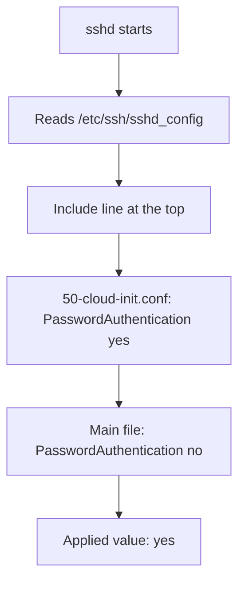

# Read The sshd Settings That Decide Who Gets In

Anyone who can log in to a node over the network can run commands as a user of that node, and a root login runs them as the owner of everything. The SSH service is therefore one of the most important listeners on a node, and its settings are among the most important lines of text on it. This part shows which file the SSH daemon reads, how it picks a value when several files set the same option, and which three options decide whether root and passwords are accepted.

## The daemon, its file and the rule that the first value wins

SSH (Secure Shell) is a protocol for logging in to a remote machine over an encrypted connection. `sshd` is the SSH daemon: the service on the node that listens on TCP port 22, authenticates the user and starts the login shell. The daemon reads its settings from `/etc/ssh/sshd_config`. Each line is a keyword and a value, for example `PermitRootLogin no`.

A main file is often not the only file. The line `Include /etc/ssh/sshd_config.d/*.conf` tells the daemon to read the matching files of a directory at that position. Cloud images and installers use this directory to add settings without editing the main file. The daemon reads the files that match the pattern in alphabetical order.

The rule that causes most mistakes is this: **for each keyword, the daemon uses the first value it reads and ignores the later ones.** Most programs let a later line override an earlier one. `sshd` does the opposite. If the `Include` line is at the top of the main file, a drop-in file sets a value before the main file does, and the value in the main file never applies.



The diagram shows a drop-in file that wins over a later line in the main file because its value is read first.

## See the effective settings of the playground node

The playground node has a stand-in SSH configuration with the same syntax as a real one. Select the environment and define a helper that runs one command inside the control-plane node container:

<!-- astrona:playground:renew -->

```sh
export KUBECONFIG="$(astrona kubeconfig ats-033-playground-010-02)"
test "$(kubectl config current-context)" = "kind-astro-ats-033-playground-010-02" || exit 1
node_name="astro-ats-033-playground-010-02-control-plane"
run_on_node() { podman exec "$node_name" "$@"; }
```

The `test` line stops the shell if `kubectl` points at another cluster. The helper `run_on_node` sends a command to the node container. Read the main file first:

```sh
run_on_node cat /etc/ssh/sshd_config
```

The file includes the drop-in directory on its first line, sets `PermitRootLogin yes` and sets `PasswordAuthentication no`. Reading only this file suggests that passwords are off. Now read the files in the order the daemon reads them. The shell expands `*.conf` in alphabetical order, so one `cat` prints the drop-ins first and the main file last:

```sh
run_on_node sh -c 'cat /etc/ssh/sshd_config.d/*.conf /etc/ssh/sshd_config'
```

The first line of the output is `PasswordAuthentication yes`, from `50-cloud-init.conf`. That line is read before `PasswordAuthentication no`, so password logins are allowed. On a host that has the daemon installed, the command `sshd -T`, run as root, prints the effective value of every setting after the daemon has applied this rule. It is the most reliable check, because it shows what the daemon will use and not what one file says.

## Three settings for the access path

`PermitRootLogin` controls whether the account `root` may log in over SSH. The value `yes` allows it with a password or a key. The value `prohibit-password` (the default in current OpenSSH versions) allows it with a key only. The value `forced-commands-only` allows a key that is restricted to one command. The value `no` refuses it. Root is the one account name every attacker knows, so `no` removes a login path that is always tried. Administrators log in as a named account and use `sudo` for administrator tasks, which also leaves a record of who did what.

`PasswordAuthentication` controls whether the daemon accepts a password. A password can be guessed by trying many candidates over the network. A key cannot be guessed in practice: the client proves that it holds a private key that matches a public key stored on the node, and the private key never travels over the network. `PubkeyAuthentication yes` turns key login on. Key-only access means `PasswordAuthentication no` together with `PubkeyAuthentication yes`.

Some systems also offer passwords through a second mechanism, keyboard-interactive authentication, which a setting called `KbdInteractiveAuthentication` controls. If you want key-only access, check this setting as well, because a prompt for a password can arrive through it even when `PasswordAuthentication` is `no`.

## Fix the value that applies

The value to repair is the one that is read first, which is the line in the drop-in file. The `sed` command below replaces the whole line in place. The pattern `^PasswordAuthentication .*` matches a line that starts with the keyword, and `-i` writes the change into the file:

```sh
run_on_node sed -i 's/^PasswordAuthentication .*/PasswordAuthentication no/' /etc/ssh/sshd_config.d/50-cloud-init.conf
run_on_node sh -c 'cat /etc/ssh/sshd_config.d/*.conf /etc/ssh/sshd_config'
```

The first value of `PasswordAuthentication` is now `no`. The later line in the main file also says `no`, so both agree. Editing the drop-in file is the right fix. Adding a second `no` at the end of the main file would change nothing, because the earlier `yes` is still read first.

On a real host a file change does not reach the running daemon until it reloads its settings. Reloading the daemon without cutting off your own session needs a few habits, covered below in the section on live changes of the daemon.

You now know where the effective value of an SSH setting comes from and how to find the line that wins. The next question is who may use the path that remains: key login is on, but every account on the node can still try it.

## Common pitfalls

> [!WARNING]
> - **Reading only the main file.** A drop-in that is read first can change a value that the main file sets. Read the files in the order the daemon reads them, or use `sshd -T` on a host that has it.
> - **Editing the wrong line.** A later line never overrides an earlier one. Change the line that is read first.
> - **Turning off passwords before a key works.** If no account has a working public key on the node, key-only access locks every administrator out. Test a key login first.
> - **Forgetting keyboard-interactive authentication.** A password prompt can come through that mechanism even when `PasswordAuthentication` is `no`.
