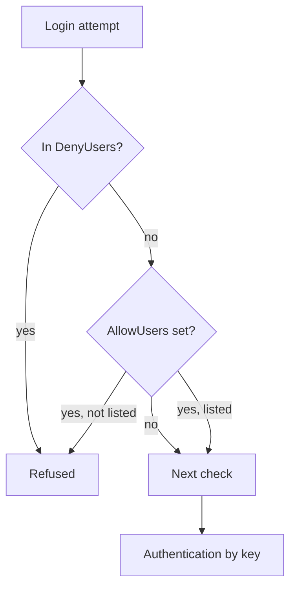

# Limit Who Can Log In

Key-only access removes guessable passwords, but every account on the node can still try to log in with a key. A node has many accounts: the system accounts of installed packages, accounts of former staff, and test accounts. Only a few people need SSH access. This part shows how to name those accounts in the SSH daemon so that every other account is refused, and how to change a live daemon without cutting off your own session.

## Allow lists and deny lists

`sshd` can check the account name of every login against four lists, each set with a keyword that takes a space-separated list of patterns: `DenyUsers`, `AllowUsers`, `DenyGroups` and `AllowGroups`. The daemon checks them in this order: `DenyUsers`, then `AllowUsers`, then `DenyGroups`, then `AllowGroups`. A match in a deny list refuses the login. If an allow list exists, an account that does not match it is refused, even when it has a valid key.

This second rule is the useful one for hardening. `AllowUsers opsadmin` does not list who is blocked. It states who is allowed, and everyone else is blocked, including accounts that are created later. A pattern can also name the client address, for example `opsadmin@10.0.0.5`, which allows the account only from that address. `AllowGroups` does the same for a group, which suits teams where people join and leave.



The diagram shows the first checks of the daemon: a deny match or a missing allow-list entry ends the login before any key is tried.

## Close root login and set the allow list

The playground node still allows root login and any account. Select the environment and define the helper, then read the two lines that need to change:

<!-- astrona:playground:renew -->

```sh
export KUBECONFIG="$(astrona kubeconfig ats-033-playground-010-02)"
test "$(kubectl config current-context)" = "kind-astro-ats-033-playground-010-02" || exit 1
node_name="astro-ats-033-playground-010-02-control-plane"
run_on_node() { podman exec "$node_name" "$@"; }
run_on_node grep -n -E '^(PermitRootLogin|AllowUsers|Match)' /etc/ssh/sshd_config
```

The `grep` output shows `PermitRootLogin yes` and no `AllowUsers` and no `Match` line. The `Match` check matters, as the next section explains. Replace the root login value, then add the allow list as a new line at the end of the file:

```sh
run_on_node sed -i 's/^PermitRootLogin .*/PermitRootLogin no/' /etc/ssh/sshd_config
run_on_node sh -c "printf 'AllowUsers opsadmin\n' >> /etc/ssh/sshd_config"
run_on_node tail -n 3 /etc/ssh/sshd_config
```

The `printf` command writes the line and `>>` appends it to the file. With `PermitRootLogin no`, the `root` account cannot log in over SSH at all. Administrators log in as `opsadmin` and use `sudo` for tasks that need root. With `AllowUsers opsadmin`, an account such as `olduser` is refused even if it has a public key on the node.

## Why a Match block changes the meaning of the last line

A `Match` line in `sshd_config` starts a conditional block, for example `Match Address 10.0.0.0/8`. Every setting after it applies only to connections that match the condition, until the next `Match` line or the end of the file. A line appended to the end of a file that already contains a `Match` block therefore becomes part of that block. An `AllowUsers` line in the wrong place then limits only some connections and leaves the rest open. When a file has `Match` blocks, put global settings above the first `Match` line. The `grep` above is the check for this: this file has no `Match` line, so the appended line is global.

## Change a live daemon without locking yourself out

Editing the file does not change a running daemon. The administrator must make the daemon read the file again, and a wrong line can cut off every future login. Three habits prevent that, and they apply on a real host where the daemon is installed.

First, check the syntax with `sshd -t`, which reads the files and reports an error without touching the running daemon. Second, reload the daemon with `systemctl reload ssh` (the service name is `ssh` on Debian and Ubuntu and `sshd` on Red Hat based systems) and do not restart it. A reload keeps the sessions that are already open, so the session you work in survives a bad change. Third, keep that session open and test a new login from a second terminal. Close the first session only after the second one works.

The playground node has no running SSH daemon, so these steps need no command here. The file you changed is what the check in the lab reads.

You now know how to state who may log in and how to change the daemon safely. Accounts that are not on the list still exist, with login shells and passwords, and they can matter for other login paths, such as a local console or `su`. Those paths need their own changes.

## Common pitfalls

> [!WARNING]
> - **Appending after a `Match` block.** The new line belongs to that block. Put global settings above the first `Match` line.
> - **Restarting instead of reloading.** A restart stops the daemon and starts it again, and a wrong file can keep it from starting. Check with `sshd -t`, reload, and test from a second session.
> - **Allowing no one.** An `AllowUsers` list with a typo in the only account name refuses every login. Test before you close the first session.
> - **Believing `AllowUsers` removes accounts.** It limits SSH logins only. The account, its password and its shell still exist.
