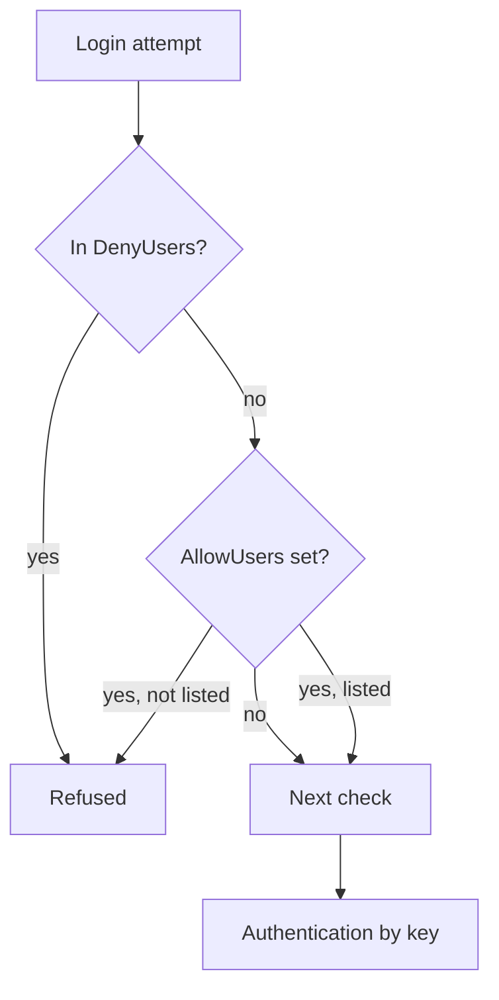

# Limit Who Can Log In

Key-only access removes guessable passwords, but every account on the node can still try to log in with a key. A node has many accounts: the system accounts of installed packages, accounts of former staff, and test accounts. Only a few people need SSH access. This part shows how to name those accounts in the SSH daemon so that every other account is refused, and how to change a live daemon without cutting off your own session.

## Allow lists and deny lists

`sshd` can check the account name of every login against four lists, each set with a keyword that takes a space-separated list of patterns: `DenyUsers`, `AllowUsers`, `DenyGroups` and `AllowGroups`. The daemon checks them in this order: `DenyUsers`, then `AllowUsers`, then `DenyGroups`, then `AllowGroups`. A match in a deny list refuses the login. If an allow list exists, an account that does not match it is refused, even when it has a valid key.

This second rule is the useful one for hardening. `AllowUsers opsadmin` does not list who is blocked. It states who is allowed, and everyone else is blocked, including accounts that are created later. A pattern can also name the client address, for example `opsadmin@10.0.0.5`, which allows the account only from that address. `AllowGroups` does the same for a group, which suits teams where people join and leave.



The diagram shows the first checks of the daemon: a deny match or a missing allow-list entry ends the login before any key is tried.

## Close root login and find the Match block

The playground is one Ubuntu 24.04 virtual machine (VM) that is a single Kubernetes node with a real SSH daemon. Its daemon still allows root login and every account. Open a shell on the VM and confirm that `kubectl` points at this playground:

<!-- astrona:playground:renew -->

```sh
astrona ssh astro-ats-033-playground-010-02
kubectl config current-context
```

```text
kubernetes-admin@astro-ats-033-playground-010-02
```

You are logged in as the `student` user. Keep this first shell open until the end of the part: if a change blocks new logins, you can still repair it from here. The SSH files belong to root, so commands that read or change them start with `sudo`. Read the lines of the main file that matter for this part:

```sh
grep -n -E '^(Include|PermitRootLogin|AllowUsers|Match)' /etc/ssh/sshd_config
```

```text
12:Include /etc/ssh/sshd_config.d/*.conf
134:PermitRootLogin yes
137:Match User backup
```

The main file has the `Include` line at line 12, `PermitRootLogin yes` at line 134, no `AllowUsers` line, and a `Match` line at line 137. No drop-in file sets `PermitRootLogin`, so line 134 is the value that applies. Replace it:

```sh
sudo sed -i 's/^PermitRootLogin .*/PermitRootLogin no/' /etc/ssh/sshd_config
```

The command prints nothing. With `PermitRootLogin no`, the `root` account cannot log in over SSH at all. Administrators log in as `opsadmin` and use `sudo` for tasks that need root. The `Match` line found above decides where the allow list may go.

## Why a Match block changes the meaning of the last line

A `Match` line in `sshd_config` starts a conditional block, for example `Match User backup` or `Match Address 10.0.0.0/8`. Every setting after it applies only to connections that match the condition, until the next `Match` line or the end of the file. A line appended to the end of a file that already contains a `Match` block therefore becomes part of that block.

You can see this without touching the real file. `sshd -T -f` reads another main file, and `-C user=backup` prints the settings for a connection of the account `backup`. Copy the main file, append an allow list to the copy, and compare the two views:

```sh
sudo cp /etc/ssh/sshd_config /tmp/sshd_config.test
echo "AllowUsers opsadmin student astrona" | sudo tee -a /tmp/sshd_config.test
sudo sshd -T -f /tmp/sshd_config.test | grep '^allowusers'
sudo sshd -T -f /tmp/sshd_config.test -C user=backup | grep '^allowusers'
sudo rm /tmp/sshd_config.test
```

```text
AllowUsers opsadmin student astrona
allowusers opsadmin
allowusers student
allowusers astrona
```

The first `sshd -T` prints no `allowusers` line: for every account except `backup`, no allow list exists. Only the connections of `backup` get the list. An `AllowUsers` line in the wrong place therefore limits one account and leaves the rest open. Put global settings above the first `Match` line, or in a drop-in file: the `Include` line sits above the `Match` block, so every line in a drop-in file is global.

## Set the allow list in a drop-in file

The allow list must name every account that needs SSH access. On this VM, administrators use `opsadmin`, and the platform logs in as `student` and `astrona`. A list without those two would block the platform and your own next login. `AllowUsers` lines add up instead of using the first value, so the name of the drop-in file does not matter for this keyword:

```sh
echo "AllowUsers opsadmin student astrona" | sudo tee /etc/ssh/sshd_config.d/10-allow-users.conf
```

```text
AllowUsers opsadmin student astrona
```

`tee` writes the line into the file and prints it. With this list, an account such as `olduser` is refused even if it has a public key on the node.

## Change a live daemon without locking yourself out

Editing a file does not change the running daemon, and a wrong line can block every future login. Three habits prevent that. First, check the syntax with `sshd -t`, which reads the files and reports an error without touching the running daemon. Second, reload the daemon with `systemctl reload ssh.service` and do not restart it. The service name is `ssh` on Debian and Ubuntu and `sshd` on Red Hat based systems. A reload keeps the sessions that are already open, so the session you work in survives a bad change. Third, keep that session open and test a new login before you close it:

```sh
sudo sshd -t
sudo systemctl reload ssh.service
sudo sshd -T | grep -E '^(permitrootlogin|passwordauthentication|allowusers) '
```

```text
permitrootlogin no
passwordauthentication no
allowusers opsadmin
allowusers student
allowusers astrona
```

`sshd -t` and the reload print nothing. `sshd -T` prints one `allowusers` line for each account. Now test the running daemon with two accounts: `student`, which is on the list, and `olduser`, which is not. The test login tries no method, as in a check of the offered methods. The journal of the `ssh` service, read with `journalctl`, shows why the daemon refused a login:

```sh
ssh -o BatchMode=yes -o PreferredAuthentications=none -o StrictHostKeyChecking=no -o UserKnownHostsFile=/dev/null student@127.0.0.1 true
ssh -o BatchMode=yes -o PreferredAuthentications=none -o StrictHostKeyChecking=no -o UserKnownHostsFile=/dev/null olduser@127.0.0.1 true
sudo journalctl --unit=ssh.service --since=-1min --no-pager --grep=AllowUsers
```

```text
Warning: Permanently added '127.0.0.1' (ED25519) to the list of known hosts.
student@127.0.0.1: Permission denied (publickey).
Warning: Permanently added '127.0.0.1' (ED25519) to the list of known hosts.
olduser@127.0.0.1: Permission denied (publickey).
Nov 18 09:09:09 astro-ats-033-playground-010-02 sshd[2961]: User olduser from 127.0.0.1 not allowed because not listed in AllowUsers
```

The client sees the same answer for both accounts, because the daemon does not tell a client why it refuses a login. The journal shows the real reason: `olduser` is not listed in `AllowUsers`. No line appears for `student`, so the list let that account through to the key check.

You now know how to state who may log in and how to change the daemon safely. Accounts that are not on the list still exist, with login shells and passwords, and they can matter for other login paths, such as a local console or `su`. Those paths need their own changes.

## Common pitfalls

> [!WARNING]
> - **Appending after a `Match` block.** The new line belongs to that block. Put global settings above the first `Match` line.
> - **Restarting instead of reloading.** A restart stops the daemon and starts it again, and a wrong file can keep it from starting. Check with `sshd -t`, reload, and test from a second session.
> - **Allowing too few.** An `AllowUsers` list without the platform accounts, or with a typo in the only account name, refuses new logins. Test before you close the first session.
> - **Believing `AllowUsers` removes accounts.** It limits SSH logins only. The account, its password and its shell still exist.
