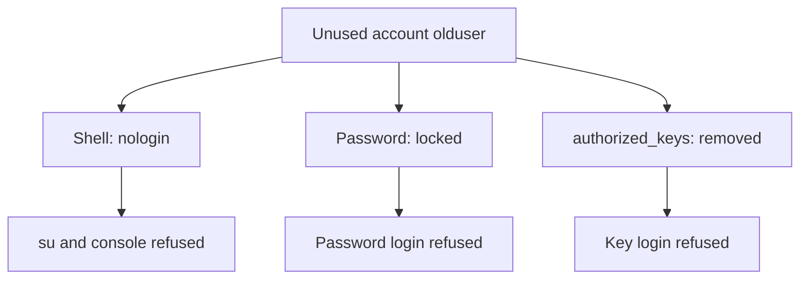

---
exam_objectives:
- Minimize host OS footprint (reduce attack surface)
---
# Login Shells And Unused Accounts

Every account on a node is a possible way in, whether or not anybody uses it. An account of a person who left, a test account, or an account created by a package keeps a login shell, and sometimes a password or a key. Closing these paths is a quiet and effective hardening step, because it needs no new software. This part reads the account database, shows how a login shell is refused, and closes the paths of an account without deleting it.

## The account database and the login shell

Linux keeps accounts in `/etc/passwd`. Each line has seven fields separated by colons: the account name, a password placeholder, the user identifier (UID), the group identifier (GID), a description, the home directory and the login shell. The login shell is the program that starts when the user logs in. An interactive account has a shell such as `/bin/bash`. An account that must not log in has `/usr/sbin/nologin`, a small program that prints a message and ends, or `/bin/false`.

A service account, which only runs a daemon, needs no shell. Package installers normally give such accounts a `nologin` shell. Accounts created by hand often get `/bin/bash` by default, and that is the common mistake.

The playground is one Ubuntu 24.04 virtual machine (VM) that is a single Kubernetes node. Open a shell on the VM and confirm that `kubectl` points at this playground:

<!-- astrona:playground:renew -->

```sh
astrona ssh astro-ats-033-playground-010-02
kubectl config current-context
```

```text
kubernetes-admin@astro-ats-033-playground-010-02
```

You are logged in as the `student` user. Reading `/etc/passwd` needs no special rights. Changing an account, or reading `/etc/shadow` where the password hashes live, needs `sudo`, which runs one command as root.

The command `getent passwd` reads the account database the way the system does, including accounts from other sources. `awk -F:` splits each line at the colons, and the program prints the name, the UID and the shell of every account whose shell does not end in `nologin` or `false`:

```sh
getent passwd | awk -F: '$7 !~ /(nologin|false)$/ {print $1 ":" $3 ":" $7}'
```

```text
root:0:/bin/bash
sync:4:/bin/sync
ubuntu:1000:/bin/bash
student:1001:/bin/bash
astrona:1002:/bin/bash
opsadmin:1003:/bin/bash
olduser:1004:/bin/bash
```

The list has seven accounts. `sync` is a system account whose shell `/bin/sync` only flushes the disks and ends, so it opens no shell. `ubuntu` is the default account of the cloud image, `student` and `astrona` are the accounts the platform uses, and `opsadmin` is the administrator. For each name ask one question: does a person or a program need to log in as this account? `olduser` is the account that nobody uses.

A second check finds accounts that have UID 0. The kernel treats every account with UID 0 as root, whatever its name, so a second one is a hidden root:

```sh
awk -F: '$3 == 0 {print $1}' /etc/passwd
```

```text
root
```

The output is the single name `root`, which is the expected result. Any other name needs an explanation or removal.

## Close the paths of an unused account

An unused account has three paths to close. The first is the login shell. The command `usermod --shell /usr/sbin/nologin olduser` changes the seventh field, so a login through `su`, a console or SSH starts `nologin` and ends. The second is the password. `usermod --lock olduser` puts an exclamation mark in front of the password hash in `/etc/shadow`, so no password matches it. The third is keys: an SSH public key in `~olduser/.ssh/authorized_keys` is a separate credential. Locking the password does not remove it, and on some systems a locked account can still log in with a key. The `nologin` shell and the `AllowUsers` list in `sshd_config` close that path, and removing the file closes it for good.

Look at the account before the change. The command `passwd -S` prints the account name and a status letter, followed by password age fields. The letter `L` means the password is locked, `P` means a usable password and `NP` means no password:

```sh
sudo passwd -S olduser
sudo ls -l /home/olduser/.ssh
```

```text
olduser P 2026-11-18 0 99999 7 -1
total 4
-rw------- 1 olduser olduser 100 Nov 18 09:09 authorized_keys
```

`olduser` has a usable password and an `authorized_keys` file. Close the shell and the password in one command, then check the result and try to switch to the account:

```sh
sudo usermod --shell /usr/sbin/nologin --lock olduser
getent passwd olduser
sudo passwd -S olduser
sudo su olduser -c true
```

```text
olduser:x:1004:1004::/home/olduser:/usr/sbin/nologin
olduser L 2026-11-18 0 99999 7 -1
This account is currently not available.
```

`usermod` prints nothing. The `getent` line now ends with `/usr/sbin/nologin`, and the status letter changed to `L`. `su` starts the shell of the target account, so it runs `nologin`, which prints its message and ends with exit code 1. The key is still there. Remove it, and confirm that the node services still run:

```sh
sudo rm /home/olduser/.ssh/authorized_keys
sudo ls -l /home/olduser/.ssh
systemctl is-active kubelet.service containerd.service ssh.service
kubectl get --raw=/readyz; echo
```

```text
total 0
active
active
active
ok
```

The `.ssh` directory is now empty. The kubelet, the container runtime and the SSH daemon are active, and the API server answers `ok`.



The diagram shows the three credentials of an account, each closed by its own change.

## Lock the account, do not delete it

Deleting an account looks cleaner, but it leaves files that belong to the old UID. Those files then show a number instead of a name, and a new account can later receive the same UID and inherit them. Locking the account and giving it a refusing shell removes every login path and keeps the files traceable. Delete the account only after you have reviewed or moved its files.

Do not use these steps on `root`, on the accounts the platform uses or on an account a program needs. The kubelet and the container runtime run as root and do not depend on any interactive account, which is why they kept running after the change.

You now know the three parts of an account that can open a login path and the commands that close them, and the module has covered the whole chain: the daemon settings, the list of accounts allowed to use it, and the accounts that should not log in. The open question is the other side of the node: the pods that run on it can also reach host resources.

## Common pitfalls

> [!WARNING]
> - **Locking only the password.** A key in `authorized_keys` is a separate credential. Set the shell to `nologin` and remove the keys as well.
> - **Changing the shell of a service account that needs one.** Some tools log in as a service account to run a command. Check how the account is used first.
> - **Missing a second UID 0 account.** Look for every account with UID 0, not only the one named `root`.
> - **Deleting an account with files.** The files keep a UID without an owner name. Lock the account, review its files, then decide.
