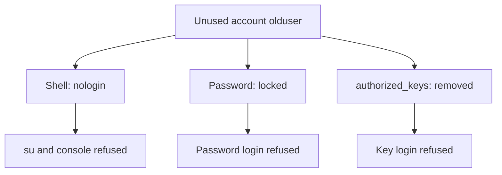

# Login Shells And Unused Accounts

Every account on a node is a possible way in, whether or not anybody uses it. An account of a person who left, a test account, or an account created by a package keeps a login shell, and sometimes a password or a key. Closing these paths is a quiet and effective hardening step, because it needs no new software. This part reads the account database, shows how a login shell is refused, and closes the paths of an account without deleting it.

## The account database and the login shell

Linux keeps accounts in `/etc/passwd`. Each line has seven fields separated by colons: the account name, a password placeholder, the user identifier (UID), the group identifier (GID), a description, the home directory and the login shell. The login shell is the program that starts when the user logs in. An interactive account has a shell such as `/bin/bash`. An account that must not log in has `/usr/sbin/nologin`, a small program that prints a message and ends, or `/bin/false`.

A service account, which only runs a daemon, needs no shell. Package installers normally give such accounts a `nologin` shell. Accounts created by hand often get `/bin/bash` by default, and that is the common mistake.

The command `getent passwd` reads the account database the way the system does, including accounts from other sources. List the accounts of the playground node whose shell is not a refusing shell. The first command defines the helper and the second prints the account name, the UID and the shell:

<!-- astrona:playground:renew -->

```sh
export KUBECONFIG="$(astrona kubeconfig ats-033-playground-010-02)"
test "$(kubectl config current-context)" = "kind-astro-ats-033-playground-010-02" || exit 1
node_name="astro-ats-033-playground-010-02-control-plane"
run_on_node() { podman exec "$node_name" "$@"; }
run_on_node sh -c "getent passwd | awk -F: '\$7 !~ /(nologin|false)\$/ {print \$1 \":\" \$3 \":\" \$7}'"
```

The list contains `root`, `opsadmin` and `olduser`, and possibly accounts that the node image provides, such as a synchronisation account. The backslashes before the dollar signs stop the outer shell from expanding them. For each name on the list ask one question: does a person or a program need to log in as this account? `root` and `opsadmin` do not need to change. `olduser` is the account that nobody uses.

A second check finds accounts that have UID 0. The kernel treats every account with UID 0 as root, whatever its name, so a second one is a hidden root:

```sh
run_on_node sh -c "awk -F: '\$3 == 0 {print \$1}' /etc/passwd"
```

The output must be the single name `root`. Any other name needs an explanation or removal.

## Close the paths of an unused account

An unused account has three paths to close. The first is the login shell. The command `usermod --shell /usr/sbin/nologin olduser` changes the seventh field, so a login through `su`, a console or SSH starts `nologin` and ends. The second is the password. `usermod --lock olduser` puts an exclamation mark in front of the password hash in `/etc/shadow`, so no password matches it. The third is keys: an SSH public key in `~olduser/.ssh/authorized_keys` is a separate credential. Locking the password does not remove it, and on some systems a locked account can still log in with a key. The `nologin` shell and the `AllowUsers` list in `sshd_config` close that path, and removing the file closes it for good.

```sh
run_on_node usermod --shell /usr/sbin/nologin --lock olduser
run_on_node getent passwd olduser
run_on_node passwd -S olduser
```

The `getent` line now ends with `/usr/sbin/nologin`. The command `passwd -S` prints the account name and a status letter. The letter `L` means the password is locked, `P` means a usable password and `NP` means no password.



The diagram shows the three credentials of an account, each closed by its own change.

## Lock the account, do not delete it

Deleting an account looks cleaner, but it leaves files that belong to the old UID. Those files then show a number instead of a name, and a new account can later receive the same UID and inherit them. Locking the account and giving it a refusing shell removes every login path and keeps the files traceable. Delete the account only after you have reviewed or moved its files.

Do not use these steps on `root` or on the account the kubelet or the container runtime needs. Both run as root and do not depend on any interactive account. The control-plane and worker node services keep running after the change, which you can confirm with `systemctl is-active kubelet`.

You now know the three parts of an account that can open a login path and the commands that close them, and the module has covered the whole chain: the daemon settings, the list of accounts allowed to use it, and the accounts that should not log in. The open question is the other side of the node: the pods that run on it can also reach host resources.

## Common pitfalls

> [!WARNING]
> - **Locking only the password.** A key in `authorized_keys` is a separate credential. Set the shell to `nologin` and remove the keys as well.
> - **Changing the shell of a service account that needs one.** Some tools log in as a service account to run a command. Check how the account is used first.
> - **Missing a second UID 0 account.** Look for every account with UID 0, not only the one named `root`.
> - **Deleting an account with files.** The files keep a UID without an owner name. Lock the account, review its files, then decide.
