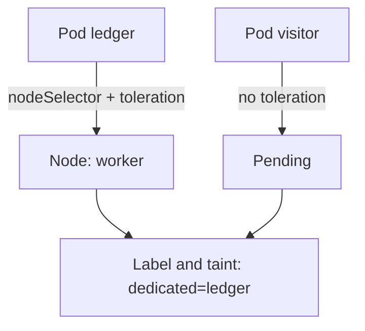

# Kubelet Settings And Dedicated Nodes

Two last parts of host access do not live in a pod specification. The first is the kubelet, the agent on every node that starts pods and answers requests about them. If its API accepts anonymous callers, anyone who can reach the node can read pod data or run commands in pods. The second is the placement of workloads: pods with different trust levels share a kernel when they share a node, so a sensitive workload should run on nodes that other workloads cannot use. This part checks the kubelet settings and then builds a dedicated node.

## The kubelet API and the settings that protect it

The kubelet serves an HTTPS API on port 10250. The API server uses it to read logs and to run `kubectl exec`. Because it can run commands inside pods, it must refuse callers that have no valid identity. Three settings in the kubelet configuration file `/var/lib/kubelet/config.yaml` decide this:

- `authentication.anonymous.enabled` must be `false`, so a request without credentials receives the answer 401 Unauthorized.
- `authorization.mode` must be `Webhook`, so the kubelet asks the API server whether the caller may perform the action. The mode `AlwaysAllow` accepts every authenticated caller and is wrong.
- `readOnlyPort` must be `0` or absent. A non-zero value opens an extra port, historically 10255, that serves pod and node information over plain HTTP without any authentication.

Select the environment, define the helper, and read the three settings from the control-plane node:

<!-- astrona:playground:renew -->

```sh
export KUBECONFIG="$(astrona kubeconfig ats-033-playground-010-03)"
test "$(kubectl config current-context)" = "kind-astro-ats-033-playground-010-03" || exit 1
node_name="astro-ats-033-playground-010-03-control-plane"
worker_name="astro-ats-033-playground-010-03-worker"
run_on_node() { podman exec "$node_name" "$@"; }
run_on_node grep -A4 -E 'anonymous|authorization|readOnlyPort' /var/lib/kubelet/config.yaml
```

Compare each value with the list above. A node created by kubeadm normally has the secure values for the first two, and the read-only port is off by default. Two more checks look at the running kubelet instead of the file. Port 10255 must not appear among the listeners, and an anonymous request to port 10250 must be refused:

```sh
run_on_node ss -tln
run_on_node curl -sk -o /dev/null -w '%{http_code}\n' https://127.0.0.1:10250/pods
```

In the `ss` list, look for port 10250 and make sure port 10255 is absent. The `curl` command sends a request without credentials, with `-k` to skip certificate checking, and prints only the HTTP status code. The expected code is `401`. A `200` would mean that anonymous access is on. If you correct the file, run `systemctl restart kubelet` on the node afterwards, because the kubelet reads its configuration at start.

## Why dedicate a node

Containers on one node share the kernel. A pod that escapes its container through a kernel flaw, or a pod with host access, can reach the data of every other pod on that node. A workload that handles sensitive data, such as a ledger of payments, should not share a node with workloads of lower trust. A **dedicated node** is a node reserved for one workload or group of workloads, and two scheduling features build it.

A **label** is a key and value on the node. A pod with a `nodeSelector` that names the label can run only on nodes that carry it. That attracts the pod to the node, but it does not keep other pods away. A **taint** is a key, a value and an effect on the node. A pod runs on a tainted node only if it has a matching **toleration**. With the effect `NoSchedule`, the scheduler does not place pods without a toleration on the node. A toleration allows the pod on the node, but it does not send the pod there. A dedicated node needs both: the taint repels everyone else, and the label with the selector sends the sensitive pods.



The diagram shows that the pod with the selector and the toleration lands on the dedicated node, and the pod without them stays pending.

## Build a dedicated node and watch the scheduler

The label key `node-restriction.kubernetes.io/dedicated` has a special prefix. The NodeRestriction admission plugin does not let a kubelet set labels with the prefix `node-restriction.kubernetes.io/` on its own node. A compromised node therefore cannot label itself to attract sensitive workloads. Label and taint the worker node:

```sh
kubectl label node "$worker_name" node-restriction.kubernetes.io/dedicated=ledger
kubectl taint nodes "$worker_name" dedicated=ledger:NoSchedule
```

Save this as `pod-ledger.yaml`:

```yaml
apiVersion: v1
kind: Pod
metadata:
  name: ledger
  namespace: starfleet
spec:
  nodeSelector:
    node-restriction.kubernetes.io/dedicated: ledger
  tolerations:
  - key: dedicated
    operator: Equal
    value: ledger
    effect: NoSchedule
  containers:
  - name: ledger
    image: docker.io/library/busybox:1.37.0
    command:
    - sh
    - -c
    - sleep 3600
```

Save this as `pod-visitor.yaml`:

```yaml
apiVersion: v1
kind: Pod
metadata:
  name: visitor
  namespace: starfleet
spec:
  containers:
  - name: visitor
    image: docker.io/library/busybox:1.37.0
    command:
    - sh
    - -c
    - sleep 3600
```

Apply both:

```sh
kubectl apply -f pod-ledger.yaml -f pod-visitor.yaml
```

Then check the result:

```sh
kubectl -n starfleet get pod ledger visitor -o wide
kubectl -n starfleet describe pod visitor
```

The `ledger` pod runs on the worker node. The `visitor` pod stays `Pending`, because the control-plane node carries its own taint and the worker node carries the `dedicated` taint, and the pod tolerates neither. The events at the end of `describe` come from the scheduler and say that no node is available because of untolerated taints. Remove the experiment and the taint, which a trailing dash deletes:

```sh
kubectl -n starfleet delete pod ledger visitor
kubectl taint nodes "$worker_name" dedicated=ledger:NoSchedule-
kubectl label node "$worker_name" node-restriction.kubernetes.io/dedicated-
```

## Limits of the method

The effect `NoSchedule` affects scheduling only. Pods that already run on the node stay, so taint a node before the workloads arrive, or use the effect `NoExecute`, which also evicts running pods that lack a toleration. Both features guide the scheduler. They are not a security boundary against someone who can create pods: a user who may create pods can add the same toleration, so combine a dedicated node with admission rules that limit who may use the label and the toleration. The same thought applies in reverse for pods that you must keep running during the change. Add the taint last, after every pod that must be on the node is in place.

You now have the three layers of the module: the fields that give host access, the admission rule that rejects them, and the placement that keeps sensitive workloads apart, together with the kubelet settings that protect the node's own API.

## Common pitfalls

> [!WARNING]
> - **Using a toleration alone.** A toleration only allows a pod on the tainted node. The `nodeSelector` sends it there. Without it the pod can run anywhere.
> - **Using a label alone.** A label with a `nodeSelector` attracts pods but does not keep other pods off. The taint does that.
> - **Tainting a node that holds pods you need.** `NoSchedule` stops new pods, including replacements. Finish rollouts first.
> - **Changing the kubelet file without a restart.** The kubelet reads `/var/lib/kubelet/config.yaml` at start. Restart it and check that the node returns to `Ready`.
