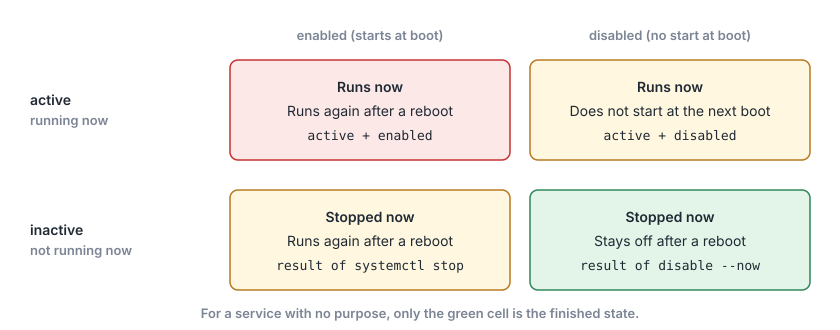
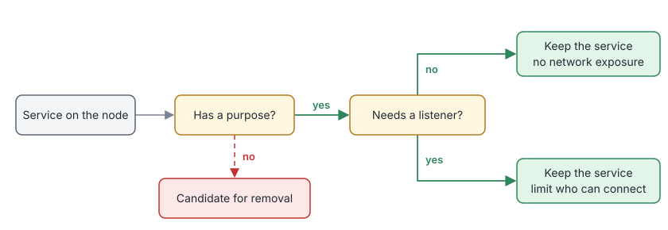

# Inventory Services And Listeners

You cannot reduce what you have not listed. A Kubernetes node is a Linux host, and most nodes start more software than the cluster needs. Typical examples are a remote administration agent, a file-sharing daemon or a development server that an image builder left behind.

Each of these programs is code that can contain a flaw. If it listens on the network, other machines can reach that code too. On this page, you build the inventory that every later decision depends on: which services run, which start at boot, and which ones listen.

## What a service is on a modern Linux node

systemd is the first process on most Linux distributions. It starts and supervises every other service. A **unit** is a description of one thing systemd manages. A unit of type `service` runs a program, and its file name ends in `.service`, for example `kubelet.service`.

The command `systemctl` is the tool that asks systemd about units and changes their state. With it, you can read two separate facts about every service. Mixing them up is the most common mistake in host hardening:

- **Active state** says whether the service is running right now. The values you will meet are `active` and `inactive`.
- **Enabled state** says whether systemd starts the service at boot. The values you will meet are `enabled` and `disabled`.

A service can be running and disabled, or stopped and enabled. Hardening needs both facts, because a service that is only stopped starts again at the next reboot.



The drawing shows the four combinations. `systemctl stop` leads to the amber cell that runs again after a reboot, and only `disable --now` leads to the green cell that stays off.

With these two facts in mind, you can look at a real node.

## The node you will inspect

The playground is one Ubuntu 24.04 virtual machine (VM). The VM is a single Kubernetes node. kubeadm installed the control plane and the kubelet on it, and the node also runs the workloads.

The node carries a seeded service named `training-extra.service`. It plays the role of a service that an image builder left behind. It runs `/bin/sleep 3600` and has no function in the cluster.

Open a shell on the VM and confirm that `kubectl` points at this playground:

<!-- astrona:playground:renew -->

```sh
astrona ssh astro-ats-033-playground-010-01
kubectl config current-context
```

```text
kubernetes-admin@astro-ats-033-playground-010-01
```

You are logged in as the `student` user. This user has a kubeconfig file, which tells `kubectl` which cluster to use and which credentials to send. Reading the state of systemd needs no special rights, so most commands on this page run without `sudo`. Commands that change the node or read the process of another user need `sudo`, which runs one command as root.

## List what is running and what starts at boot

Start with the running services. `systemctl list-units` shows the units that systemd has loaded, and the two filters keep only services that are running:

```sh
systemctl list-units --type=service --state=running --no-pager
```

```text
  UNIT                         LOAD   ACTIVE SUB     DESCRIPTION
  auditd.service               loaded active running Security Auditing Service
  containerd.service           loaded active running containerd container runtime
  cron.service                 loaded active running Regular background program processing daemon
  dbus.service                 loaded active running D-Bus System Message Bus
  getty@tty1.service           loaded active running Getty on tty1
  kubelet.service              loaded active running kubelet: The Kubernetes Node Agent
  ModemManager.service         loaded active running Modem Manager
  multipathd.service           loaded active running Device-Mapper Multipath Device Controller
  polkit.service               loaded active running Authorization Manager
  rsyslog.service              loaded active running System Logging Service
  serial-getty@ttyAMA0.service loaded active running Serial Getty on ttyAMA0
  snapd.service                loaded active running Snap Daemon
  ssh.service                  loaded active running OpenBSD Secure Shell server
  systemd-journald.service     loaded active running Journal Service
  systemd-logind.service       loaded active running User Login Management
  systemd-networkd.service     loaded active running Network Configuration
  systemd-resolved.service     loaded active running Network Name Resolution
  systemd-timesyncd.service    loaded active running Network Time Synchronization
  systemd-udevd.service        loaded active running Rule-based Manager for Device Events and Files
  training-extra.service       loaded active running Disposable training service
  udisks2.service              loaded active running Disk Manager
  unattended-upgrades.service  loaded active running Unattended Upgrades Shutdown
  user@1001.service            loaded active running User Manager for UID 1001
  user@1002.service            loaded active running User Manager for UID 1002

Legend: LOAD   → Reflects whether the unit definition was properly loaded.
        ACTIVE → The high-level unit activation state, i.e. generalization of SUB.
        SUB    → The low-level unit activation state, values depend on unit type.

24 loaded units listed.
```

The `--no-pager` option prints the list directly instead of opening a pager. The list contains the services the node needs, for example `containerd.service` and `kubelet.service`. It also contains `training-extra.service` and `ModemManager.service`. ModemManager manages mobile broadband modems, and a VM in a data center does not have one.

A running list shows only the present moment. So also list what is set to start at boot:

```sh
systemctl list-unit-files --type=service --state=enabled --no-pager
```

The output below is shortened: the dots stand for lines that were removed.

```text
UNIT FILE                              STATE   PRESET
apparmor.service                       enabled enabled
apport.service                         enabled enabled
auditd.service                         enabled enabled
...
containerd.service                     enabled enabled
...
kubelet.service                        enabled enabled
lvm2-monitor.service                   enabled enabled
ModemManager.service                   enabled enabled
multipathd.service                     enabled enabled
...
training-extra.service                 enabled enabled
...
48 unit files listed.
```

`list-unit-files` reads the unit files on disk, not the running state. The second command therefore shows what a reboot would start. Compare the two lists:

- A service that is in the enabled list but not in the running list has stopped or failed since boot.
- A service that is in the running list but not in the enabled list was started by hand or by another service.

The lists give you names. To decide about one service, you need more detail.

## Read one service in detail

Before you decide about a service, ask four questions:

- What program does it run?
- Who started it?
- Is it enabled?
- Does anything depend on it?

`systemctl status` answers the first three:

```sh
systemctl status training-extra.service --no-pager
```

```text
● training-extra.service - Disposable training service
     Loaded: loaded (/etc/systemd/system/training-extra.service; enabled; preset: enabled)
     Active: active (running) since Wed 2026-11-18 09:04:31 UTC; 848ms ago
   Main PID: 3004 (sleep)
      Tasks: 1 (limit: 4594)
     Memory: 244.0K (peak: 392.0K)
        CPU: 707us
     CGroup: /system.slice/training-extra.service
             └─3004 /bin/sleep 3600
```

The output shows the path of the unit file, `/etc/systemd/system/training-extra.service`. The line `Loaded:` contains the word `enabled` or `disabled`, and the line `Active:` contains `active (running)`. The last lines show the process ID and the command line. To see the unit file itself, use `systemctl cat`:

```sh
systemctl cat training-extra.service
```

```text
# /etc/systemd/system/training-extra.service
[Unit]
Description=Disposable training service

[Service]
ExecStart=/bin/sleep 3600

[Install]
WantedBy=multi-user.target
```

The file has a `[Service]` section with the line `ExecStart=/bin/sleep 3600` and an `[Install]` section with `WantedBy=multi-user.target`. The `WantedBy` line is what `enable` uses. It tells systemd to start this service whenever the system reaches `multi-user.target`, the normal boot target.

The fourth question, what depends on the service, needs the dependency list in reverse:

```sh
systemctl list-dependencies --reverse training-extra.service --no-pager
```

```text
training-extra.service
● └─multi-user.target
●   └─graphical.target
```

Only `multi-user.target` wants the service. `graphical.target` appears because it includes `multi-user.target`. No other service appears, so no service needs `training-extra.service`. If other services appeared below it, they would need the service, and stopping it could affect them.

So far, the inventory covers what runs. The next question is which of those programs other machines can reach.

## List the network listeners

A service with no network listener can only be attacked by someone who already has a shell on the node. A service that listens on a network address can be attacked from other machines, so listeners get the most attention.

`ss` is the socket statistics tool. Four options together list every TCP socket that waits for connections:

- `-t` shows TCP sockets.
- `-l` shows listening sockets only.
- `-n` shows numbers instead of names.
- `-p` shows the process that owns each socket.

Run it with `sudo`, so that `ss` can also show the processes of other users:

```sh
sudo ss -tlnp
```

```text
State  Recv-Q Send-Q Local Address:Port  Peer Address:PortProcess
LISTEN 0      4096   127.0.0.53%lo:53         0.0.0.0:*    users:(("systemd-resolve",pid=485,fd=15))
LISTEN 0      4096       127.0.0.1:46059      0.0.0.0:*    users:(("containerd",pid=839,fd=14))
LISTEN 0      4096         0.0.0.0:22         0.0.0.0:*    users:(("sshd",pid=1039,fd=3),("systemd",pid=1,fd=234))
LISTEN 0      4096       127.0.0.1:10257      0.0.0.0:*    users:(("kube-controller",pid=1688,fd=4))
LISTEN 0      4096       127.0.0.1:10259      0.0.0.0:*    users:(("kube-scheduler",pid=1698,fd=4))
LISTEN 0      4096       127.0.0.1:10249      0.0.0.0:*    users:(("kube-proxy",pid=2013,fd=11))
LISTEN 0      4096       127.0.0.1:10248      0.0.0.0:*    users:(("kubelet",pid=1886,fd=20))
LISTEN 0      4096       127.0.0.1:2379       0.0.0.0:*    users:(("etcd",pid=1702,fd=7))
LISTEN 0      4096       127.0.0.1:2381       0.0.0.0:*    users:(("etcd",pid=1702,fd=11))
LISTEN 0      4096      127.0.0.54:53         0.0.0.0:*    users:(("systemd-resolve",pid=485,fd=17))
LISTEN 0      4096       10.0.2.15:2380       0.0.0.0:*    users:(("etcd",pid=1702,fd=3))
LISTEN 0      4096       10.0.2.15:2379       0.0.0.0:*    users:(("etcd",pid=1702,fd=6))
LISTEN 0      4096               *:6443             *:*    users:(("kube-apiserver",pid=1674,fd=4))
LISTEN 0      4096               *:10256            *:*    users:(("kube-proxy",pid=2013,fd=10))
LISTEN 0      4096            [::]:22            [::]:*    users:(("sshd",pid=1039,fd=4),("systemd",pid=1,fd=235))
LISTEN 0      4096               *:10250            *:*    users:(("kubelet",pid=1886,fd=11))
```

Read the `Local Address:Port` column first. The local address decides who can connect:

- `127.0.0.1` means the service accepts connections from the node itself only.
- `0.0.0.0` or `*` means it accepts connections on every IPv4 interface.
- `[::]` means it accepts connections on every IPv6 interface.

![Diagram: a process on the node reaches a listener on 127.0.0.1, while another machine cannot reach 127.0.0.1 but can reach sshd on 0.0.0.0:22 and on [::]:22](images/listener-addresses.svg)

The drawing shows the difference. Only a process on the node reaches the controller manager on `127.0.0.1:10257`, but another machine reaches `sshd` on port 22 over both IPv4 and IPv6.

The last column shows the program that owns the socket. This node runs the control plane, so you find the API server (`kube-apiserver`) on port 6443 and `etcd` on ports 2379 and 2380. The kubelet listens on port 10250, and `containerd` on a loopback port. `sshd` listens on port 22 for both IPv4 and IPv6. The scheduler, the controller manager and the kubelet health port 10248 listen on `127.0.0.1` only.

Port 10250 is the kubelet API. The API server must reach it, so it listens on all addresses. Its protection comes from authentication and authorization in the kubelet configuration, not from the address.

## Decide: required, justify or remove

With the three lists in hand, put every item on the inventory into one of three groups:

- **Required.** The service is part of how a node works: the container runtime, the kubelet, and the networking and time services of the distribution. On a control-plane node, the API server, the scheduler, the controller manager and the datastore are required too.
- **Justified.** The service has a documented owner and purpose, such as a monitoring agent. It stays only while that owner exists.
- **No purpose.** The service is a candidate for removal.



The drawing shows the decision for each service. No purpose means removal, and a purpose that needs a listener means you must limit who can connect. In this playground, `training-extra.service` has no purpose, so it is the candidate for removal.

You now have the three views of a node that every hardening task starts from: running services, enabled services and listeners. The open question is how to remove a service in a way that lasts, because stopping it is not enough.

## Common pitfalls

> [!WARNING]
> - **Judging a service by its name.** An unfamiliar name does not mean the service is unneeded. Read its unit file with `systemctl cat` and check the reverse dependencies before you decide.
> - **Reading only the running list.** A service that is stopped now but enabled starts again at the next boot. Always compare the running list with the enabled list.
> - **Forgetting the other address family.** A service can listen on `0.0.0.0` and on `[::]` as two separate sockets. Check both in the `ss` output.
> - **Running `ss` without `-p`.** Without the owning process you see a port but not the program behind it.
