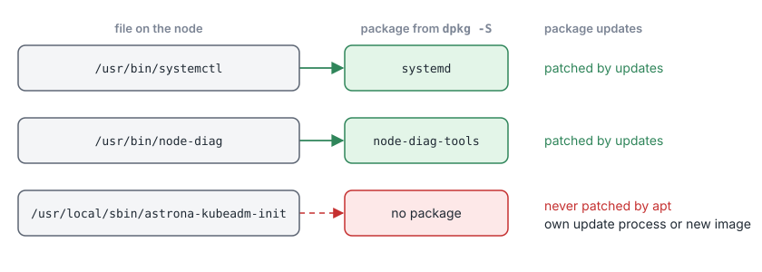
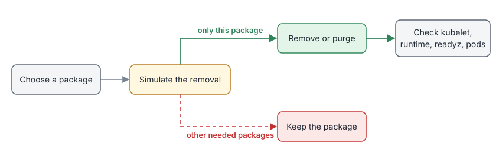

# Remove Packages And Keep The Node Working

A disabled service still has its files on disk, and its package still needs security updates. A tool that is installed but never used gives an attacker who reaches the node a ready-made set of programs. Examples are a compiler, a network scanner or an old database client.

Removing the package removes that code and the duty to patch it. But removing the wrong package can break the node. On this page, you learn how to find what a package does, how to simulate a removal before you do it, and how to keep the result.

## Packages, the package manager and who owns a file

A **package** is an archive of files plus metadata, including the list of other packages it needs. A **dependency** is another package that must be installed for a package to work. On Debian and Ubuntu systems, the low-level tool is `dpkg`, which installs and lists packages. `apt-get` is the higher-level tool that also resolves dependencies.

Two rules from the package system matter for hardening:

- A file that belongs to a package is patched when the package is updated.
- A file that belongs to no package is invisible to the package manager, so no update ever patches it.

Programs that an image builder copies in by hand fall into the second group. They need a manual update process or a replacement of the node image. To see which group a file is in, you ask the package database.

## Find out what is installed and who owns a file

The playground is one Ubuntu 24.04 virtual machine (VM) that is a single Kubernetes node. Open a shell on the VM and confirm that `kubectl` points at this playground:

<!-- astrona:playground:renew -->

```sh
astrona ssh astro-ats-033-playground-010-01
kubectl config current-context
```

```text
kubernetes-admin@astro-ats-033-playground-010-01
```

You are logged in as the `student` user. Reading the package database needs no special rights. Removing a package changes the node, so that command starts with `sudo`, which runs one command as root.

List the packages that someone installed on purpose. `apt-mark showmanual` prints the packages marked as manually installed. Packages that were installed only as a dependency of another package are not in this list:

```sh
apt-mark showmanual
```

The output below is shortened: the dots stand for lines that were removed.

```text
apparmor-utils
apt-transport-https
apt-utils
auditd
...
conntrack
containerd
cri-tools
curl
...
jq
kubeadm
kubectl
kubelet
kubernetes-cni
...
ncurses-term
node-diag-tools
openssh-server
...
vim
```

The list holds the Kubernetes packages (`kubeadm`, `kubectl`, `kubelet`, `kubernetes-cni`), the container runtime `containerd`, and a package named `node-diag-tools`. Nothing in the cluster uses `node-diag-tools`. It plays the role of a diagnostic tool that an image builder left behind.

The count of installed packages is one number to track over time. The command `dpkg-query --list` prints one line per package plus five header lines. `wc -l` counts those lines, which gives a number to compare from one week to the next:

```sh
dpkg-query --list | wc -l
```

```text
741
```

To learn which package owns a file, use `dpkg -S`. The next commands ask about the real paths of `systemctl` and `node-diag`. `command -v` finds the program in the search path, and `readlink -f` follows symbolic links to the real file:

```sh
dpkg -S "$(readlink -f "$(command -v systemctl)")"
dpkg -S "$(readlink -f "$(command -v node-diag)")"
```

```text
systemd: /usr/bin/systemctl
node-diag-tools: /usr/bin/node-diag
```

Each answer starts with the package name, then the file. `systemctl` belongs to `systemd`, and `node-diag` belongs to `node-diag-tools`, so the package manager patches both.

Now ask about a file that no package installed. The image of this VM has a helper script in `/usr/local/sbin`, a folder that the package manager leaves to the administrator:

```sh
ls -l /usr/local/sbin
dpkg -S /usr/local/sbin/astrona-kubeadm-init
```

```text
total 4
-rwxr-xr-x 1 root root 2233 Nov 17 23:18 astrona-kubeadm-init
dpkg-query: no path found matching pattern /usr/local/sbin/astrona-kubeadm-init
```

`dpkg` finds no package for the file. No update from the package manager will ever patch it, so it needs its own update process or a new node image.



The drawing sums up the three answers. Package updates patch the two files that belong to a package, and the file without a package needs its own update process.

Now you know what `node-diag-tools` is and that nothing in the cluster uses it. Before you remove it, check what else the removal would take.

## Simulate before you remove

`apt-get` has three commands that remove packages:

- `apt-get remove` removes a package and keeps its configuration files.
- `apt-get purge` removes the package and its configuration files.
- `apt-get autoremove` removes dependency packages that nothing needs any more.

All three can remove more than you expect, because removing a package also removes every package that depends on it.

The option `--simulate` (short form `-s`) prints what would happen and changes nothing. It works without `sudo`, and then prints a note that it is only a simulation. A second check looks from the other side: `apt-cache rdepends --installed` lists the installed packages that depend on a package. Run both for `node-diag-tools`:

```sh
apt-get remove --simulate node-diag-tools
apt-cache rdepends --installed node-diag-tools
```

```text
NOTE: This is only a simulation!
      apt-get needs root privileges for real execution.
      Keep also in mind that locking is deactivated,
      so don't depend on the relevance to the real current situation!
Reading package lists...
Building dependency tree...
Reading state information...
The following packages will be REMOVED:
  node-diag-tools
0 upgraded, 0 newly installed, 1 to remove and 0 not upgraded.
Remv node-diag-tools [0.9.1]
node-diag-tools
Reverse Depends:
```

Read the lines that start with `Remv`. The first one is the package you named. Every further `Remv` line is another package that the removal would take with it. Here there is only one, so the removal takes nothing else.

The list under `Reverse Depends:` is empty, so no installed package needs `node-diag-tools`. If the list contains packages you need, such as `systemd`, `libc6` or `kubelet`, stop. The package is then a dependency of the node itself.

The simulation has one limit: it knows only the dependencies that packages declare. To see this limit, simulate the removal of the container runtime:

```sh
apt-get remove --simulate containerd
```

```text
NOTE: This is only a simulation!
      apt-get needs root privileges for real execution.
      Keep also in mind that locking is deactivated,
      so don't depend on the relevance to the real current situation!
Reading package lists...
Building dependency tree...
Reading state information...
The following package was automatically installed and is no longer required:
  runc
Use 'apt autoremove' to remove it.
The following packages will be REMOVED:
  containerd
0 upgraded, 0 newly installed, 1 to remove and 0 not upgraded.
Remv containerd [2.2.1-0ubuntu1~24.04.4]
```

The simulation removes only `containerd`, and offers to clean up `runc` later. Yet the kubelet cannot start a single pod without a container runtime. The `kubelet` package does not declare `containerd` as a dependency, so `apt-get` cannot warn you.

The simulation checks the package database, not what the node needs to work. Use the simulation when you plan a removal, and use `rdepends` when you want to understand why something cannot go. For `node-diag-tools`, both checks are clean, so the real removal can follow.

## Remove, then prove the node still works

The simulation showed only the package you meant to remove, so purge it. `--yes` answers the confirmation question:

```sh
sudo apt-get purge --yes node-diag-tools
```

The output below is shortened: the progress lines of the package database and the messages of the `debconf` and `needrestart` helpers were removed.

```text
Reading package lists...
Building dependency tree...
Reading state information...
The following packages will be REMOVED:
  node-diag-tools*
0 upgraded, 0 newly installed, 1 to remove and 0 not upgraded.
After this operation, 0 B of additional disk space will be used.
Removing node-diag-tools (0.9.1) ...
```

The star after `node-diag-tools*` in the list means purge: the configuration files go too. Check that the package is gone, and simulate an autoremove before you accept one. Then check the same things as after a service change:

- The kubelet and the container runtime must be active.
- The API server must be ready.
- The workloads must still run.

Run all the checks in one block:

```sh
dpkg-query -W node-diag-tools
apt-get autoremove --simulate
systemctl is-active kubelet.service containerd.service
kubectl get --raw=/readyz; echo
kubectl -n starfleet get pods
```

```text
dpkg-query: no packages found matching node-diag-tools
NOTE: This is only a simulation!
      apt-get needs root privileges for real execution.
      Keep also in mind that locking is deactivated,
      so don't depend on the relevance to the real current situation!
Reading package lists...
Building dependency tree...
Reading state information...
0 upgraded, 0 newly installed, 0 to remove and 0 not upgraded.
active
active
ok
NAME                     READY   STATUS    RESTARTS   AGE
probe-7db6ffd7d6-77vm6   1/1     Running   0          5s
probe-7db6ffd7d6-8278t   1/1     Running   0          5s
shuttle                  1/1     Running   0          5s
```

`dpkg-query -W` finds no package, and the autoremove would remove nothing. Both services are active, and every pod in `starfleet` shows `Running`. The two `probe` pods belong to the `probe` Deployment. A pod that restarts right after a package change is a sign that the change affected the container runtime, the networking or the storage of the node.



The drawing shows the order that avoids outages: simulate first, remove only when the list is safe, and verify afterwards.

## Keep the result: updates and durable state

Removal happens at one point in time. Two habits keep the result.

The first habit is patching. Installing a package update does not change a process that is already running, so a service keeps using the old code until it restarts. On Ubuntu, the file `/var/run/reboot-required` exists after an update that needs a reboot, and the kernel stays old until the node restarts. On the playground the file does not exist, so no reboot is pending. Plan restarts with draining: `kubectl drain` moves pods away from the node before the restart, and `kubectl uncordon` allows scheduling again afterwards.

The second habit is durability. A manual change on one node is lost when the node is replaced, and it makes nodes differ from each other. Put the hardening steps into the node image or the provisioning tool, so a new node starts hardened. Record who owns each remaining service and package, so a later review can ask the owner whether it is still needed.

You can now list what a node runs, turn a service off for good, and remove packages with a simulation as protection. The open question is the interfaces that need no open port at all. A socket file, a mounted host directory or a flag on a pod can give the same authority as a root shell.

## Common pitfalls

> [!WARNING]
> - **Running `apt-get remove` without `--simulate` first.** The command also removes every package that depends on the one you named, and `--yes` skips the confirmation.
> - **Assuming a package update fixes a running process.** The process keeps the old code until it restarts, and a kernel update needs a reboot.
> - **Trusting the package manager for every file.** A file that no package owns is never patched by `apt`.
> - **Hardening one node by hand.** The next replacement node starts without the change. Put the change into the node image or provisioning.
