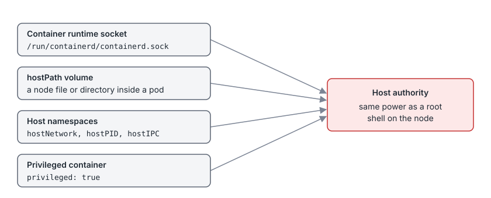
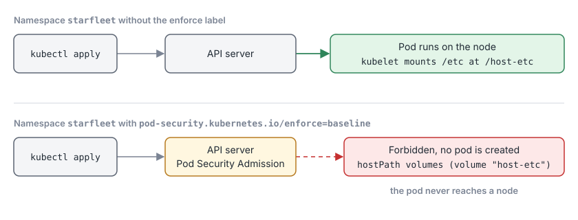

# Privileged Host Interfaces

Some of the most dangerous parts of a node have no network port. A socket file, a mounted directory or one flag on a pod gives a process the same power as a root shell on the node. A list of listeners never shows them.

On this page, you meet those interfaces and see where to look for them, on the node and in the cluster. You then let a pod read a file from the host through a `hostPath` volume, and see how Pod Security Admission stops it.

## Four ways a process reaches host authority

A process can reach host authority in four ways. Each one is a file, a volume or a field, not a network port.

The **container runtime socket** is a Unix socket file, for example `/run/containerd/containerd.sock` for containerd. Whoever can write to it can ask the runtime to start any container. That includes a privileged container that mounts the whole host filesystem. For this reason, membership of a group that owns a runtime socket (for example the `docker` group with Docker) is equal to root access.

A **`hostPath` volume** mounts a file or directory of the node into a pod. A pod with a `hostPath` of `/` can read and change every file of the node.

**Host namespaces** are set by the pod fields `hostNetwork`, `hostPID` and `hostIPC`. With them, the pod shares the network, the process list or the inter-process communication of the node. A **privileged container** (`securityContext.privileged: true`) has almost every Linux capability and access to the devices of the node.



The drawing shows the four interfaces side by side. Each one leads to the same result: the power of a root shell on the node, without any network port.

One more component needs a check. The **kubelet** is the node agent that starts pods. Its API on port 10250 can run commands inside pods, so it must reject unauthenticated callers. The kubelet configuration decides that.

## Look at the runtime socket and the kubelet settings

The playground is one Ubuntu 24.04 virtual machine (VM) that is a single Kubernetes node. Open a shell on the VM and confirm that `kubectl` points at this playground:

<!-- astrona:playground:renew -->

```sh
astrona ssh astro-ats-033-playground-010-01
kubectl config current-context
```

```text
kubernetes-admin@astro-ats-033-playground-010-01
```

You are logged in as the `student` user. Some files only root may read, so the commands that read them start with `sudo`, which runs one command as root. First, look at the owner and the permission bits of the containerd socket:

```sh
ls -l /run/containerd/containerd.sock
```

```text
srw-rw---- 1 root root 0 Nov 18 09:03 /run/containerd/containerd.sock
```

The first character `s` marks a socket. The owner and the group are both `root`, and the mode `rw-rw----` gives read and write access to the owner and the group only. All other users, including `student`, have no access. Any account that you add to the `root` group would gain control of the container runtime, so the group of the socket matters as much as its owner.

Next, read the kubelet configuration file. Three settings protect the kubelet API:

- `authentication.anonymous.enabled` must be `false`, so a caller without credentials gets a rejection.
- `authorization.mode` must be `Webhook`, so the kubelet asks the API server whether the caller may do the action. The default `AlwaysAllow` must not be used.
- `readOnlyPort` must be `0` or absent, because port 10255 serves unauthenticated read-only data.

Search the file for the three settings:

```sh
sudo grep -A4 -E 'anonymous|authorization|readOnlyPort' /var/lib/kubelet/config.yaml
```

```text
  anonymous:
    enabled: false
  webhook:
    cacheTTL: 0s
    enabled: true
--
authorization:
  mode: Webhook
  webhook:
    cacheAuthorizedTTL: 0s
    cacheUnauthorizedTTL: 0s
```

`grep -A4` prints each matching line and the four lines after it, and `--` separates the two matches. Anonymous authentication is `false`, and the authorization mode is `Webhook`. No line matches `readOnlyPort`, so the setting is absent and the read-only port stays off.

kubeadm created this node, and it sets all three values as required. If your output differs on another node, correct the file and restart the kubelet with `sudo systemctl restart kubelet`. The node files are now checked, so the next check moves to the pods.

## Find pods that use host namespaces

The cluster side of the inventory asks which pods share the namespaces of the host. The `custom-columns` output format prints chosen fields of every pod:

```sh
kubectl get pods -A -o custom-columns=NAMESPACE:.metadata.namespace,NAME:.metadata.name,HOSTNETWORK:.spec.hostNetwork,HOSTPID:.spec.hostPID
```

```text
NAMESPACE     NAME                                                      HOSTNETWORK   HOSTPID
kube-system   coredns-7d764666f9-6gcgh                                  <none>        <none>
kube-system   coredns-7d764666f9-d5mw9                                  <none>        <none>
kube-system   etcd-astro-ats-033-playground-010-01                      true          <none>
kube-system   kube-apiserver-astro-ats-033-playground-010-01            true          <none>
kube-system   kube-controller-manager-astro-ats-033-playground-010-01   true          <none>
kube-system   kube-proxy-mkhsh                                          true          <none>
kube-system   kube-scheduler-astro-ats-033-playground-010-01            true          <none>
outpost       drifter                                                   <none>        <none>
starfleet     probe-7db6ffd7d6-77vm6                                    <none>        <none>
starfleet     probe-7db6ffd7d6-8278t                                    <none>        <none>
starfleet     shuttle                                                   <none>        <none>
```

Pods that do not set a field show `<none>`. In `kube-system`, the control-plane pods (`etcd`, `kube-apiserver`, `kube-controller-manager`, `kube-scheduler`) and `kube-proxy` show `true` in the `HOSTNETWORK` column. They need it to do their job. The `coredns` pods and the pods in `starfleet` and `outpost` show `<none>`. Any other pod with `true` needs a justification.

A list shows which pods use these fields, but not what such a pod can do. A short experiment shows that.

## Read a host file from a pod

The next file defines a pod that mounts the `/etc` directory of the node read-only and then sleeps.

Save this as `pod-host-reader.yaml`:

```yaml
apiVersion: v1
kind: Pod
metadata:
  name: host-reader
  namespace: starfleet
spec:
  restartPolicy: Never
  containers:
  - name: reader
    image: docker.io/library/busybox:1.37.0
    command:
    - sh
    - -c
    - sleep 3600
    volumeMounts:
    - name: host-etc
      mountPath: /host-etc
      readOnly: true
  volumes:
  - name: host-etc
    hostPath:
      path: /etc
```

Apply it:

```sh
kubectl apply -f pod-host-reader.yaml
```

```text
pod/host-reader created
```

Then check the result:

```sh
kubectl -n starfleet wait --for=condition=Ready pod/host-reader --timeout=120s
kubectl -n starfleet exec host-reader -- cat /host-etc/hostname
```

```text
pod/host-reader condition met
astro-ats-033-playground-010-01
```

The second command prints the host name of the node that runs the pod, `astro-ats-033-playground-010-01`, not the name of the pod. The kubelet on that node, with the container runtime, mounted the node directory into the container. The pod only read a harmless file here. The same mount without `readOnly` and with a path of `/` would let it change any file on the node.

The API server accepted this pod without a question. To stop such pods, the API server needs a rule that checks them.

## Block it with Pod Security Admission

An admission controller is a part of the API server that checks a request after authentication and authorization, and before the object is stored. Pod Security Admission is a built-in admission controller. It checks every new pod against a Pod Security Standard that a namespace label selects.

The `baseline` standard forbids `hostPath` volumes, host namespaces and privileged containers. The label `pod-security.kubernetes.io/enforce=baseline` makes the API server reject a pod that violates the standard. It does not remove pods that already run.

Remove the pod, label the namespace, and apply the same file again:

```sh
kubectl -n starfleet delete pod host-reader
kubectl label namespace starfleet pod-security.kubernetes.io/enforce=baseline
kubectl apply -f pod-host-reader.yaml
```

```text
pod "host-reader" deleted from starfleet namespace
namespace/starfleet labeled
Error from server (Forbidden): error when creating "pod-host-reader.yaml": pods "host-reader" is forbidden: violates PodSecurity "baseline:latest": hostPath volumes (volume "host-etc")
```

The last command fails. The error message names `PodSecurity`, the `baseline` level and the `hostPath` volume `host-etc`. The rejection comes from the API server, so the pod never reaches a node. To undo the experiment, remove the label with `kubectl label namespace starfleet pod-security.kubernetes.io/enforce-`.



The drawing compares the two attempts. Without the label, the pod runs and reads the node files. With the label, Pod Security Admission in the API server rejects it before it reaches a node.

You now know the interfaces that carry host authority without a port, and two ways to check them. You read node files for the socket and the kubelet, and you query the API for pods. Together with the service and package steps, this gives one hardening cycle: list what exists, turn off what has no purpose, remove what is not needed and review the interfaces that remain. The question still open on every real node is which of those remaining interfaces each workload truly needs.

## Common pitfalls

> [!WARNING]
> - **Treating a runtime socket like a normal file.** Write access to it equals root on the node. Check its owner and mode, and never mount it into a pod without a strong reason.
> - **Thinking `readOnly: true` makes a `hostPath` safe.** It protects the files from writes, but the pod can still read secrets such as kubelet credentials under `/var/lib/kubelet`.
> - **Expecting Pod Security Admission to remove running pods.** The `enforce` label affects new and updated pods only. Audit the existing ones with `kubectl get pods`.
> - **Changing the kubelet configuration without a restart.** The kubelet reads `/var/lib/kubelet/config.yaml` at start, so run `systemctl restart kubelet` and check the node returns to `Ready`.
