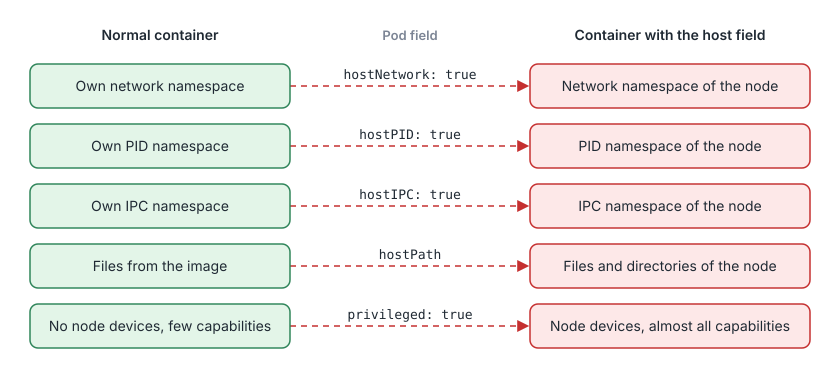
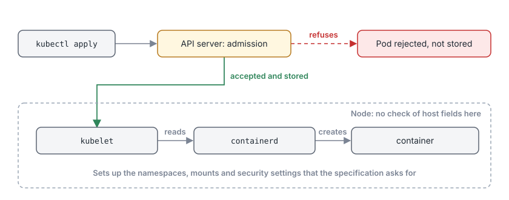
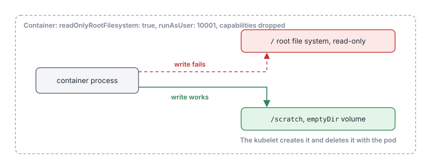

# Host Namespaces, hostPath And Privileged Containers

A container keeps a process apart from its node by giving it its own view of the system. A few fields of the pod specification switch that view off. Each of these fields has real uses, and each one is dangerous in a pod that does not need it.

On this page, you see what container isolation is made of and what each field removes. You watch two of the fields work in a running pod. Then you learn the safe settings that replace them, so you can spot the fields in a manifest and decide whether to allow them.

## What isolation is made of and who sets it

A Linux **namespace** is a kernel feature that gives a group of processes their own copy of a system resource. A container normally gets three of them. Its network namespace holds its own network interfaces and addresses. Its process identifier (PID) namespace holds its own process list, where the first process is PID 1.

The third is the inter-process communication (IPC) namespace, which holds its own shared memory and message queues. The files of a container come from the container image, not from the node.



The drawing compares a normal container with one that uses the host fields. Each field swaps one private view for the view of the node.

Now look at who builds these walls. The API server only stores the pod specification. The kubelet, the agent on each node, reads the specification and asks the container runtime (containerd) to create the container. The runtime then sets up the namespaces, the mounts and the security settings.



The drawing shows the only place where a pod can be refused. The node does not check a field that asks for host access. It does what the specification says, and only an admission check in the API server can refuse the pod.

## What each field gives a pod

Five fields remove parts of the isolation. Each one opens a different path to the node:

- **`hostNetwork: true`** puts the pod in the network namespace of the node. The pod has the node's address and sees the node's interfaces. It can also connect to services that listen only on the node's loopback address, such as a local metrics port.
- **`hostPID: true`** puts the pod in the node's PID namespace. The pod sees every process of the node. With enough rights, it can read their memory or send them signals.
- **`hostIPC: true`** puts the pod in the node's IPC namespace, so it can read shared memory segments of host processes.
- **`hostPath`** is a volume type that mounts a file or directory of the node into the container. The directory `/var/log` exposes logs. The directory `/etc` exposes node configuration. The directory `/var/lib/kubelet` exposes the credentials the kubelet uses. A runtime socket such as `/run/containerd/containerd.sock` lets the pod start any container on the node.
- **`securityContext.privileged: true`** gives the container almost every Linux capability and access to the devices of the node. A privileged container can mount the node's disks and load kernel modules.

The risk is not the same for each field. `privileged: true` and a `hostPath` of `/` or of a runtime socket are close to root on the node. `hostNetwork` and `hostPID` expose information and local services. Still, all of them let an attack on one pod become an attack on the node, and then on every other pod on it.

## See host PID and host network in a running pod

The `beacon` Deployment of the playground already uses some of these fields. For a clean look at two of them, create a short-lived pod that uses only `hostPID` and `hostNetwork`. Select the environment first:

<!-- astrona:playground:renew -->

```sh
export KUBECONFIG="$(astrona kubeconfig ats-033-playground-010-03)"
test "$(kubectl config current-context)" = "kind-astro-ats-033-playground-010-03" || exit 1
```

Save this as `pod-host-view.yaml`:

```yaml
apiVersion: v1
kind: Pod
metadata:
  name: host-view
  namespace: starfleet
spec:
  hostPID: true
  hostNetwork: true
  restartPolicy: Never
  containers:
  - name: viewer
    image: docker.io/library/busybox:1.37.0
    command:
    - sh
    - -c
    - sleep 3600
```

Apply it:

```sh
kubectl apply -f pod-host-view.yaml
```

Then check the result. The first command waits until the pod is ready. The second prints the process list as the container sees it. The third prints the pod address next to the address of its node:

```sh
kubectl -n starfleet wait --for=condition=Ready pod/host-view --timeout=120s
kubectl -n starfleet exec host-view -- ps
kubectl -n starfleet get pod host-view -o wide
```

The process list is not a short list of container processes. It holds the processes of the node, including `kubelet` and `containerd`, because the pod shares the node's PID namespace.

In the `-o wide` output, the `IP` column shows the same address as the node, because the pod uses the node's network namespace. A normal pod, such as `shuttle`, shows an address from the pod network. In the playground, the node is a container, so you see the processes and the address of the node container. On a real host, the pod would see the processes of the whole machine.

Remove the pod when you have seen the result:

```sh
kubectl -n starfleet delete pod host-view
```

## What to use instead of host access

Removing the host fields is only half of the fix. A workload that loses its `hostPath` volume still needs somewhere to write. A container that loses `privileged: true` should not keep root rights by default either. The pod specification has fields for both, and the container runtime applies them when it creates the container.

An **`emptyDir`** volume is an empty directory that the kubelet creates for the pod on the node and deletes when the pod is removed. It gives the container a place to write temporary files without exposing any existing node directory. It replaces a `hostPath` that a pod used only as scratch space.

The `securityContext` of a container holds the settings that limit what the process may do. These fields remove root rights from a container:

- **`runAsUser`** sets the numeric user ID (UID) of the container process, for example `10001`. You can also set it in the pod's `securityContext`, for all containers.
- **`runAsNonRoot: true`** makes the kubelet refuse to start the container if the process would run as UID 0.
- **`allowPrivilegeEscalation: false`** stops the process and its children from gaining more rights than their parent, for example through a set-user-ID program.
- **`capabilities.drop: ["ALL"]`** removes every Linux capability. A capability is one piece of root power, such as changing file owners or binding to a low port.
- **`readOnlyRootFilesystem: true`** mounts the container's image files read-only. A write to `/` fails, so the process can write only to volumes such as an `emptyDir`.

These settings work together. With `readOnlyRootFilesystem: true`, a container that writes temporary files fails unless it gets an `emptyDir` volume for them. So the usual pattern is a read-only root, a non-root UID, no capabilities and one `emptyDir` mounted where the program writes.



The drawing shows the usual pattern. The root file system refuses writes, and the `emptyDir` volume is the one place where the process can write.

## Legitimate uses and the failure case

Some workloads really need these fields. A network plugin runs with `hostNetwork` to configure the node's networking. A log collector mounts `/var/log` with `hostPath`. A node monitoring agent reads host processes.

Such pods run in system namespaces and are reviewed. They also use the narrowest setting that works, for example a read-only `hostPath` of one directory instead of `/`.

The failure case is a workload that gets host access out of convenience. A developer adds `privileged: true` because a pod fails with a permission error, or mounts `/var/run` to talk to the runtime, and the setting stays. Such a pod is the entry point for the escape that the rest of the module guards against. So ask two questions of every pod with one of these fields: does its job truly need the field, and which narrower setting would do?

You now know the five fields that remove container isolation, you have seen two of them work, and you know the settings that replace them. One question is still open: how does a cluster stop a pod from using these fields without relying on every author to remember? The answer is that the API server can reject such pods.

## Common pitfalls

> [!WARNING]
> - **Treating `privileged: false` as safe.** The field is only one of five. A pod with `hostPID`, `hostNetwork` and a broad `hostPath` stays dangerous.
> - **Thinking `readOnly: true` on a `hostPath` makes it safe.** The pod can still read secrets, such as kubelet credentials, from the mounted directory.
> - **Assuming the node checks the specification.** The kubelet and the container runtime carry out what the pod specification says. Only an admission check in the API server can refuse it.
> - **Forgetting init containers.** Their security context counts as well.
