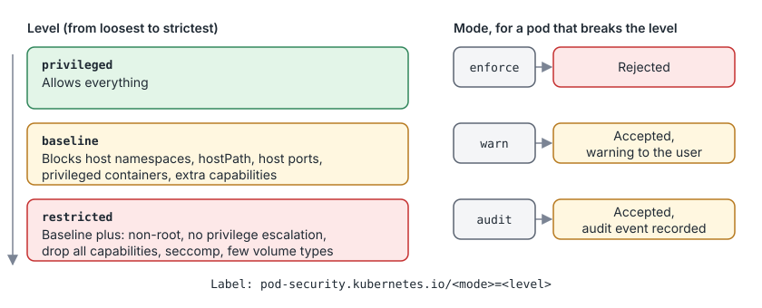
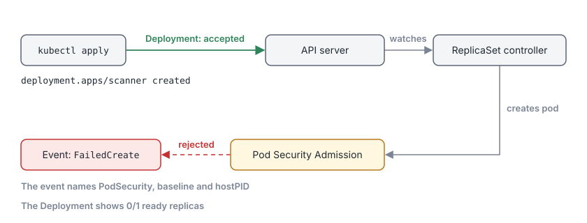

# Enforce Limits With Pod Security Admission

A reviewer can catch a privileged pod in one manifest. But a cluster has many teams and many manifests, so it needs a rule that the API server applies to every pod, whoever writes it. Pod Security Admission is that rule.

On this page, you learn the three standards it enforces and the three modes it runs in. You also meet the surprise that catches many administrators: the API server accepts a Deployment even when it rejects the Deployment's pods.

## Standards, levels and modes

Pod Security Admission is an admission controller built into the API server. An admission controller checks a request after authentication and authorization, and before the API server stores the object. Pod Security Admission checks every pod against one of three **Pod Security Standards**. Labels on the namespace choose the standard:

- **`privileged`** allows everything.
- **`baseline`** blocks the known routes to host access: `hostNetwork`, `hostPID`, `hostIPC`, `hostPath` volumes, host ports, privileged containers and extra capabilities beyond a short safe list.
- **`restricted`** includes `baseline` and adds hardening rules. A container must set `allowPrivilegeEscalation: false` and run as a non-root user (`runAsNonRoot: true`). It must also drop all capabilities, use a seccomp profile of type `RuntimeDefault` or `Localhost`, and use only a short list of volume types.

A label sets one level for one **mode**. The label key is `pod-security.kubernetes.io/<mode>`, and its value is the level. The three modes act differently on a pod that breaks the level:

- **`enforce`** makes the API server reject the pod.
- **`warn`** accepts the pod and returns a warning to the user.
- **`audit`** accepts the pod and records an audit event.



The drawing shows the three levels on the left and the three modes on the right. Only `enforce` stops the pod. A common rollout sets `warn` and `audit` first to learn what would break, and `enforce` after that.

## Preview a label before you apply it

Before you set a label for real, you can test it. A server-side dry run of the label command shows what would break without changing the namespace. Run the dry run against the `starfleet` namespace, which holds the `beacon` Deployment with host access:

<!-- astrona:playground:renew -->

```sh
export KUBECONFIG="$(astrona kubeconfig ats-033-playground-010-03)"
test "$(kubectl config current-context)" = "kind-astro-ats-033-playground-010-03" || exit 1
kubectl label namespace starfleet pod-security.kubernetes.io/enforce=baseline --dry-run=server --overwrite
```

The command returns warnings for pods in `starfleet` that already break `baseline`. The `beacon` pod appears in the warnings, because it uses the host namespaces, a privileged container and a `hostPath` volume. Pods that follow the level produce no warning.

The dry run changed nothing. This is the safe first step before any `enforce` label.

## A Deployment is accepted while its pods are rejected

Next, see where the rejection really happens. You apply a Deployment that breaks `baseline` to a namespace that enforces it. First, label `outpost`:

```sh
kubectl label namespace outpost pod-security.kubernetes.io/enforce=baseline
```

Save this as `deployment-scanner.yaml`:

```yaml
apiVersion: apps/v1
kind: Deployment
metadata:
  name: scanner
  namespace: outpost
spec:
  replicas: 1
  selector:
    matchLabels:
      app: scanner
  template:
    metadata:
      labels:
        app: scanner
    spec:
      hostPID: true
      containers:
      - name: scanner
        image: docker.io/library/busybox:1.37.0
        command:
        - sh
        - -c
        - sleep 3600
```

Apply it:

```sh
kubectl apply -f deployment-scanner.yaml
```

Then check the result:

```sh
kubectl -n outpost get deployment scanner
kubectl -n outpost get events --field-selector reason=FailedCreate
```

The `apply` command succeeds, and the Deployment shows no ready replica. Pod Security Admission checks pods, not Deployments. So the Deployment object passes. The ReplicaSet controller then tries to create the pod and receives the rejection.

The controller records the failure as a `FailedCreate` event on the ReplicaSet. The message names `PodSecurity`, the level `baseline` and the field that breaks it, `hostPID`.



The drawing shows that the rejection happens when the ReplicaSet controller creates the pod. So the user sees a success from `kubectl apply` and must read the events to find the error.

## Fix the template and read the result

The fix goes in the pod template, not in the namespace. Remove `hostPID` and add the container settings that `restricted` expects, which also satisfy `baseline`. Save this as `deployment-scanner.yaml`, replacing the earlier file:

```yaml
apiVersion: apps/v1
kind: Deployment
metadata:
  name: scanner
  namespace: outpost
spec:
  replicas: 1
  selector:
    matchLabels:
      app: scanner
  template:
    metadata:
      labels:
        app: scanner
    spec:
      containers:
      - name: scanner
        image: docker.io/library/busybox:1.37.0
        command:
        - sh
        - -c
        - sleep 3600
        securityContext:
          allowPrivilegeEscalation: false
          runAsNonRoot: true
          runAsUser: 10001
          capabilities:
            drop:
            - ALL
```

Apply it, wait for the rollout and remove the experiment:

```sh
kubectl apply -f deployment-scanner.yaml
kubectl -n outpost rollout status deployment/scanner --timeout=120s
kubectl -n outpost delete deployment scanner
kubectl label namespace outpost pod-security.kubernetes.io/enforce-
```

The rollout completes, because the new pod passes the level. The last command removes the label: the trailing dash after the key deletes it.

Two limits matter. First, the `enforce` mode checks pods when they are created or updated, so it does not remove a pod that already runs. Second, pods in system namespaces such as `kube-system` need host namespaces for their job. A cluster administrator therefore exempts them in the admission configuration, or leaves their namespaces without an `enforce` label.

You now know how the cluster rejects host access and where the error appears. Two parts of the node's own protection are still open: the kubelet API that the pods depend on, and the choice of which nodes sensitive pods may share.

## Common pitfalls

> [!WARNING]
> - **Reading `deployment created` as success.** A rejected pod shows up as a `FailedCreate` event and a Deployment with no ready replicas. Read the events of the ReplicaSet.
> - **Labelling first and fixing later.** After an `enforce` label, the ReplicaSet cannot create a replacement pod for a Deployment that breaks the level. Fix the template first and label after.
> - **Expecting `enforce` to remove running pods.** It affects new and updated pods only.
> - **Labelling system namespaces.** Components in `kube-system` need host access. Use `warn` and `audit` there, or exempt them.
