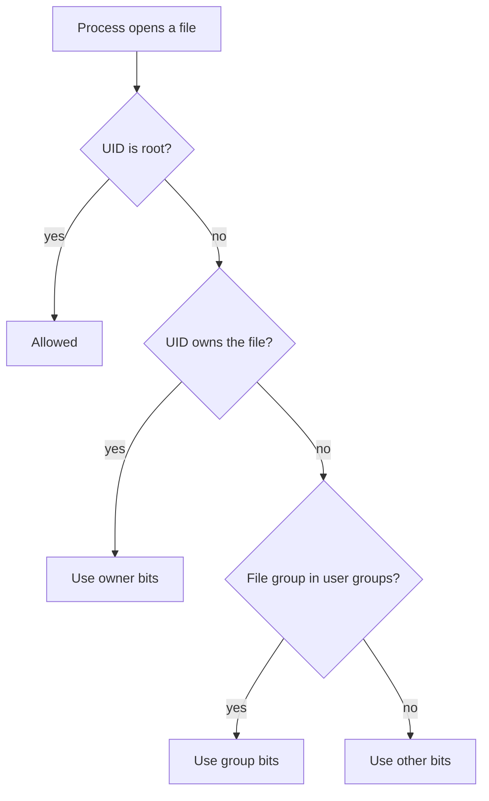

# Users, Groups And File Permissions

A report file must be readable by one automation account. The quick fix is to make the file readable by everyone, or to give the account root. Both fixes give far more access than the task needs. Linux has a smaller tool for this job: the group. This part explains how the kernel decides whether an account may read a file, and then grants exactly one file to exactly one account.

## How Linux decides access

Every process on Linux runs as a user, identified by a number called the **user ID (UID)**. UID 0 is `root`, which bypasses ordinary permission checks. A user also has one primary group and can belong to supplementary groups, each identified by a **group ID (GID)**. The files `/etc/passwd` and `/etc/group` map the names to the numbers, and `getent` reads them through the system's name service.

Every file has an owner, a group and nine permission bits, shown as three triplets for the owner, the group and everyone else. Each triplet has `r` (read), `w` (write) and `x` (execute). The kernel checks the triplets in order and uses the first that applies: if the user owns the file, only the owner bits count; otherwise, if one of the user's groups owns the file, only the group bits count; otherwise the bits for everyone else count.



The diagram shows that exactly one set of bits applies, so a file with mode `0640` is readable by its group and closed to everyone else, even if the "other" bits would be wider.

## Inspect the two reports

Select the environment, confirm the cluster, and define a helper that runs one command in the control-plane node container:

<!-- astrona:playground:renew -->

```sh
export KUBECONFIG="$(astrona kubeconfig ats-033-playground-020-01)"
test "$(kubectl config current-context)" = "kind-astro-ats-033-playground-020-01" || exit 1
node_name="astro-ats-033-playground-020-01-control-plane"
run_on_node() { podman exec "$node_name" "$@"; }
```

Look at the identity of the account and at the two files:

```sh
run_on_node id training-reader
run_on_node ls -l /var/lib/training-identity
```

`id` prints the UID, the primary group and every supplementary group. The UID is not 0, and the group list does not contain `training-readers`. In the `ls -l` output, `public-report` has the group `training-readers` and the mode `-rw-r-----`, and `private-report` has owner and group `root` and the mode `-rw-------`.

## Test access as the account

Reading a file as `root` proves nothing, because `root` can read everything. To test an account, run the command as that account. `runuser -u <user> -- <command>` runs a command as another user. A denied read makes `cat` print a permission error and exit with a non-zero status, and `podman exec` passes that status on:

```sh
run_on_node runuser -u training-reader -- cat /var/lib/training-identity/public-report
```

The command fails with `Permission denied`. The account is not the owner, it does not belong to the group `training-readers`, and the other bits of the file are empty. Group membership is the missing piece.

## Grant access through a group

`usermod` changes an account. The option `--append` (`-a`) together with `--groups` (`-G`) adds the account to a supplementary group and keeps its other groups. This is the most important detail of the command: without `--append`, `usermod --groups` replaces the whole list of supplementary groups, and the account silently loses its other groups.

```sh
run_on_node usermod --append --groups training-readers training-reader
```

The new membership applies to processes that start after the change. Run the two reads again, one allowed and one that must still be denied:

```sh
run_on_node runuser -u training-reader -- cat /var/lib/training-identity/public-report
run_on_node runuser -u training-reader -- cat /var/lib/training-identity/private-report
```

The first read prints `disposable-report`. The second fails with `Permission denied`, because `private-report` belongs to the group `root` with mode `0600`, and the account is neither the owner nor in that group. The account gained one file and nothing else. Finally, confirm the account did not gain root:

```sh
run_on_node id training-reader
```

The group list now includes `training-readers`. It does not include `root`, and the UID is still not 0.

## Why a group is better than the alternatives

Three common shortcuts give the account too much. Making the file world-readable (`chmod o+r`) lets every account on the node read it. Adding the account to the `root` group gives it the group rights on every file that the `root` group owns. Giving it `sudo` access to `cat` the file can leak other files through the same command and gives away root-level execution. A dedicated group for one purpose keeps the permission visible: `getent group training-readers` lists exactly who can read the report.

You now know how the kernel chooses between owner, group and other bits, and how a dedicated group gives narrow read access. The next question is the opposite case: an account that really needs administrative actions. That access must be narrow too, which is the topic of `sudo` and account locking.

## Common pitfalls

> [!WARNING]
> - **Using `usermod -G` without `-a`.** It replaces all supplementary groups. Use `--append --groups` to add one.
> - **Testing as root.** `root` can read everything, so a successful read as root proves nothing. Test with `runuser -u <user>`.
> - **Expecting a running session to see a new group.** Group membership is read when a process starts. A login that started earlier must start again.
> - **Fixing a denial with `chmod 777` or `chmod o+r`.** That opens the file to every account. Grant a group instead.
