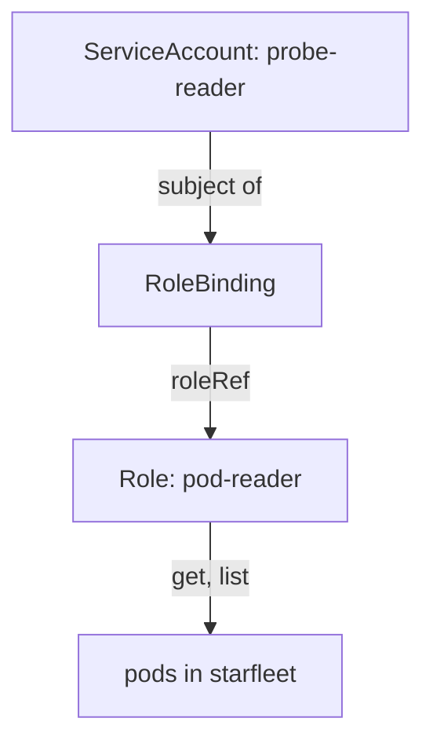

# Kubernetes Identities And RBAC

A Linux account and a Kubernetes identity are different things. The Linux account decides what a process may do on the node. A Kubernetes identity decides what a caller may do through the Kubernetes API, and the API server checks it on every request. A pod that talks to the API is the usual case, and its identity is a ServiceAccount. If that ServiceAccount has more permissions than the pod needs, an attacker who controls the pod inherits them. This part builds a ServiceAccount with exactly one permission and proves the limit.

## Who is calling and what may they do

The API server answers two questions for every request. **Authentication** asks who the caller is. A user has a client certificate or a token from an identity provider. A pod uses a **ServiceAccount**, a namespaced Kubernetes object that represents a workload. Its full user name is `system:serviceaccount:<namespace>:<name>`. **Authorization** asks whether that caller may do the requested verb on the requested resource. On a standard cluster the authorization mode is **RBAC** (role-based access control).

RBAC uses four kinds of object. A **Role** is a list of rules in one namespace; each rule names API groups, resources and verbs such as `get`, `list`, `create` and `delete`. A **ClusterRole** is the same list for the whole cluster or for non-namespaced resources. A **RoleBinding** connects a Role to subjects (users, groups or ServiceAccounts) inside one namespace. A **ClusterRoleBinding** connects a ClusterRole to subjects across the whole cluster. RBAC only adds permissions: there is no deny rule, so a subject with no binding has no access.



The diagram shows that the ServiceAccount has no permission itself; the RoleBinding links it to a Role, and the Role names the verbs and the resource.

## Create the identity and its Role

Select the environment first:

<!-- astrona:playground:renew -->

```sh
export KUBECONFIG="$(astrona kubeconfig ats-033-playground-020-01)"
test "$(kubectl config current-context)" = "kind-astro-ats-033-playground-020-01" || exit 1
```

Save this as `serviceaccount-probe-reader.yaml`:

```yaml
apiVersion: v1
kind: ServiceAccount
metadata:
  name: probe-reader
  namespace: starfleet
automountServiceAccountToken: false
```

Save this as `role-pod-reader.yaml`:

```yaml
apiVersion: rbac.authorization.k8s.io/v1
kind: Role
metadata:
  name: pod-reader
  namespace: starfleet
rules:
- apiGroups: [""]
  resources: ["pods"]
  verbs: ["get", "list"]
```

Save this as `rolebinding-probe-reader.yaml`:

```yaml
apiVersion: rbac.authorization.k8s.io/v1
kind: RoleBinding
metadata:
  name: probe-reader-pod-reader
  namespace: starfleet
subjects:
- kind: ServiceAccount
  name: probe-reader
  namespace: starfleet
roleRef:
  apiGroup: rbac.authorization.k8s.io
  kind: Role
  name: pod-reader
```

The empty string in `apiGroups` means the core API group, where `pods` lives. The field `roleRef` cannot be changed after the RoleBinding exists, so a wrong reference means deleting and creating the object again. Apply all three:

```sh
kubectl apply -f serviceaccount-probe-reader.yaml -f role-pod-reader.yaml -f rolebinding-probe-reader.yaml
```

## Prove the limit with kubectl auth can-i

`kubectl auth can-i <verb> <resource>` asks the API server whether an action is allowed and prints `yes` or `no`. The option `--as` sends the question as another identity, so you test the permissions of the ServiceAccount from your own administrator session. Ask four questions: one that should be allowed and three that must not be:

```sh
sa=system:serviceaccount:starfleet:probe-reader
kubectl auth can-i list pods --as="$sa" -n starfleet
kubectl auth can-i delete pods --as="$sa" -n starfleet
kubectl auth can-i get secrets --as="$sa" -n starfleet
kubectl auth can-i list pods --as="$sa" -n outpost
```

The answers are `yes`, `no`, `no` and `no`. The Role allows only `get` and `list` on pods, and only in `starfleet`, because the RoleBinding is in that namespace. To see the complete list of what one identity may do in a namespace, use the `--list` option:

```sh
kubectl auth can-i --list --as="$sa" -n starfleet
```

The table contains the `get` and `list` verbs for `pods`. It also contains a few rules that every authenticated caller receives, such as the right to ask what it may do (`selfsubjectaccessreviews`). Those come from built-in ClusterRoles and are not part of the Role you wrote.

## Stop the token from reaching the pod

A pod authenticates to the API with a token that the kubelet writes into the pod at `/var/run/secrets/kubernetes.io/serviceaccount`. By default every pod receives the token of its ServiceAccount, even when the application never calls the API. A pod that does not use the API should not have the token. The field `automountServiceAccountToken: false` on the ServiceAccount or the pod turns it off, and a value on the pod overrides the value on the ServiceAccount.

Save this as `pod-sa-reader.yaml`:

```yaml
apiVersion: v1
kind: Pod
metadata:
  name: sa-reader
  namespace: starfleet
spec:
  serviceAccountName: probe-reader
  restartPolicy: Never
  containers:
  - name: reader
    image: docker.io/library/busybox:1.37.0
    command:
    - sh
    - -c
    - sleep 3600
```

Apply it:

```sh
kubectl apply -f pod-sa-reader.yaml
```

Then check the result. The pod uses the ServiceAccount, which has the mount turned off, so the token directory must not exist:

```sh
kubectl -n starfleet wait --for=condition=Ready pod/sa-reader --timeout=120s
kubectl -n starfleet exec sa-reader -- ls /var/run/secrets/kubernetes.io/serviceaccount
```

The `ls` command fails with `No such file or directory`, which is the expected result. If the mount were on, the directory would hold the files `token`, `ca.crt` and `namespace`. The token in that directory is a bound token: the API server ties it to the pod and it expires, which makes it safer than the old long-lived token Secrets.

## Common ways RBAC grows too wide

Four patterns create the most excess access. A wildcard in `verbs` or `resources` (`"*"`) grants more than anyone reviewed. A binding to the built-in ClusterRole `cluster-admin` gives full control of the cluster. A ClusterRoleBinding where a RoleBinding would do spreads a permission across all namespaces. The `default` ServiceAccount of a namespace collects permissions when people bind roles to it, and then every pod that does not name a ServiceAccount inherits them. Give each workload its own ServiceAccount and bind only that.

You now can create a narrow identity, test it from the outside with `auth can-i` and keep its token out of pods that do not need it. The last question for any identity is how to take access back and how to see what it did.

## Common pitfalls

> [!WARNING]
> - **Binding roles to the `default` ServiceAccount.** Every pod without a `serviceAccountName` uses it and gains the permissions.
> - **Using `*` in a Role.** It grants verbs or resources nobody planned. List the exact verbs and resources.
> - **Testing with your own session.** An administrator can do everything. Test with `--as=system:serviceaccount:<namespace>:<name>`.
> - **Forgetting that a RoleBinding is namespaced.** It grants the Role in its own namespace only, even when the subject lives elsewhere.
