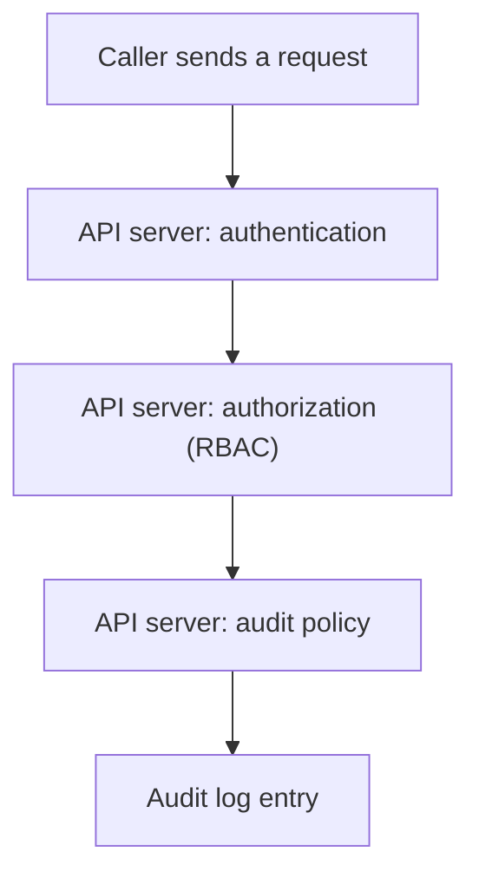

# Revocation And Audit

Granting access is half of least privilege. The other half is taking it back when the task ends or an account is at risk, and knowing afterwards what the identity did. A person who leaves a team keeps a group membership. A RoleBinding stays long after the project that needed it. This part removes access on the host and in the cluster, confirms that it is gone, and shows where the records of actions are kept.

## Revoking host access

Host access has several layers, and revoking one layer does not always remove the others. Group membership grants file access, `sudoers` rules grant commands, and SSH keys or passwords grant the login itself. A complete revocation removes the group membership, deletes the sudoers file, removes the public key from `~/.ssh/authorized_keys` and locks the account. For an account that is no longer needed at all, `userdel` removes it, and `userdel --remove` also deletes the home directory.

Remember that a running process keeps the groups it started with. Ending the sessions of an account, with `loginctl terminate-user <user>` or by killing its processes, makes the revocation take effect immediately.

Select the environment and define the helper:

<!-- astrona:playground:renew -->

```sh
export KUBECONFIG="$(astrona kubeconfig ats-033-playground-020-01)"
test "$(kubectl config current-context)" = "kind-astro-ats-033-playground-020-01" || exit 1
node_name="astro-ats-033-playground-020-01-control-plane"
run_on_node() { podman exec "$node_name" "$@"; }
```

Make sure the account is in the group, then remove it. `gpasswd --delete <user> <group>` removes one account from one group and leaves every other membership alone:

```sh
run_on_node usermod --append --groups training-readers training-reader
run_on_node runuser -u training-reader -- cat /var/lib/training-identity/public-report
run_on_node gpasswd --delete training-reader training-readers
run_on_node runuser -u training-reader -- cat /var/lib/training-identity/public-report
```

The first read succeeds. After `gpasswd` removes the membership, the second read fails with `Permission denied`, because the new process starts without the group. Confirm the end state with the commands that show membership from both sides:

```sh
run_on_node id training-reader
run_on_node getent group training-readers
```

The group list of the account no longer contains `training-readers`, and the group entry has no member names after the last colon.

## Revoking Kubernetes access

In the cluster, access ends when the RoleBinding is deleted, because RBAC only adds permissions. The Role can stay; without a binding it grants nothing. The commands below need the ServiceAccount `probe-reader`, the Role `pod-reader` (verbs `get` and `list` on pods) and the RoleBinding `probe-reader-pod-reader`, all in the `starfleet` namespace. Delete the binding and ask whether the ServiceAccount can still list pods:

```sh
sa=system:serviceaccount:starfleet:probe-reader
kubectl -n starfleet delete rolebinding probe-reader-pod-reader
kubectl auth can-i list pods --as="$sa" -n starfleet
```

The answer is now `no`. The API server evaluates RBAC on each request, so the revocation applies at once. Credentials differ. A ServiceAccount token that already exists is valid until it expires or until the ServiceAccount is deleted, but a valid token with no binding can do nothing. Tokens that you issue by hand, with `kubectl create token probe-reader --duration=10m`, are short-lived by design, and a short duration is the best revocation plan for a credential that cannot be recalled.

Look for bindings that nobody reviews. These two commands list every RoleBinding and every ClusterRoleBinding, with the subjects:

```sh
kubectl get rolebindings -A -o wide
kubectl get clusterrolebindings -o wide
```

Read the `SUBJECTS` column. Entries that name `default` ServiceAccounts, groups such as `system:authenticated`, or the role `cluster-admin` are the first to question.

## Where the actions are recorded

An audit trail answers who did what, and when. On the node, `sudo` logs each use in the authentication log: `/var/log/auth.log` on Debian and Ubuntu, or the systemd journal. `journalctl --unit ssh` shows SSH logins, and `last` reads the login history. The Linux audit framework (`auditd`) can record file access and system calls, and `ausearch` reads its log.

In the cluster, the API server writes an audit log only when it is started with an audit policy (`--audit-policy-file`) and a destination such as `--audit-log-path`. The policy chooses the level for each request: `None`, `Metadata` (who, what and when), `Request` (adds the request body) or `RequestResponse`. A common policy records `Metadata` for most resources and `RequestResponse` or `Request` for sensitive ones, but never logs the content of Secrets at a level above `Metadata`, because the body would hold the secret value.



The diagram shows the API server as the place where identity, permission and record come together for every request.

You can now remove access at each layer and know where the proof of use lives. The module has followed one rule from the file system to the API: grant narrowly, test as the identity, and take access back as soon as the task ends.

## Common pitfalls

> [!WARNING]
> - **Removing a user from one place only.** Group membership, `sudoers` files, SSH keys and Kubernetes bindings are separate. Check each.
> - **Expecting a running session to lose a group at once.** The processes keep the old groups until they restart. End the session.
> - **Keeping a RoleBinding after the task.** The Role grants nothing without a binding, so delete the binding.
> - **Logging Secrets with `Request` or `RequestResponse`.** The audit log would then contain secret values. Use `Metadata` for Secrets.
