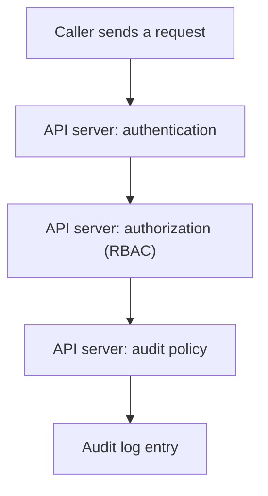

# Revocation And Audit

Granting access is half of least privilege. The other half is taking it back when the task ends or an account is at risk, and knowing afterwards what the identity did. A person who leaves a team keeps a group membership. A RoleBinding stays long after the project that needed it. This part removes access on the host and in the cluster, confirms that it is gone, and shows where the records of actions are kept.

## Revoking host access

Host access has several layers, and revoking one layer does not always remove the others. Group membership grants file access, `sudoers` rules grant commands, and SSH keys or passwords grant the login itself. A complete revocation removes the group membership, deletes the sudoers file, removes the public key from `~/.ssh/authorized_keys` and locks the account. For an account that is no longer needed at all, `userdel` removes it, and `userdel --remove` also deletes the home directory.

Remember that a running process keeps the groups it started with. Ending the sessions of an account, with `loginctl terminate-user <user>` or by killing its processes, makes the revocation take effect immediately.

Open a shell on the playground VM. The VM is the cluster's only node, so the account commands run on the node itself. They need `root`, so they run with `sudo`:

<!-- astrona:playground:renew -->

```sh
astrona ssh astro-ats-033-playground-020-01
kubectl config current-context
```

```text
kubernetes-admin@astro-ats-033-playground-020-01
```

Make sure the account is in the group, then remove it. `gpasswd --delete <user> <group>` removes one account from one group and leaves every other membership alone. `runuser -u <user> --` starts a new process as that account, which tests the account's real access:

```sh
sudo usermod --append --groups training-readers training-reader
sudo runuser -u training-reader -- cat /var/lib/training-identity/public-report
sudo gpasswd --delete training-reader training-readers
sudo runuser -u training-reader -- cat /var/lib/training-identity/public-report
```

```text
disposable-report
Removing user training-reader from group training-readers
cat: /var/lib/training-identity/public-report: Permission denied
```

The first read succeeds. After `gpasswd` removes the membership, the second read fails, because the new process starts without the group. Confirm the end state with the commands that show membership from both sides:

```sh
id training-reader
getent group training-readers
```

```text
uid=1003(training-reader) gid=1004(training-reader) groups=1004(training-reader)
training-readers:x:1003:
```

The group list of the account no longer contains `training-readers`, and the group entry has no member names after the last colon.

## Revoking Kubernetes access

In the cluster, access ends when the RoleBinding is deleted, because RBAC only adds permissions. The Role can stay; without a binding it grants nothing. The commands below need the ServiceAccount `probe-reader`, the Role `pod-reader` (verbs `get` and `list` on pods) and the RoleBinding `probe-reader-pod-reader`, all in the `starfleet` namespace. Delete the binding and ask whether the ServiceAccount can still list pods:

```sh
sa=system:serviceaccount:starfleet:probe-reader
kubectl -n starfleet delete rolebinding probe-reader-pod-reader
kubectl auth can-i list pods --as="$sa" -n starfleet
```

```text
rolebinding.rbac.authorization.k8s.io "probe-reader-pod-reader" deleted from starfleet namespace
no
```

The answer is now `no`. The API server evaluates RBAC on each request, so the revocation applies at once. Credentials differ. A ServiceAccount token that already exists is valid until it expires or until the ServiceAccount is deleted, but a valid token with no binding can do nothing. Tokens that you issue by hand, with `kubectl create token probe-reader --duration=10m`, are short-lived by design, and a short duration is the best revocation plan for a credential that cannot be recalled.

Look for bindings that nobody reviews. These two commands list every RoleBinding and every ClusterRoleBinding, with the subjects:

```sh
kubectl get rolebindings -A -o wide
kubectl get clusterrolebindings -o wide
```

kubeadm, the tool that built this cluster, creates many system bindings, so the output below is shortened to the header and three lines of the second command:

```text
NAME                                                            ROLE                                                                               AGE   USERS                            GROUPS                                            SERVICEACCOUNTS
cluster-admin                                                   ClusterRole/cluster-admin                                                          60s                                    system:masters
system:basic-user                                               ClusterRole/system:basic-user                                                      60s                                    system:authenticated
system:public-info-viewer                                       ClusterRole/system:public-info-viewer                                              60s                                    system:authenticated, system:unauthenticated
```

The `USERS`, `GROUPS` and `SERVICEACCOUNTS` columns list the subjects. `cluster-admin` is bound to the group `system:masters`, and every member of that group has full control. The two other bindings give only discovery rights to every caller. Entries that name `default` ServiceAccounts, a broad group such as `system:authenticated` with a strong role, or the role `cluster-admin` are the first to question.

## Where the actions are recorded

An audit trail answers who did what, and when. On the node, `sudo` logs each use in the authentication log: `/var/log/auth.log` on Debian and Ubuntu, or the systemd journal. Each line names the account that ran sudo, the target user and the full command:

```sh
sudo grep -E 'sudo:.*COMMAND' /var/log/auth.log | tail -n 3
```

```text
2026-11-18T08:58:22.475834+00:00 astro-ats-033-playground-020-01 sudo:  student : PWD=/home/student ; USER=root ; COMMAND=/usr/bin/gpasswd --delete training-reader training-readers
2026-11-18T08:58:22.486609+00:00 astro-ats-033-playground-020-01 sudo:  student : PWD=/home/student ; USER=root ; COMMAND=/usr/sbin/runuser -u training-reader -- cat /var/lib/training-identity/public-report
2026-11-18T08:58:22.598885+00:00 astro-ats-033-playground-020-01 sudo:  student : PWD=/home/student ; USER=root ; COMMAND=/usr/bin/grep -E sudo:.*COMMAND /var/log/auth.log
```

Your times differ. The last line is the `grep` itself, because it also ran through sudo. The SSH daemon writes each login to the systemd journal, with the account, the source address and the key fingerprint:

```sh
sudo journalctl --unit ssh -n 4 --no-pager
```

```text
Nov 18 08:58:21 astro-ats-033-playground-020-01 sshd[2816]: pam_unix(sshd:session): session opened for user student(uid=1001) by student(uid=0)
Nov 18 08:58:21 astro-ats-033-playground-020-01 sshd[2816]: pam_unix(sshd:session): session closed for user student
Nov 18 08:58:21 astro-ats-033-playground-020-01 sshd[2889]: Accepted publickey for student from 10.0.2.2 port 51108 ssh2: ED25519 SHA256:2va+Gta7yUzekcs6fG/CWbtQdUbMfmjcHkt0102vcCQ
Nov 18 08:58:21 astro-ats-033-playground-020-01 sshd[2889]: pam_unix(sshd:session): session opened for user student(uid=1001) by student(uid=0)
```

`last` reads the login history from `/var/log/wtmp`. The Linux audit framework (`auditd`) can record file access and system calls, and `ausearch` reads its log. The package is installed on this node, but it records nothing until someone adds rules:

```sh
sudo auditctl -l
```

```text
No rules
```

An audit trail exists only where something was set up to write it.

In the cluster, the API server writes an audit log only when it is started with an audit policy (`--audit-policy-file`) and a destination such as `--audit-log-path`. The policy chooses the level for each request: `None`, `Metadata` (who, what and when), `Request` (adds the request body) or `RequestResponse`. A common policy records `Metadata` for most resources and `RequestResponse` or `Request` for sensitive ones, but never logs the content of Secrets at a level above `Metadata`, because the body would hold the secret value.



The diagram shows the API server as the place where identity, permission and record come together for every request.

You can now remove access at each layer and know where the proof of use lives. The module has followed one rule from the file system to the API: grant narrowly, test as the identity, and take access back as soon as the task ends.

## Common pitfalls

> [!WARNING]
> - **Removing a user from one place only.** Group membership, `sudoers` files, SSH keys and Kubernetes bindings are separate. Check each.
> - **Expecting a running session to lose a group at once.** The processes keep the old groups until they restart. End the session.
> - **Keeping a RoleBinding after the task.** The Role grants nothing without a binding, so delete the binding.
> - **Logging Secrets with `Request` or `RequestResponse`.** The audit log would then contain secret values. Use `Metadata` for Secrets.
