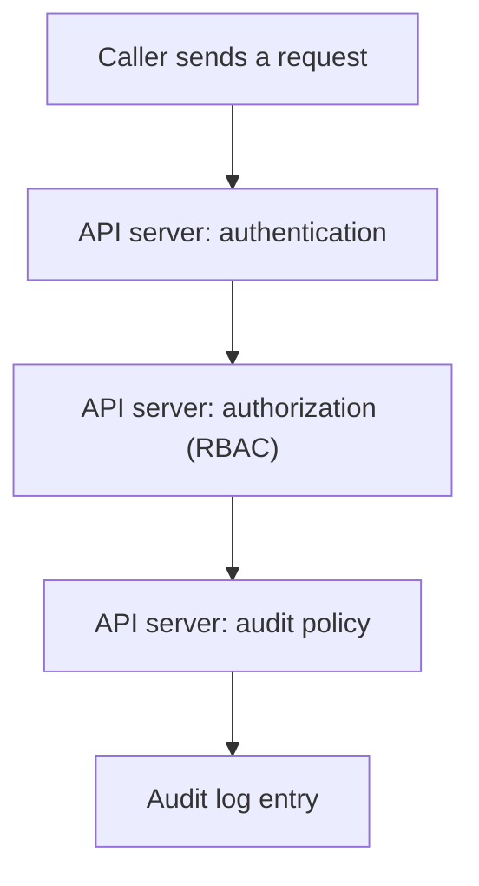

# Audit Trails On The Node And In The Cluster

Removing access protects the system from now on. It does not tell you what an identity did while it still had access. An audit trail answers who did what, and when. This part reads the records that the node and the cluster keep, adds a Linux audit rule that records changes to the sudoers files, and names the settings the API server needs to write its own audit log.

The commands run on the playground VM, which is the cluster's only node. Log records belong to root, so the commands run with `sudo`. Open a shell on the VM:

<!-- astrona:playground:renew -->

```sh
astrona ssh astro-ats-033-playground-020-01
kubectl config current-context
```

```text
kubernetes-admin@astro-ats-033-playground-020-01
```

## Records on the node

On the node, `sudo` logs each use in the authentication log: `/var/log/auth.log` on Debian and Ubuntu, or the systemd journal. Each line names the account that ran sudo, the target user and the full command:

```sh
sudo grep -E 'sudo:.*COMMAND' /var/log/auth.log | tail -n 3
```

```text
2026-11-18T08:58:22.475834+00:00 astro-ats-033-playground-020-01 sudo:  student : PWD=/home/student ; USER=root ; COMMAND=/usr/bin/gpasswd --delete training-reader training-readers
2026-11-18T08:58:22.486609+00:00 astro-ats-033-playground-020-01 sudo:  student : PWD=/home/student ; USER=root ; COMMAND=/usr/sbin/runuser -u training-reader -- cat /var/lib/training-identity/public-report
2026-11-18T08:58:22.598885+00:00 astro-ats-033-playground-020-01 sudo:  student : PWD=/home/student ; USER=root ; COMMAND=/usr/bin/grep -E sudo:.*COMMAND /var/log/auth.log
```

The lines show sudo commands that ran earlier on this VM, so your lines and times differ. The last line is the `grep` itself, because it also ran through sudo. The SSH daemon writes each login to the systemd journal, with the account, the source address and the key fingerprint:

```sh
sudo journalctl --unit ssh -n 4 --no-pager
```

```text
Nov 18 08:58:21 astro-ats-033-playground-020-01 sshd[2816]: pam_unix(sshd:session): session opened for user student(uid=1001) by student(uid=0)
Nov 18 08:58:21 astro-ats-033-playground-020-01 sshd[2816]: pam_unix(sshd:session): session closed for user student
Nov 18 08:58:21 astro-ats-033-playground-020-01 sshd[2889]: Accepted publickey for student from 10.0.2.2 port 51108 ssh2: ED25519 SHA256:2va+Gta7yUzekcs6fG/CWbtQdUbMfmjcHkt0102vcCQ
Nov 18 08:58:21 astro-ats-033-playground-020-01 sshd[2889]: pam_unix(sshd:session): session opened for user student(uid=1001) by student(uid=0)
```

`last` reads the login history from `/var/log/wtmp`. The Linux audit framework (`auditd`) can record file access and system calls, and `ausearch` reads its log. The package is installed on this node, but it records nothing until someone adds rules:

```sh
sudo auditctl -l
```

```text
No rules
```

A watch rule asks the kernel to record every change to one path. The audit daemon (`auditd`) writes each record to `/var/log/audit/audit.log`. Add a watch on the sudoers drop-in directory, so that every new sudo rule leaves a record. The option `-p wa` records writes and attribute changes, and `-k sudoers-change` puts a search key on each record:

```sh
sudo auditctl -w /etc/sudoers.d -p wa -k sudoers-change
```

Now create a file in the directory, the way someone would add a sudo rule. Then search the log for the key. The option `--input-logs` makes `ausearch` read the audit log. Without it, `ausearch` reads from standard input when that input is not a terminal, for example in a script, and then finds nothing:

```sh
echo '# test' | sudo tee /etc/sudoers.d/99-audit-test >/dev/null
sudo ausearch --input-logs -k sudoers-change --format text
```

```text
At 09:21:41 11/18/26 student, acting as root, successfully add_rule sudoers-change using /usr/sbin/auditctl
At 09:21:41 11/18/26 student, acting as root, successfully opened-file /etc/sudoers.d/99-audit-test using /usr/bin/tee
```

The second line names the login account `student`, even though the file was written as root. The kernel stores the login user ID (the audit UID, `auid`) when the user logs in, and `sudo` does not change it. This is why the audit log can name the person behind a root action. The first line shows that adding the rule was recorded too. Remove the test file and the rule when you are done:

```sh
sudo rm /etc/sudoers.d/99-audit-test
sudo auditctl -W /etc/sudoers.d -p wa -k sudoers-change
```

A rule added with `auditctl` lasts only until the next reboot. A permanent rule goes in a file under `/etc/audit/rules.d/`. An audit trail exists only where something was set up to write it, and the same is true in the cluster.

## Records in the cluster

The API server writes an audit log only when it is started with an audit policy (`--audit-policy-file`) and a destination such as `--audit-log-path`. The policy chooses the level for each request: `None`, `Metadata` (who, what and when), `Request` (adds the request body) or `RequestResponse`. A common policy records `Metadata` for most resources and `RequestResponse` or `Request` for sensitive ones, but never logs the content of Secrets at a level above `Metadata`, because the body would hold the secret value.



The diagram shows the API server as the place where identity, permission and record come together for every request.

You now know where the proof of use lives: the authentication log for `sudo`, the journal for SSH logins, `auditd` for file changes and the API server audit log for requests. Each record exists only if something was set up to write it before the action happened. The rule for identities is the same from the file system to the API: grant narrowly, test as the identity, take access back as soon as the task ends, and keep a record that shows who used it.

## Common pitfalls

> [!WARNING]
> - **Expecting a record that nobody configured.** `auditd` records nothing without rules, and the API server writes no audit log without an audit policy and a log path.
> - **Running `ausearch` in a script without `--input-logs`.** When standard input is not a terminal, `ausearch` reads it instead of the audit log and prints `<no matches>`.
> - **Trusting the `uid` field alone.** After `sudo`, `uid` is `root`. The `auid` field names the account that logged in.
> - **Logging Secrets with `Request` or `RequestResponse`.** The audit log would then contain secret values. Use `Metadata` for Secrets.
