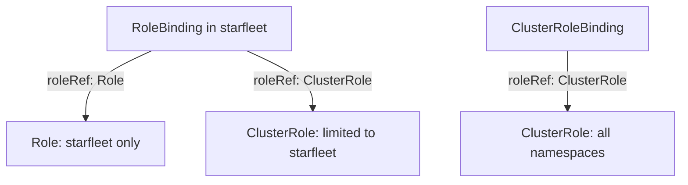

# Roles, ClusterRoles And Bindings

The API server checks every request against RBAC rules before it runs the request. If the rules are wrong, a workload either fails because it lacks a permission or, worse, succeeds because it holds far more than it needs. To write correct rules you must know exactly what each of the four RBAC kinds contains and where each one applies. This part builds a Role, shows what a ClusterRole adds, and shows how the kind of binding decides the scope.

## The four kinds and what they hold

RBAC separates what is allowed from who is allowed. A **Role** holds rules and lives in one namespace. A **ClusterRole** holds rules and is not namespaced. It can describe resources that exist outside any namespace (nodes, namespaces, PersistentVolumes), URLs that are not resources (`/healthz`), or the same namespaced resources as a Role. A **RoleBinding** lives in one namespace and gives a Role or a ClusterRole to subjects. A **ClusterRoleBinding** gives a ClusterRole to subjects in every namespace and for cluster-scoped resources. A subject is a user, a group or a ServiceAccount.

Each rule has four parts. `apiGroups` names the API group, and the empty string means the core group, where `pods`, `secrets` and `configmaps` live. `resources` names the resource, and a slash adds a subresource, such as `pods/log` or `pods/exec`. `verbs` names the actions: `get`, `list`, `watch`, `create`, `update`, `patch`, `delete` and a few others. The optional `resourceNames` restricts the rule to named objects. RBAC has no deny rule. The API server allows a request when at least one rule from any binding of the subject matches it.



The diagram shows that the binding, not the role, decides the scope: a RoleBinding limits even a ClusterRole to its own namespace.

## Build a narrow Role

The playground has a `shuttle` pod and a `probe` Deployment in `starfleet`. A reporting tool needs to read the configuration of one ConfigMap, not all of them. Select the playground first:

<!-- astrona:playground:renew -->

```sh
export KUBECONFIG="$(astrona kubeconfig ats-033-playground-020-02)"
test "$(kubectl config current-context)" = "kind-astro-ats-033-playground-020-02" || exit 1
```

Save this as `serviceaccount-report-reader.yaml`:

```yaml
apiVersion: v1
kind: ServiceAccount
metadata:
  name: report-reader
  namespace: starfleet
```

Save this as `role-probe-code-reader.yaml`:

```yaml
apiVersion: rbac.authorization.k8s.io/v1
kind: Role
metadata:
  name: probe-code-reader
  namespace: starfleet
rules:
- apiGroups: [""]
  resources: ["configmaps"]
  resourceNames: ["probe-code"]
  verbs: ["get"]
```

Save this as `rolebinding-report-reader.yaml`:

```yaml
apiVersion: rbac.authorization.k8s.io/v1
kind: RoleBinding
metadata:
  name: report-reader-probe-code
  namespace: starfleet
subjects:
- kind: ServiceAccount
  name: report-reader
  namespace: starfleet
roleRef:
  apiGroup: rbac.authorization.k8s.io
  kind: Role
  name: probe-code-reader
```

Apply all three:

```sh
kubectl apply -f serviceaccount-report-reader.yaml -f role-probe-code-reader.yaml -f rolebinding-report-reader.yaml
```

Then check the result. Ask the API server as the ServiceAccount whether it may read the named ConfigMap, list ConfigMaps, and read the same ConfigMap in another namespace:

```sh
account=system:serviceaccount:starfleet:report-reader
kubectl auth can-i get configmap/probe-code --as="$account" -n starfleet
kubectl auth can-i list configmaps --as="$account" -n starfleet
kubectl auth can-i get configmap/probe-code --as="$account" -n outpost
```

The answers are `yes`, `no` and `no`. The `resourceNames` list allows only the `get` of that one object. A `list` request has no object name, so a rule with `resourceNames` never matches it. A `no` answer ends the command with a nonzero exit status, which is normal.

## Limit a ClusterRole with a RoleBinding

Kubernetes ships ClusterRoles such as `view`, which grants read access to most namespaced resources. A ClusterRoleBinding would give that read access in every namespace. A RoleBinding that points to the same ClusterRole gives it in one namespace only. You reuse the rules and still limit the scope.

Save this as `rolebinding-report-reader-view.yaml`:

```yaml
apiVersion: rbac.authorization.k8s.io/v1
kind: RoleBinding
metadata:
  name: report-reader-view
  namespace: starfleet
subjects:
- kind: ServiceAccount
  name: report-reader
  namespace: starfleet
roleRef:
  apiGroup: rbac.authorization.k8s.io
  kind: ClusterRole
  name: view
```

Apply it:

```sh
kubectl apply -f rolebinding-report-reader-view.yaml
```

Then check the result in both namespaces:

```sh
kubectl auth can-i list pods --as="$account" -n starfleet
kubectl auth can-i list pods --as="$account" -n outpost
```

The first answer is `yes` and the second is `no`. The `view` ClusterRole does not include Secrets, so the ServiceAccount still cannot read them. The reference of a binding to a role cannot change after creation, so a wrong `roleRef` means deleting the binding and creating it again.

## Choosing the right kind

Use a Role and a RoleBinding when the permission is about one namespace, which is most workloads. Use a ClusterRole with a RoleBinding when several namespaces need the same rules but each one grants them separately. Use a ClusterRole with a ClusterRoleBinding only for cluster-scoped resources such as nodes, or for a tool that truly works across all namespaces. When you are not sure, start with the smaller scope.

You now know what each kind holds, how `resourceNames` narrows a rule and how the binding sets the scope. The next question is how permissions grow beyond this care in real clusters, and what Kubernetes does to stop users from granting what they do not hold.

## Common pitfalls

> [!WARNING]
> - **Using a ClusterRoleBinding where a RoleBinding is enough.** The permission then applies in every namespace.
> - **Expecting `resourceNames` to restrict `list`, `watch` or `create`.** These verbs have no object name in the request, so the rule does not match.
> - **Forgetting the empty string in `apiGroups`.** Core resources such as pods need `""`, not `"v1"`.
> - **Testing as yourself.** An administrator can do everything. Test with `--as=system:serviceaccount:<namespace>:<name>`.
