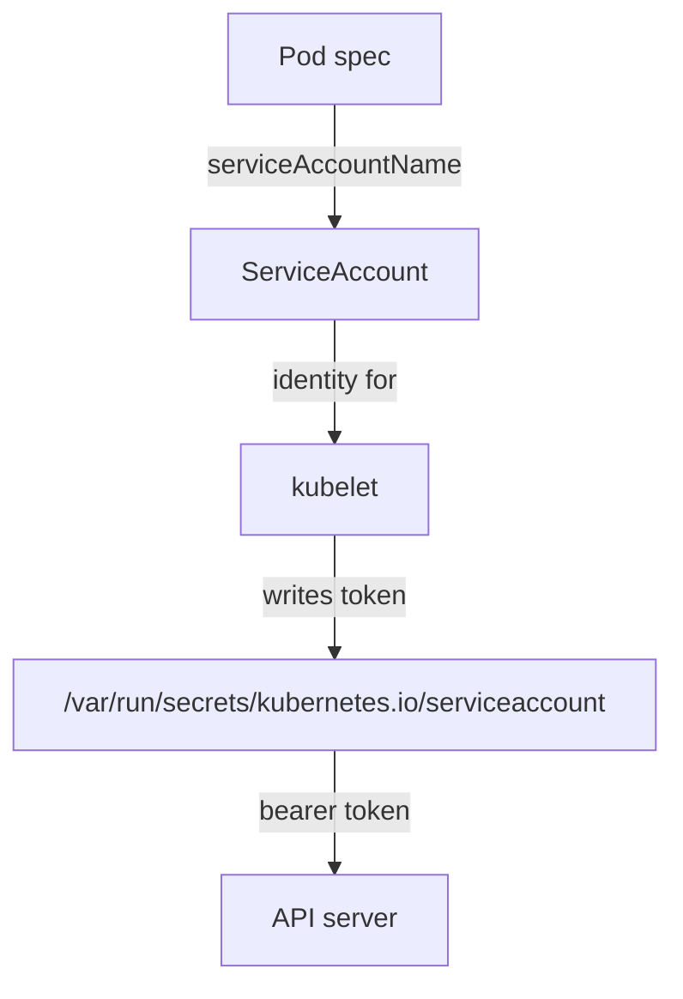

# Dedicated ServiceAccounts And automountServiceAccountToken

A pod needs an identity so that the API server can decide what it may do. If every pod in a namespace shares one identity, then every permission any of them needs is held by all of them. A dedicated ServiceAccount per workload keeps the permissions separate and makes an audit possible. This part shows how a pod receives its identity and token, how to assign a dedicated ServiceAccount, and how to keep the token out of pods that never call the API.

## How a pod gets its identity and token

A **ServiceAccount** is a namespaced Kubernetes object that represents the identity of a workload. Its full user name inside the API server is `system:serviceaccount:<namespace>:<name>`. The field `serviceAccountName` in the pod spec selects it. If the field is empty, the ServiceAccount admission controller in the API server sets it to `default`.

When the pod starts, the kubelet on the node writes the files `token`, `ca.crt` and `namespace` into `/var/run/secrets/kubernetes.io/serviceaccount` inside every container. The `token` file is a JSON Web Token (JWT), a signed text value that the API server accepts as proof of identity. Any process in the container that can read the file can call the API as the ServiceAccount. A path traversal bug, a remote code execution bug or a compromised image gives an attacker this token without any other credential.



The diagram shows that the pod spec picks the ServiceAccount, the kubelet writes the token and the API server accepts the token as that identity.

## Look at the default behaviour

Select the playground first:

<!-- astrona:playground:renew -->

```sh
export KUBECONFIG="$(astrona kubeconfig ats-033-playground-020-03)"
test "$(kubectl config current-context)" = "kind-astro-ats-033-playground-020-03" || exit 1
```

The `monitor` Deployment in the playground names no ServiceAccount. Check which one its pod uses, and which files it received:

```sh
kubectl -n starfleet get pods -l app=monitor -o jsonpath='{.items[0].spec.serviceAccountName}{"\n"}'
kubectl -n starfleet exec deploy/monitor -- ls /var/run/secrets/kubernetes.io/serviceaccount
```

The first command prints `default`. The second lists `ca.crt`, `namespace` and `token`. The `monitor` application does not call the API, but it holds a token anyway.

## Create a dedicated ServiceAccount and turn the token off

The field `automountServiceAccountToken` controls the mount. You can set it on the ServiceAccount, which applies to all pods that use it, and on the pod, which applies to that pod. When both are set, the pod setting wins. Set it to `false` in both places for a workload that does not use the API, so that a later change to one object cannot bring the token back.

Save this as `serviceaccount-report-agent.yaml`:

```yaml
apiVersion: v1
kind: ServiceAccount
metadata:
  name: report-agent
  namespace: starfleet
automountServiceAccountToken: false
```

Save this as `deployment-report-agent.yaml`:

```yaml
apiVersion: apps/v1
kind: Deployment
metadata:
  name: report-agent
  namespace: starfleet
spec:
  replicas: 1
  selector:
    matchLabels:
      app: report-agent
  template:
    metadata:
      labels:
        app: report-agent
    spec:
      serviceAccountName: report-agent
      automountServiceAccountToken: false
      containers:
      - name: agent
        image: docker.io/library/busybox:1.37.0
        command:
        - sh
        - -c
        - sleep 3600
```

Apply both:

```sh
kubectl apply -f serviceaccount-report-agent.yaml -f deployment-report-agent.yaml
```

Then check the result. Wait for the pod, then ask whether the token file exists and whether the pod uses the new ServiceAccount:

```sh
kubectl -n starfleet rollout status deployment/report-agent --timeout=180s
kubectl -n starfleet exec deploy/report-agent -- sh -c 'test -e /var/run/secrets/kubernetes.io/serviceaccount/token && echo mounted || echo absent'
kubectl -n starfleet get pods -l app=report-agent -o jsonpath='{.items[0].spec.serviceAccountName}{"\n"}'
```

The commands print `absent` and `report-agent`. With no token in the container, an attacker who controls the process has no credential to the API from inside the pod. Network access to the API server is still possible, so the token is one layer, not the only one.

## When the pod needs the API

A workload that calls the API, such as a controller, needs the token. Keep the dedicated ServiceAccount, leave the mount on and bind a Role with only the verbs and resources it uses. The goal is not to remove all tokens. The goal is that each token exists for a reason and carries the smallest permission set.

You now can give a workload its own identity and decide whether it receives a token. The token that the kubelet writes today is not the old, never-expiring kind. The next part shows how it is issued and how to control its lifetime.

## Common pitfalls

> [!WARNING]
> - **Setting the field on the ServiceAccount and expecting running pods to change.** Pods read the setting at start. Roll the Deployment.
> - **Leaving `serviceAccountName` empty.** The pod then uses `default`, which may hold permissions that someone bound to it.
> - **Setting the field to `false` on a pod that calls the API.** The calls then fail with an authentication error.
> - **Reusing one ServiceAccount for many workloads.** Their permissions merge, and the audit log cannot tell them apart.
