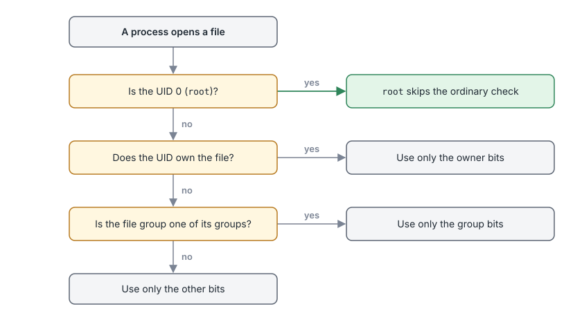
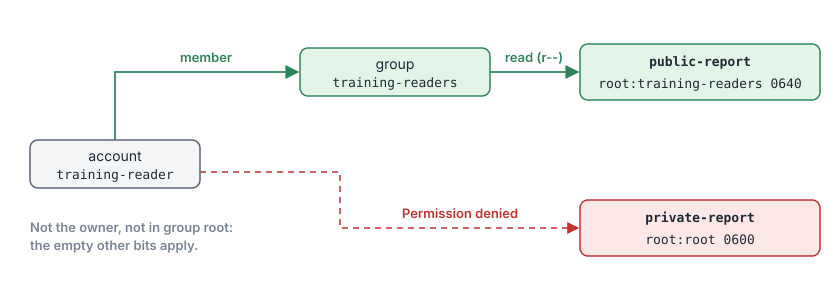

# Users, Groups And File Permissions

One automation account must be able to read a report file. The quick fix is to make the file readable by everyone, or to give the account root. Both fixes give far more access than the task needs.

Linux has a smaller tool for this job: the group. On this page, you see how the kernel decides whether an account may read a file. Then you grant exactly one file to exactly one account.

## How Linux decides access

Every process on Linux runs as a user. A number called the **user ID (UID)** identifies that user. UID 0 is `root`, and `root` skips the ordinary permission checks.

A user also has one primary group and can belong to more groups, called supplementary groups. A number called the **group ID (GID)** identifies each group. The files `/etc/passwd` and `/etc/group` map the names to the numbers. The command `getent` reads them through the name service of the system.

Every file has an owner, a group and nine permission bits. The bits form three sets of three: one set for the owner, one for the group and one for everyone else ("other"). Each set has `r` (read), `w` (write) and `x` (execute).

The kernel checks the sets in a fixed order and uses the first one that applies:

- If the user owns the file, only the owner bits count.
- Otherwise, if one of the user's groups owns the file, only the group bits count.
- Otherwise, the bits for everyone else count.



The drawing shows that exactly one set of bits applies. So a file with mode `0640` is readable by its group and closed to everyone else, even if the "other" bits would be wider.

## Inspect the two reports

Now look at the real files. Open a shell on the playground VM. The VM is the only node of the cluster, so the commands run on the node itself. The second command confirms that `kubectl` uses the cluster of this playground:

<!-- astrona:playground:renew -->

```sh
astrona ssh astro-ats-033-playground-020-01
kubectl config current-context
```

```text
kubernetes-admin@astro-ats-033-playground-020-01
```

You are logged in as `student`. Files that `root` owns need `sudo`, the program that runs one command as `root`. Look at the identity of the account and at the two files:

```sh
id training-reader
ls -l /var/lib/training-identity
```

```text
uid=1003(training-reader) gid=1004(training-reader) groups=1004(training-reader)
total 8
-rw------- 1 root root             26 Nov 18 08:41 private-report
-rw-r----- 1 root training-readers 18 Nov 18 08:41 public-report
```

`id` prints the UID, the primary group and every supplementary group. The UID is not 0, and the group list does not contain `training-readers`. Your dates and IDs can differ.

In the `ls -l` output, `public-report` has the group `training-readers` and the mode `-rw-r-----`. `private-report` has the owner `root`, the group `root` and the mode `-rw-------`.

## Test access as the account

You can see the modes, but you still need a real test. Reading a file as `root` proves nothing, because `root` can read everything. To test an account, run the command as that account.

`runuser -u <user> -- <command>` runs a command as another user. Only `root` may use `runuser`, so it runs under `sudo`:

```sh
sudo runuser -u training-reader -- cat /var/lib/training-identity/public-report
```

```text
cat: /var/lib/training-identity/public-report: Permission denied
```

The command fails, and `cat` exits with status 1. The account is not the owner, it does not belong to the group `training-readers`, and the other bits of the file are empty. Group membership is the missing piece.

## Grant access through a group

`usermod` is the command that changes an account. The option `--append` (`-a`) together with `--groups` (`-G`) adds the account to a supplementary group and keeps its other groups.

This is the most important detail of the command. Without `--append`, `usermod --groups` replaces the whole list of supplementary groups, and the account silently loses its other groups.

```sh
sudo usermod --append --groups training-readers training-reader
```

The new membership applies to processes that start after the change. Run the two reads again, one that must now work and one that must still be denied:

```sh
sudo runuser -u training-reader -- cat /var/lib/training-identity/public-report
sudo runuser -u training-reader -- cat /var/lib/training-identity/private-report
```

```text
disposable-report
cat: /var/lib/training-identity/private-report: Permission denied
```

The first read succeeds. The second read fails, because `private-report` belongs to the group `root` with mode `0600`, and the account is neither the owner nor in that group. The account gained one file and nothing else.



The drawing shows the result. The membership opens `public-report` through its group bits, and `private-report` stays closed, because the empty other bits apply to the account.

Finally, confirm that the account did not gain root, and see who is in the group:

```sh
id training-reader
getent group training-readers
```

```text
uid=1003(training-reader) gid=1004(training-reader) groups=1004(training-reader),1003(training-readers)
training-readers:x:1003:training-reader
```

The group list now includes `training-readers`. It does not include `root`, and the UID is still not 0.

## Why a group is better than the alternatives

There are three common shortcuts, and each one gives the account too much:

- Making the file readable by everyone (`chmod o+r`) lets every account on the node read it.
- Adding the account to the `root` group gives it the group rights on every file that the `root` group owns.
- Giving it `sudo` access to `cat` the file can leak other files through the same command, and it gives away root-level execution.

A dedicated group for one purpose keeps the permission visible. `getent group training-readers` lists exactly who can read the report.

You now know how the kernel chooses between the owner, group and other bits, and how a dedicated group gives narrow read access. The opposite case is still open: an account that really needs administrative actions. That access must be narrow too, and that is the job of `sudo` and account locking.

## Common pitfalls

> [!WARNING]
> - **Using `usermod -G` without `-a`.** It replaces all supplementary groups. Use `--append --groups` to add one.
> - **Testing as root.** `root` can read everything, so a successful read as root proves nothing. Test with `runuser -u <user>`.
> - **Expecting a running session to see a new group.** Linux reads group membership when a process starts. A login that started earlier must start again.
> - **Fixing a denial with `chmod 777` or `chmod o+r`.** That opens the file to every account. Grant a group instead.
