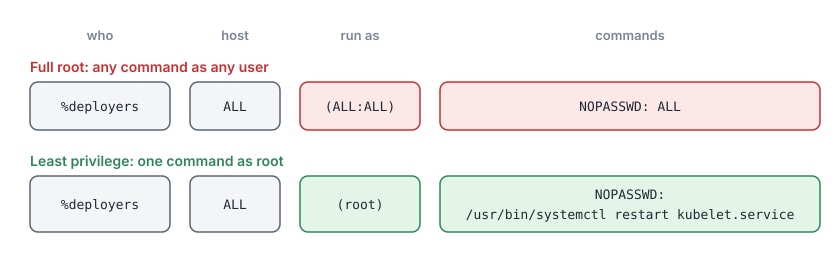
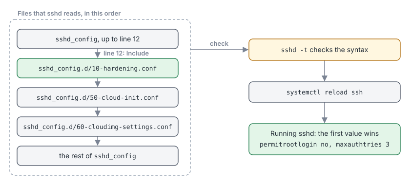

# Privilege Elevation And Account Locking

Some tasks do need administrator rights: restarting a service, reading a protected log, applying an update. The question is how an account receives those rights. A login as `root` gives all of them to everyone who knows the password.

This page covers three tools that keep those rights narrow. `sudo` grants chosen commands to chosen accounts. SSH settings limit direct `root` logins and password logins. Account locks turn an identity off without deleting it.

## What sudo does and where its rules live

`sudo` runs one command as another user, normally `root`, after it checks its rule set. These rules are called the **sudoers** rules. They live in the file `/etc/sudoers` and in files under `/etc/sudoers.d`.

Each rule has four parts: the user or group, the host, the user to run as, and the commands. The tool `visudo` edits these files and checks the syntax before it saves. This matters, because a syntax error in the sudoers file can lock every administrator out.

Compare two rules. The first gives full root access, and the second gives one command:

```text
%deployers ALL=(ALL:ALL) NOPASSWD: ALL
%deployers ALL=(root) NOPASSWD: /usr/bin/systemctl restart kubelet.service
```

The first rule lets members of the group `deployers` run any command as any user, without a password. The second rule lets them run only `systemctl restart kubelet.service` as `root`. The second rule is the least-privilege form.



The drawing lines up the four parts of both rules. Only the "run as" and "commands" parts differ, and those two parts decide how much power the rule gives.

A narrow rule can still be weaker than it looks. Three details cause this:

- A wildcard in a command argument (`systemctl restart *`) matches more than you intended.
- A command that can start a shell or edit files, such as an editor, a pager or `find`, turns a narrow rule into full root.
- A rule with `NOPASSWD` removes the second barrier if someone steals the account.

To review who holds which rights, use `sudo -l -U <user>`, which lists the commands that a user may run. Also check the members of the `sudo` group (Debian and Ubuntu) or the `wheel` group (Red Hat family).

Save narrow rules as separate files in `/etc/sudoers.d`. Then each grant has an owner, and you remove it by deleting one file. The name of a rule file must not contain a dot or end with a tilde, because `sudo` skips such files.

## Check what the node has

With the rules in mind, look at the real node. Open a shell on the playground VM. The VM is the only node of the cluster, so the commands run on the node itself:

<!-- astrona:playground:renew -->

```sh
astrona ssh astro-ats-033-playground-020-01
kubectl config current-context
```

```text
kubernetes-admin@astro-ats-033-playground-020-01
```

This Ubuntu node has `sudo` and `visudo`. Check every sudoers file, then ask `sudo` what two accounts may run. `sudo -l -U <user>` needs root, so it also runs under `sudo`:

```sh
sudo visudo -c
sudo -l -U training-reader
sudo -l -U student
```

```text
/etc/sudoers: parsed OK
/etc/sudoers.d/90-cloud-init-users: parsed OK
/etc/sudoers.d/README: parsed OK
User training-reader is not allowed to run sudo on astro-ats-033-playground-020-01.
Matching Defaults entries for student on astro-ats-033-playground-020-01:
    env_reset, mail_badpass, secure_path=/usr/local/sbin\:/usr/local/bin\:/usr/sbin\:/usr/bin\:/sbin\:/bin\:/snap/bin, use_pty

User student may run the following commands on astro-ats-033-playground-020-01:
    (ALL) NOPASSWD: ALL
```

All files parse. `training-reader` has no sudo rule. `student` has the rule `(ALL) NOPASSWD: ALL` from `/etc/sudoers.d/90-cloud-init-users`. cloud-init, the tool that sets up a cloud VM on its first boot, wrote that file.

This is the full-root rule from the comparison above. It is normal for a disposable lab VM. On a real node, it is exactly what a review must find and question.

## Check and change the state of an account

`sudo` rules control what an account may run. The account itself can also be turned on or off. Three commands show its state:

- `passwd -S` prints the password status: the name, a status letter (`L` locked, `P` usable password, `NP` no password), the date of the last change and the aging settings.
- `chage -l` lists the password aging and the account expiry date.
- `getent passwd` prints the line from `/etc/passwd`, which ends with the login shell.

```sh
getent passwd training-reader
sudo passwd -S training-reader
sudo chage -l training-reader
```

```text
training-reader:x:1003:1004::/home/training-reader:/bin/sh
training-reader P 2026-11-18 0 99999 7 -1
Last password change					: Nov 18, 2026
Password expires					: never
Password inactive					: never
Account expires						: never
Minimum number of days between password change		: 0
Maximum number of days between password change		: 99999
Number of days of warning before password expires	: 7
```

Now turn the account off. You use three settings together:

- `usermod --lock` adds a `!` in front of the stored password hash, so password login fails.
- `usermod --expiredate 1` sets the expiry to a date in the past. PAM (Pluggable Authentication Modules), the library that login programs use for account checks, then refuses the account for every method.
- Setting the shell to `nologin` blocks interactive logins.

Run all three, then try to start a session with `su`:

```sh
sudo usermod --lock --expiredate 1 --shell /usr/sbin/nologin training-reader
sudo passwd -S training-reader
sudo su -s /bin/sh -c 'id -un' training-reader
```

```text
training-reader L 2026-11-18 0 99999 7 -1
Your account has expired; please contact your system administrator.
su: Authentication failure
```

The status letter changes to `L`. PAM refuses even `su` from `root`, because the account has expired.

A lock marker alone blocks only password logins. On this node, an SSH login with a public key still worked for a locked account until the key was removed. That is why the command above sets all three settings.

Restore the account so you can use it later in the module:

```sh
sudo usermod --unlock --expiredate '' --shell /bin/sh training-reader
sudo passwd -S training-reader
```

```text
training-reader P 2026-11-18 0 99999 7 -1
```

The status letter returns to `P`, and `chage -l` shows the expiry as `never` again.

## SSH settings that limit remote access

Account locks protect one account. The SSH daemon `sshd` protects the main remote entry to a Linux host for all accounts. Its main configuration file is `/etc/ssh/sshd_config`. These settings are the usual hardening baseline:

- `PermitRootLogin no` stops direct logins as `root`, so every action is tied to a named account.
- `PasswordAuthentication no` allows public-key logins only, which removes password guessing.
- `AllowUsers` or `AllowGroups` lists the accounts that may log in at all.
- `MaxAuthTries` lowers the number of attempts per connection.

`sshd -T` prints the configuration that `sshd` builds from all its files. Look at the current values and at where they come from:

```sh
sudo sshd -T | grep -E '^(permitrootlogin|passwordauthentication|kbdinteractiveauthentication|maxauthtries) '
ls /etc/ssh/sshd_config.d
grep -n -i include /etc/ssh/sshd_config
```

```text
maxauthtries 6
permitrootlogin without-password
passwordauthentication no
kbdinteractiveauthentication no
50-cloud-init.conf
60-cloudimg-settings.conf
12:Include /etc/ssh/sshd_config.d/*.conf
```

Password logins are already off. The value `without-password` still allows `root` to log in with a key.

Line 12 reads the drop-in files in `/etc/ssh/sshd_config.d` in name order, before the rest of `sshd_config`. For most settings, `sshd` uses the first value it reads. So a drop-in file with a low number wins.



The drawing shows the read order and the steps after a change. Because `10-hardening.conf` comes first, its values win, but the running daemon only uses them after `sshd -t` and a reload.

Save this as `10-hardening.conf` in your home directory, for example with `nano 10-hardening.conf`:

```text
PermitRootLogin no
MaxAuthTries 3
```

Install the file, check the syntax with `sshd -t` (no output means the files are valid) and reload the service. A reload makes the running daemon read its files again without closing open sessions:

```sh
sudo install -m 0644 10-hardening.conf /etc/ssh/sshd_config.d/10-hardening.conf
sudo sshd -t
sudo systemctl reload ssh
```

Then check the result. The last command is a login attempt with `BatchMode=yes`, which sends no password. The server answers with the list of methods it offers:

```sh
sudo sshd -T | grep -E '^(permitrootlogin|passwordauthentication|maxauthtries) '
ssh -o BatchMode=yes -o StrictHostKeyChecking=no -o UserKnownHostsFile=/dev/null training-reader@127.0.0.1 true
```

```text
maxauthtries 3
permitrootlogin no
passwordauthentication no
Warning: Permanently added '127.0.0.1' (ED25519) to the list of known hosts.
training-reader@127.0.0.1: Permission denied (publickey).
```

The files now give `no` and `3`, and the running daemon offers only `publickey`.

Keep in mind that `sshd -T` shows what the files say, not what the running daemon uses. On this node, a test drop-in with `PasswordAuthentication yes` made the server offer `(publickey,password)` after a reload. After the file was deleted, the server kept offering `password` until the next reload.

So always run `sshd -t`, reload, and then test with a real login attempt. A node that needs no remote login at all is better without `sshd`: no daemon means no listener.

## Direct root and shared accounts

Two practices undo all the work above. A shared account, such as one `admin` login for a whole team, removes the record of who did what. A direct `root` login does the same, and it also bypasses the sudo log. Named accounts with narrow `sudo` rules leave a trail in the authentication log, and that log is where you look later to see who did what.

You can now judge a sudoers rule, check the state of an account, and turn an identity off without deleting it. But the node holds only half of the identities of a cluster. The Kubernetes API has its own accounts and its own permission model, and those need the same narrow limits.

## Common pitfalls

> [!WARNING]
> - **Editing sudoers with a normal editor.** A syntax error can lock out every administrator. Use `visudo`, or `visudo -cf <file>` to check a file first.
> - **Granting a command that opens a shell.** Editors, pagers and `find` can start a shell, so a rule for them gives full root.
> - **Locking only the password.** `usermod --lock` does not stop key-based SSH logins. Also set an expiry date or a `nologin` shell.
> - **Changing sshd without a reload.** `sshd -T` reads the files, but the running daemon keeps its old settings until `systemctl reload ssh`. Run `sshd -t` first, because a broken file can stop new logins.
> - **Using wildcards in command arguments.** `systemctl restart *` also matches arguments you did not plan for. Name the exact command.
