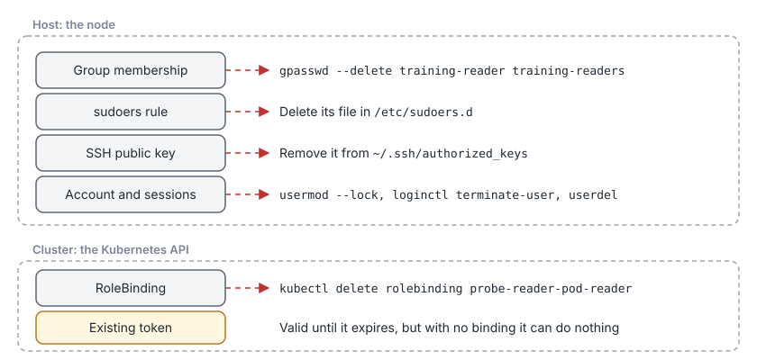

# Revoking Host And Kubernetes Access

Granting access is half of least privilege. The other half is taking it back when the task ends or when an account is at risk. In practice, access tends to stay: a person who leaves a team keeps a group membership, and a RoleBinding stays long after the project that needed it.

On this page, you remove access on the host and in the cluster. Then you confirm that it is really gone.

## Revoking host access

Host access has several layers, and revoking one layer does not always remove the others. Group membership grants file access. `sudoers` rules grant commands. SSH keys or passwords grant the login itself.

A complete revocation therefore does four things:

- it removes the group membership;
- it deletes the sudoers file;
- it removes the public key from `~/.ssh/authorized_keys`;
- it locks the account.

For an account that is no longer needed at all, `userdel` removes it, and `userdel --remove` also deletes the home directory.



The drawing lists each layer next to the step that removes it. Each layer gives access on its own, so you check every one.

Running processes add one more detail. A running process keeps the groups it started with. If you end the sessions of an account, with `loginctl terminate-user <user>` or by killing its processes, the revocation takes effect immediately.

Now try it. Open a shell on the playground VM. The VM is the only node of the cluster, so the account commands run on the node itself. They need `root`, so they run with `sudo`:

<!-- astrona:playground:renew -->

```sh
astrona ssh astro-ats-033-playground-020-01
kubectl config current-context
```

```text
kubernetes-admin@astro-ats-033-playground-020-01
```

Make sure the account is in the group, then remove it. `gpasswd --delete <user> <group>` removes one account from one group and leaves every other membership alone. `runuser -u <user> --` starts a new process as that account, which tests the real access of the account:

```sh
sudo usermod --append --groups training-readers training-reader
sudo runuser -u training-reader -- cat /var/lib/training-identity/public-report
sudo gpasswd --delete training-reader training-readers
sudo runuser -u training-reader -- cat /var/lib/training-identity/public-report
```

```text
disposable-report
Removing user training-reader from group training-readers
cat: /var/lib/training-identity/public-report: Permission denied
```

The first read succeeds. After `gpasswd` removes the membership, the second read fails, because the new process starts without the group. Confirm the end state with the commands that show the membership from both sides:

```sh
id training-reader
getent group training-readers
```

```text
uid=1003(training-reader) gid=1004(training-reader) groups=1004(training-reader)
training-readers:x:1003:
```

The group list of the account no longer contains `training-readers`. The group entry has no member names after the last colon.

## Revoking Kubernetes access

The cluster has its own layer of access. There, access ends when you delete the RoleBinding, because RBAC (role-based access control) only adds permissions. The Role can stay: without a binding, it grants nothing.

The commands below need three objects in the `starfleet` namespace: the ServiceAccount `probe-reader`, the Role `pod-reader` (verbs `get` and `list` on pods) and the RoleBinding `probe-reader-pod-reader`. Delete the binding, and ask whether the ServiceAccount can still list pods:

```sh
sa=system:serviceaccount:starfleet:probe-reader
kubectl -n starfleet delete rolebinding probe-reader-pod-reader
kubectl auth can-i list pods --as="$sa" -n starfleet
```

```text
rolebinding.rbac.authorization.k8s.io "probe-reader-pod-reader" deleted from starfleet namespace
no
```

The answer is now `no`. The API server evaluates RBAC on each request, so the revocation applies at once.

Credentials behave differently. A ServiceAccount token that already exists stays valid until it expires or until the ServiceAccount is deleted. But a valid token with no binding can do nothing.

Tokens that you issue by hand, with `kubectl create token probe-reader --duration=10m`, are short-lived by design. A short duration is the best revocation plan for a credential that you cannot recall.

Old bindings that nobody reviews are the next thing to look for. These two commands list every RoleBinding and every ClusterRoleBinding, with their subjects:

```sh
kubectl get rolebindings -A -o wide
kubectl get clusterrolebindings -o wide
```

kubeadm, the tool that built this cluster, creates many system bindings. So the output below is shortened to the header and three lines of the second command:

```text
NAME                                                            ROLE                                                                               AGE   USERS                            GROUPS                                            SERVICEACCOUNTS
cluster-admin                                                   ClusterRole/cluster-admin                                                          60s                                    system:masters
system:basic-user                                               ClusterRole/system:basic-user                                                      60s                                    system:authenticated
system:public-info-viewer                                       ClusterRole/system:public-info-viewer                                              60s                                    system:authenticated, system:unauthenticated
```

The `USERS`, `GROUPS` and `SERVICEACCOUNTS` columns list the subjects. `cluster-admin` is bound to the group `system:masters`, and every member of that group has full control. The two other bindings give only discovery rights to every caller.

Some entries deserve your questions first:

- entries that name a `default` ServiceAccount;
- a broad group such as `system:authenticated` bound to a strong role;
- any binding to the role `cluster-admin`.

You can now remove access at each layer of the host and the cluster, and prove with a test as the identity that the access is gone. One question is still open: how do you find out afterwards what an identity did while it had access?

## Common pitfalls

> [!WARNING]
> - **Removing a user from one place only.** Group membership, `sudoers` files, SSH keys and Kubernetes bindings are separate. Check each.
> - **Expecting a running session to lose a group at once.** The processes keep the old groups until they restart. End the session.
> - **Keeping a RoleBinding after the task.** The Role grants nothing without a binding, so delete the binding.
