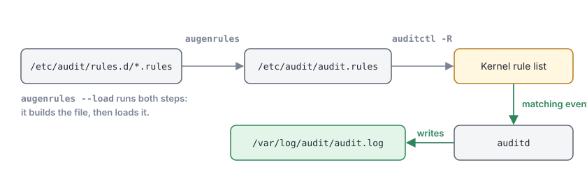

# Persistent Audit Rules With augenrules

An audit rule added with `auditctl` lives only in the kernel. When the audit daemon restarts or the node reboots, the rule is gone, and a change made after that leaves no record. A team that must prove who changed the sudo rules needs a rule that loads again at every start.

On this page, you write such a persistent rule and load it without a reboot. Then you find the record of one new sudoers file.

The Linux audit framework has three pieces that this page uses:

- The kernel holds the list of active rules and creates a record for each matching event.
- The audit daemon (`auditd`) writes those records to `/var/log/audit/audit.log`.
- `auditctl` is the command that adds, removes and lists the rules in the kernel.

A fourth tool, `augenrules`, builds one rule file from many small rule files, as the steps below show.

The commands run on the playground VM, which is the only node of the cluster. Audit rules belong to root, so the commands run with `sudo`. Open a shell on the VM:

<!-- astrona:playground:renew -->

```sh
astrona ssh astro-ats-033-playground-020-01
kubectl config current-context
```

```text
kubernetes-admin@astro-ats-033-playground-020-01
```

## Rule files and augenrules

Persistent rules live in files under `/etc/audit/rules.d/`. Each file name ends in `.rules`. Each line holds one rule or one setting, written with the same options as `auditctl`. List the directory and the settings in the default file, without the comment lines and empty lines:

```sh
sudo ls /etc/audit/rules.d
sudo grep -v -e '^#' -e '^$' /etc/audit/rules.d/audit.rules
```

```text
audit.rules
-D
-b 8192
--backlog_wait_time 60000
-f 1
```

Ubuntu ships only the default file. Its lines are settings, not rules:

- `-D` deletes all loaded rules before the new ones load.
- `-b 8192` sets the size of the kernel buffer for records.
- `--backlog_wait_time` sets how long the kernel waits when that buffer is full.
- `-f 1` makes the kernel print a message when it loses records.

Nothing in the file watches a path, so the kernel has no rules yet.

Now add a rule file for the sudoers drop-in directory. A watch rule (`-w`) asks the kernel to record access to one path. `-p wa` records writes and attribute changes, such as a new mode or owner. `-k sudoers-change` adds a search key to each record. Write the rule to its own file, then compare the files with what is loaded:

```sh
echo '-w /etc/sudoers.d -p wa -k sudoers-change' | sudo tee /etc/audit/rules.d/40-sudoers.rules
sudo augenrules --check
sudo auditctl -l
```

```text
-w /etc/sudoers.d -p wa -k sudoers-change
/usr/sbin/augenrules: Rules have changed and should be updated
No rules
```

The file exists, but the kernel still has no rules. A file in `rules.d` does nothing by itself.

`augenrules` reads every `.rules` file in `/etc/audit/rules.d/` in the order of the file names. It joins them into one file, `/etc/audit/audit.rules`. The number at the start of a file name, such as `40-`, sets its place in that order. `augenrules --check` compares the files with that generated file, and here it reports that the generated file is out of date.



The drawing shows that a rule reaches the kernel only through the generated `audit.rules` file. The kernel creates the records, and `auditd` writes them to the log file.

## Loading the rules without a reboot

To close that gap, load the rules. `augenrules --load` builds `/etc/audit/audit.rules` and then gives it to `auditctl -R`, which loads every rule in the file into the kernel. Its own output is a long status block, so the command below hides it. Load the rules, then check the kernel, the generated file and the check result:

```sh
sudo augenrules --load >/dev/null
sudo auditctl -l
sudo grep sudoers /etc/audit/audit.rules
sudo augenrules --check
```

```text
-w /etc/sudoers.d -p wa -k sudoers-change
-w /etc/sudoers.d -p wa -k sudoers-change
/usr/sbin/augenrules: No change
```

The first line comes from `auditctl -l`, which lists the rules the kernel uses now. The second line comes from the generated file. The last line confirms that the rule files and the generated file match.

The rule is active and also on disk. The next step of the test is a real change in the watched directory.

## A change that leaves a record

Add a sudo rule for the playground account `training-reader`, the same way an administrator would add one. Sudoers files must belong to root and have mode `0440`. `visudo -c` checks the syntax of every sudoers file:

```sh
echo 'training-reader ALL=(root) NOPASSWD: /usr/bin/systemctl status kubelet' | sudo tee /etc/sudoers.d/40-training-reader
sudo chmod 0440 /etc/sudoers.d/40-training-reader
sudo visudo -c
```

```text
training-reader ALL=(root) NOPASSWD: /usr/bin/systemctl status kubelet
/etc/sudoers: parsed OK
/etc/sudoers.d/40-training-reader: parsed OK
/etc/sudoers.d/90-cloud-init-users: parsed OK
/etc/sudoers.d/README: parsed OK
```

Now search for the record. `ausearch` reads the audit log, and it takes these options here:

- `--input-logs` makes it read the log file, even when it runs in a script;
- `-k` selects records by key;
- `-f` selects records for one file;
- `--format text` prints each record as one plain sentence.

```sh
sudo ausearch --input-logs -k sudoers-change -f /etc/sudoers.d/40-training-reader --format text
```

```text
At 10:59:09 11/18/26 student, acting as root, successfully opened-file /etc/sudoers.d/40-training-reader using /usr/bin/tee
At 10:59:09 11/18/26 student, acting as root, successfully changed-file-permissions-of /etc/sudoers.d/40-training-reader to 0440 using /usr/bin/chmod
```

Your times differ. The kernel created two records: one when `tee` opened the new file for writing, and one when `chmod` changed its mode. Both name `student`, the account that logged in, even though root did the work through `sudo`.

When `ausearch` finds no record, it prints `<no matches>` and exits with status 1. This happens when the file was written before the rule was loaded, because the kernel records only events that match a rule at that moment.

## What survives a restart

A persistent rule is only useful if it comes back after a restart. To test this, add a second watch with `auditctl` only, on the SSH daemon configuration. Then restart `auditd` and list the rules again:

```sh
sudo auditctl -w /etc/ssh/sshd_config -p wa -k sshd-config
sudo systemctl restart auditd
sudo auditctl -l
```

```text
-w /etc/sudoers.d -p wa -k sudoers-change
```

Before the restart, `auditctl -l` listed both watches. After the restart, only the rule from `rules.d` is back.

On Ubuntu, the systemd unit `auditd.service` has the line `ExecStartPost=-/sbin/augenrules --load`. So every start of `auditd` loads the generated file again. The `-D` setting at the top of that file first deletes all rules, which removes the runtime-only watch. A reboot has the same result.


The drawing shows the kernel rules before and after the restart. Only the watch that has a rule file survives.

Remove the test sudoers file and the rule file. Then load the rules again, so that the kernel matches the files:

```sh
sudo rm /etc/sudoers.d/40-training-reader /etc/audit/rules.d/40-sudoers.rules
sudo augenrules --load >/dev/null
sudo auditctl -l
```

```text
No rules
```

You now know the full path of a persistent audit rule. A `.rules` file goes in `/etc/audit/rules.d/`. `augenrules` builds `/etc/audit/audit.rules` from it, and `augenrules --load` puts it into the kernel without a reboot. `augenrules --check` shows when the files in `rules.d` and the generated file differ, and `ausearch -k ... -f ...` finds the record of one file.

The rule must be loaded before the change happens, because the kernel cannot record the past. What is still open is how long these records stay: `auditd` rotates and deletes old log files by the limits in `/etc/audit/auditd.conf`.

## Common pitfalls

> [!WARNING]
> - **Adding the rule with `auditctl` only.** The rule is gone after the next restart of `auditd` or the next reboot. Put it in a file under `/etc/audit/rules.d/`.
> - **Writing the file and not loading it.** A file in `rules.d` changes nothing until `augenrules --load` runs. `augenrules --check` reports "Rules have changed and should be updated" when you forget.
> - **Using the wrong file name.** `augenrules` reads only files whose names end in `.rules`. A file named `40-sudoers.conf` is ignored.
> - **Making the change before the watch is active.** The kernel records only events that match a loaded rule. Load the rule first, then make the change.
> - **Forgetting `--input-logs` in a script.** Without it, `ausearch` reads standard input when that input is not a terminal and prints `<no matches>`.
