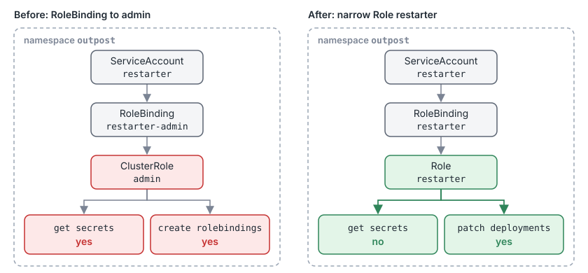
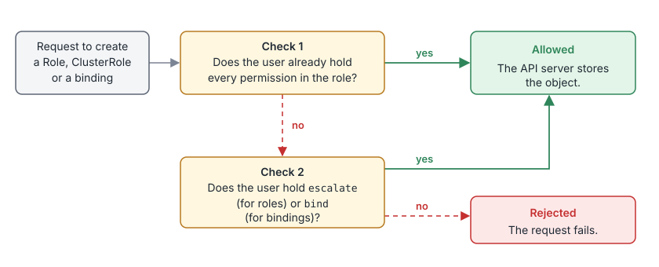

# Wildcards, cluster-admin And Escalation

Most RBAC incidents come from a few patterns. One is a wildcard that nobody reviewed. Another is a binding to `cluster-admin` that solved a deadline and then stayed. A third is a role that lets its holder quietly give themselves more power.

These patterns are easy to write and hard to see later. On this page, you see what each one grants and how to replace it. You also see how the API server limits who may create RBAC objects.

## What a wildcard really grants

The character `*` in `apiGroups`, `resources` or `verbs` means everything, including things that do not exist yet. Here is what that means for each field:

- A rule with `verbs: ["*"]` on `pods` allows `delete` and `create` as well as `get`.
- A rule with `resources: ["*"]` includes Secrets.
- A rule with `apiGroups: ["*"]` also covers every custom resource that someone installs next year.

The rule stays the same while its effect grows.

The ClusterRole `cluster-admin` is the largest case. It allows every verb on every resource in every namespace and on every URL. A ClusterRoleBinding to it gives that power over the whole cluster.

The built-in group `system:masters` has the same power and bypasses RBAC completely. So a certificate that names this group cannot be restricted by any rule. Bind `cluster-admin` only to a few human administrators, and never to a workload.

## Replace a wide binding with a narrow one

A wide binding is easiest to understand when you measure it, so this section creates one, tests it and then replaces it. First, point `kubectl` at the playground cluster:

<!-- astrona:playground:renew -->

```sh
export KUBECONFIG="$(astrona kubeconfig ats-033-playground-020-02)"
test "$(kubectl config current-context)" = "kind-astro-ats-033-playground-020-02" || exit 1
```

A deployment tool in `outpost` needs to restart one Deployment. Save this as `serviceaccount-restarter.yaml`:

```yaml
apiVersion: v1
kind: ServiceAccount
metadata:
  name: restarter
  namespace: outpost
```

Save this as `rolebinding-restarter-admin.yaml`, which shows the shortcut that people take:

```yaml
apiVersion: rbac.authorization.k8s.io/v1
kind: RoleBinding
metadata:
  name: restarter-admin
  namespace: outpost
subjects:
- kind: ServiceAccount
  name: restarter
  namespace: outpost
roleRef:
  apiGroup: rbac.authorization.k8s.io
  kind: ClusterRole
  name: admin
```

Apply both and measure the result:

```sh
kubectl apply -f serviceaccount-restarter.yaml -f rolebinding-restarter-admin.yaml
account=system:serviceaccount:outpost:restarter
kubectl auth can-i get secrets --as="$account" -n outpost
kubectl auth can-i create rolebindings --as="$account" -n outpost
```

Both answers are `yes`. The RoleBinding limits the built-in ClusterRole `admin` to one namespace. But inside that namespace, `admin` still reads every Secret and can create RoleBindings.

A restart needs a `patch` on one Deployment. The Role below allows `get` and `patch` on Deployments in the `apps` API group. Save this as `role-restarter.yaml`:

```yaml
apiVersion: rbac.authorization.k8s.io/v1
kind: Role
metadata:
  name: restarter
  namespace: outpost
rules:
- apiGroups: ["apps"]
  resources: ["deployments"]
  verbs: ["get", "patch"]
```

Save this as `rolebinding-restarter.yaml`:

```yaml
apiVersion: rbac.authorization.k8s.io/v1
kind: RoleBinding
metadata:
  name: restarter
  namespace: outpost
subjects:
- kind: ServiceAccount
  name: restarter
  namespace: outpost
roleRef:
  apiGroup: rbac.authorization.k8s.io
  kind: Role
  name: restarter
```

Apply both, then delete the wide binding. Deleting is a separate step, because RBAC only adds permissions. The old binding keeps working until you remove it:

```sh
kubectl apply -f role-restarter.yaml -f rolebinding-restarter.yaml
kubectl -n outpost delete rolebinding restarter-admin
kubectl auth can-i get secrets --as="$account" -n outpost
kubectl auth can-i patch deployments.apps --as="$account" -n outpost
```

The answers are now `no` and `yes`.



The drawing compares the two states. The narrow Role grants only what a restart needs, and the access to Secrets disappears only after you delete `restarter-admin`.

## How Kubernetes stops privilege escalation

Privilege escalation means that a user gains more permissions than they were given. A user who may create Roles and RoleBindings could, for example, write a RoleBinding to `cluster-admin` for themselves. The API server prevents this with two checks:

- A user can create or update a Role or ClusterRole only if they already hold every permission in it, or if they hold the special verb `escalate` on `roles` or `clusterroles`.
- A user can create a binding to a role only if they already hold all permissions in that role, or if they hold the verb `bind` on that role.

The verb `create` on `rolebindings` alone is therefore not enough to grant power.



The drawing shows the check that the API server runs for every new or changed Role and binding. A request passes only on one of the two paths.

The permission to create pods is an indirect form of the same risk. A subject that can create a pod in a namespace can start a pod that mounts the token of any ServiceAccount in that namespace. The pod can then act as that account. The same holds for the verbs on `pods/exec` and for reading Secrets that contain tokens. When you review a Role, ask what each permission lets the holder reach next, not only what it names.

## Common wide patterns to look for

The rules above lead to a short list of patterns. These four create most excess access:

- A wildcard in any of the three rule fields grants more than anyone reviewed.
- A ClusterRoleBinding to `cluster-admin` or to `admin`-level roles gives a workload control it should not have.
- A ClusterRoleBinding where a RoleBinding would do spreads a permission to all namespaces.
- Permissions on `secrets`, `pods/exec`, `serviceaccounts/token`, `roles`, `rolebindings` and `nodes/proxy` deserve a second look, because each one is a way to more power.

You can now replace a wide binding, delete the old path and explain why creating RBAC objects is itself a protected action. The open question is how to find these patterns in a cluster that you did not build.

## Common pitfalls

> [!WARNING]
> - **Creating the narrow Role and leaving the old binding.** RBAC only adds permissions, so the wide access stays until you delete the old binding.
> - **Granting `create` on `pods` and calling it harmless.** The holder can run a pod with another ServiceAccount's token.
> - **Granting `bind` or `escalate` casually.** These verbs switch off the escalation check.
> - **Reading `admin` as a small role.** It is limited to one namespace, but it reads Secrets and writes RoleBindings there.
