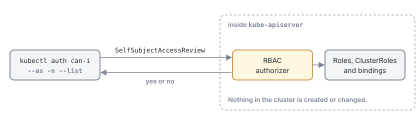
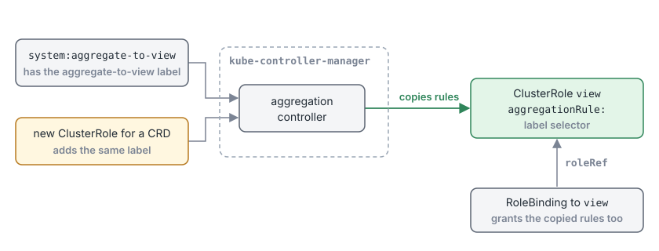

# Audit Permissions With kubectl auth can-i

A cluster that has run for a year holds RoleBindings that nobody remembers. You cannot judge them by their names. You judge them by what they allow, and the fastest way to learn that is to ask the API server.

On this page, you use `kubectl auth can-i` to test single actions and full permission lists. You also learn about aggregated ClusterRoles, which change without anyone editing them, and you list the bindings that carry the most risk.

## Ask the API server

The command `kubectl auth can-i <verb> <resource>` sends a SelfSubjectAccessReview to the API server and prints `yes` or `no`. A SelfSubjectAccessReview is an API request that asks "may I do this?" without doing it. The same authorizer that decides real requests gives the answer, so it is more reliable than reading YAML.

A few options change the question:

- `--as=<user>` sends the question as another identity. This needs permission to impersonate, which means to act as another user.
- `-n <namespace>` asks a namespaced question in that namespace.
- `--list` prints every rule that applies to the identity in that namespace.



The drawing shows the path of one question. The RBAC authorizer inside the API server answers it, and nothing in the cluster changes.

To try it, point `kubectl` at the playground cluster first:

<!-- astrona:playground:renew -->

```sh
export KUBECONFIG="$(astrona kubeconfig ats-033-playground-020-02)"
test "$(kubectl config current-context)" = "kind-astro-ats-033-playground-020-02" || exit 1
```

The playground has a ServiceAccount `ops-agent` that was bound too widely. Test it with single questions, and then with the complete list:

```sh
account=system:serviceaccount:starfleet:ops-agent
kubectl auth can-i delete secrets --as="$account" -n outpost
kubectl auth can-i '*' '*' --as="$account"
kubectl auth can-i --list --as="$account" -n starfleet
```

The first two answers are `yes`. The third command shows a rule for every resource and every verb. A list that contains `*.*` with `[*]` means the identity can do everything.

Compare this with a narrow identity. Its list shows only the resources you named, plus the few rules that every authenticated caller receives, such as `selfsubjectaccessreviews`.

You can also ask the same question for other kinds of subject. `--as-group` adds a group, and a user name such as `jane` can be tested with `--as=jane`. A request about a non-resource URL uses the path instead of a resource, for example `kubectl auth can-i get /healthz`.

## Aggregated ClusterRoles

Some ClusterRoles, such as `admin`, `edit` and `view`, do not hold their own rules. Instead, they hold an `aggregationRule`, which names label selectors. A controller in `kube-controller-manager` copies the rules of every ClusterRole that matches the labels into the aggregated role.

This is how a new custom resource definition (CRD) gets included in `view`. A CRD adds a new resource type to the API. Its author adds the label `rbac.authorization.k8s.io/aggregate-to-view: "true"` to a ClusterRole, and the controller copies those rules into `view`.



The drawing shows how the rules flow into `view`. The binding to `view` stays the same, but what it grants changes when a new labelled ClusterRole appears.

The effect is that a binding to `edit` can grow without any change to the binding or to `edit` itself. Anyone who can create a ClusterRole with an aggregation label changes the power of every subject bound to the aggregated role. You cannot edit the rules of an aggregated role by hand either, because the controller overwrites them. Inspect the selector:

```sh
kubectl get clusterrole view -o jsonpath='{.aggregationRule}{"\n"}'
kubectl get clusterrole -l rbac.authorization.k8s.io/aggregate-to-view=true
```

The first command prints the label selector. The second lists the ClusterRoles that feed `view`. When you build a custom role that should include these rules, bind to the aggregated role, or give your own role the same labels on purpose.

## Find over-broad bindings

With these tools, you can walk through a cluster. Start from the objects that grant the most. List every ClusterRoleBinding with its role and its subjects, and look for `cluster-admin` and for subjects that are ServiceAccounts or broad groups:

```sh
kubectl get clusterrolebindings -o custom-columns=NAME:.metadata.name,ROLE:.roleRef.name,SUBJECTS:.subjects[*].name
```

On a `kind` cluster, `cluster-admin` is bound to the group `system:masters` and to the group `kubeadm:cluster-admins`. Any binding to `cluster-admin` for a ServiceAccount, such as `ops-agent-admin` here, needs a reason.

Next, list the RoleBindings in all namespaces, and search the rules of Roles and ClusterRoles for the wildcard character:

```sh
kubectl get rolebindings --all-namespaces -o custom-columns=NAMESPACE:.metadata.namespace,NAME:.metadata.name,ROLE:.roleRef.name,SUBJECTS:.subjects[*].name
kubectl get roles,clusterroles --all-namespaces -o yaml | grep -n -B6 '\- .\*.'
```

The second command prints each wildcard entry with the six lines before it. This shows the rule and often the role name. The built-in ClusterRole `cluster-admin` and a few `system:` roles contain wildcards by design, so look at the custom ones.

After you find a suspect, open the role with `kubectl get role <name> -o yaml` and decide what the workload needs. Then replace the role with a narrow one, bind it, and delete the old binding.

Finally, check the identities that every pod can use. Pods that name no ServiceAccount use the `default` ServiceAccount of their namespace, so ask what it may do:

```sh
kubectl auth can-i --list --as=system:serviceaccount:starfleet:default -n starfleet
```

The list must show only the rules that every authenticated caller receives. Any extra rule means someone bound a role to `default`.

You can now test an identity from the outside, explain why an aggregated role changes over time and walk through a cluster to find the bindings that matter. Together, this gives a full loop: write narrowly, bind narrowly, prove it and keep auditing. The question that stays open in every real cluster is which new binding or labelled ClusterRole appears next, which is why the audit repeats.

## Common pitfalls

> [!WARNING]
> - **Trusting a role name.** A role called `reader` can still hold a wildcard. Read the rules or ask `can-i --list`.
> - **Forgetting `-n`.** Without a namespace, `kubectl` asks in the namespace of your current context.
> - **Missing the aggregated roles.** A binding to `view`, `edit` or `admin` follows the labels on other ClusterRoles.
> - **Reading only RoleBindings.** A ClusterRoleBinding grants the same power in every namespace.
