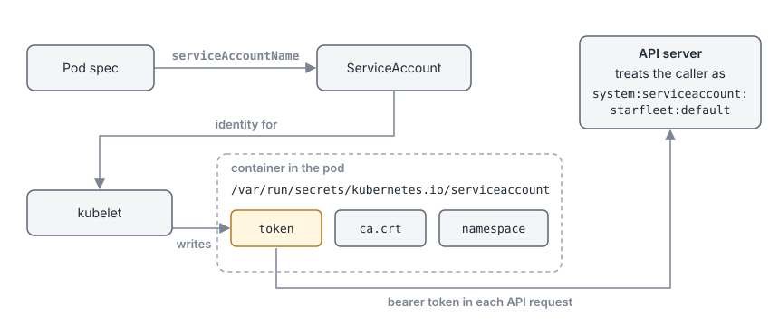
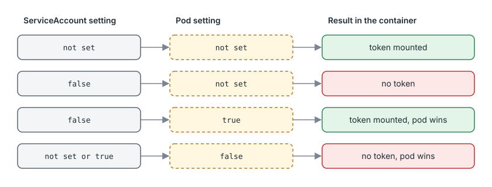

# Dedicated ServiceAccounts And automountServiceAccountToken

A pod needs an identity, so that the API server can decide what the pod may do. If every pod in a namespace shares one identity, then all of them hold every permission that any one of them needs. One ServiceAccount for each workload keeps the permissions apart, and it lets you see in an audit which workload did what.

On this page, you see how a pod gets its identity and its token. You give a workload its own ServiceAccount, and you keep the token out of pods that never call the API.

## How a pod gets its identity and token

A **ServiceAccount** is a namespaced Kubernetes object that stands for the identity of a workload. Inside the API server, its full user name is `system:serviceaccount:<namespace>:<name>`. The field `serviceAccountName` in the pod spec picks the ServiceAccount. If the field is empty, the ServiceAccount admission controller in the API server sets it to `default`.

When the pod starts, the kubelet on the node writes three files into `/var/run/secrets/kubernetes.io/serviceaccount` inside every container: `token`, `ca.crt` and `namespace`. The `token` file holds a JSON Web Token (JWT). A JWT is a signed piece of text, and the API server accepts it as proof of identity.



The drawing shows who does what. The pod spec picks the ServiceAccount, the kubelet writes the token, and the API server accepts the token as that identity.

This matters for security. Any process in the container that can read the `token` file can call the API as the ServiceAccount. So a path traversal bug, a remote code execution bug or a compromised image gives an attacker this token, without any other credential.

## Look at the default behaviour

To see this in a real pod, start with a workload that sets nothing. Select the playground first:

<!-- astrona:playground:renew -->

```sh
export KUBECONFIG="$(astrona kubeconfig ats-033-playground-020-03)"
test "$(kubectl config current-context)" = "kind-astro-ats-033-playground-020-03" || exit 1
```

The `monitor` Deployment in the playground names no ServiceAccount. Check which ServiceAccount its pod uses, and which files the pod received:

```sh
kubectl -n starfleet get pods -l app=monitor -o jsonpath='{.items[0].spec.serviceAccountName}{"\n"}'
kubectl -n starfleet exec deploy/monitor -- ls /var/run/secrets/kubernetes.io/serviceaccount
```

The first command prints `default`. The second lists `ca.crt`, `namespace` and `token`. The `monitor` application does not call the API, but it holds a token anyway.

## Create a dedicated ServiceAccount and turn the token off

The field `automountServiceAccountToken` controls whether the kubelet mounts the token. You can set it in two places:

- on the ServiceAccount, where it applies to all pods that use that ServiceAccount;
- on the pod, where it applies to that pod only.

When both are set, the pod setting wins. The drawing below shows the four common cases.



With nothing set, the pod gets a token. With `false` on the ServiceAccount, the pod gets no token, unless the pod itself sets `true`.

For a workload that does not use the API, set the field to `false` in both places. Then a later change to one of the two objects cannot bring the token back.

Save this as `serviceaccount-report-agent.yaml`:

```yaml
apiVersion: v1
kind: ServiceAccount
metadata:
  name: report-agent
  namespace: starfleet
automountServiceAccountToken: false
```

Save this as `deployment-report-agent.yaml`:

```yaml
apiVersion: apps/v1
kind: Deployment
metadata:
  name: report-agent
  namespace: starfleet
spec:
  replicas: 1
  selector:
    matchLabels:
      app: report-agent
  template:
    metadata:
      labels:
        app: report-agent
    spec:
      serviceAccountName: report-agent
      automountServiceAccountToken: false
      containers:
      - name: agent
        image: docker.io/library/busybox:1.37.0
        command:
        - sh
        - -c
        - sleep 3600
```

Apply both:

```sh
kubectl apply -f serviceaccount-report-agent.yaml -f deployment-report-agent.yaml
```

Then check the result. Wait for the pod. Then ask whether the token file exists, and whether the pod uses the new ServiceAccount:

```sh
kubectl -n starfleet rollout status deployment/report-agent --timeout=180s
kubectl -n starfleet exec deploy/report-agent -- sh -c 'test -e /var/run/secrets/kubernetes.io/serviceaccount/token && echo mounted || echo absent'
kubectl -n starfleet get pods -l app=report-agent -o jsonpath='{.items[0].spec.serviceAccountName}{"\n"}'
```

The commands print `absent` and `report-agent`. With no token in the container, an attacker who controls the process has no credential for the API from inside the pod. The pod can still reach the API server over the network, so the missing token is one layer of protection, not the only one.

## When the pod needs the API

Some workloads do call the API, for example a controller, and those need the token. For such a workload, keep the dedicated ServiceAccount and leave the mount on. Then bind a Role that holds only the verbs and resources the workload uses.

So the goal is not to remove every token. The goal is that each token exists for a reason and carries the smallest set of permissions.

You can now give a workload its own identity and decide whether it gets a token. The token that the kubelet writes today is not the old kind that never expires. That leaves an open question: how is this token issued, and how do you control its lifetime?

## Common pitfalls

> [!WARNING]
> - **Setting the field on the ServiceAccount and expecting running pods to change.** Pods read the setting when they start. Roll the Deployment.
> - **Leaving `serviceAccountName` empty.** The pod then uses `default`, which may hold permissions that someone bound to it.
> - **Setting the field to `false` on a pod that calls the API.** The API calls then fail with an authentication error.
> - **Reusing one ServiceAccount for many workloads.** Their permissions add up, and the audit log cannot tell the workloads apart.
