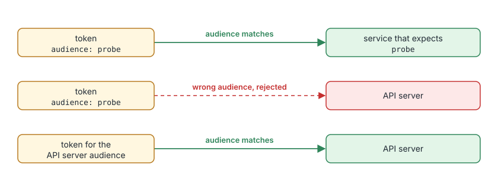

# Bound Projected Tokens

A token that never expires is a permanent credential. If it leaks, it stays valid until someone finds the leak and deletes the ServiceAccount. Earlier Kubernetes versions created such tokens automatically and stored them in Secrets.

Current versions issue short-lived tokens instead, and each one is tied to the pod it was issued for. On this page, you see how these tokens work, how to set their lifetime and their audience, and how to request one by hand for a script or a test.

## What bound means

A **bound** token is a JWT (JSON Web Token, a signed piece of text that proves an identity) with limits built in. The API server issues it through the TokenRequest API and ties it to an object, usually the pod. The token carries an expiry time and the name and UID (unique identifier) of the pod. When the pod is deleted, the API server rejects the token, even if the expiry time has not passed yet.

The kubelet does the work on the node. It requests the token for the pod and writes it into a **projected volume**, which is a volume that combines data from several sources. It also refreshes the token before it expires.


The drawing shows the round trip between the kubelet and the API server, and what the token holds. It also shows the one event that ends the token early: deleting the pod.

Two numbers matter here. For a token requested through a projected volume, the default lifetime is one hour. The kubelet starts to refresh a token when it has used 80 percent of its lifetime.

These tokens are the normal case today. Since Kubernetes 1.24, the control plane no longer creates a token Secret for each ServiceAccount. Since version 1.22, the default token in a pod is a bound projected token.

A token also has an **audience**, which names the service that should accept it. The API server accepts tokens whose audience includes its own identity. Another service, such as a vault or a registry, can require a token with its own audience. A token for the wrong audience fails there.



The drawing shows that the same token can pass at one service and fail at another. Only the audience decides this.

## Project a token with a short lifetime

You can ask the kubelet for an extra token, with your own lifetime and audience. To do this, add a `serviceAccountToken` source to a projected volume. A workload that calls a different service then holds a token meant only for that service. The smallest allowed `expirationSeconds` is 600, which is ten minutes.

Select the playground first:

<!-- astrona:playground:renew -->

```sh
export KUBECONFIG="$(astrona kubeconfig ats-033-playground-020-03)"
test "$(kubectl config current-context)" = "kind-astro-ats-033-playground-020-03" || exit 1
```

Save this as `serviceaccount-token-client.yaml`:

```yaml
apiVersion: v1
kind: ServiceAccount
metadata:
  name: token-client
  namespace: starfleet
automountServiceAccountToken: false
```

Save this as `pod-token-client.yaml`:

```yaml
apiVersion: v1
kind: Pod
metadata:
  name: token-client
  namespace: starfleet
spec:
  serviceAccountName: token-client
  automountServiceAccountToken: false
  restartPolicy: Never
  containers:
  - name: client
    image: docker.io/library/busybox:1.37.0
    command:
    - sh
    - -c
    - sleep 3600
    volumeMounts:
    - name: probe-token
      mountPath: /var/run/secrets/tokens
      readOnly: true
  volumes:
  - name: probe-token
    projected:
      sources:
      - serviceAccountToken:
          path: probe-token
          audience: probe
          expirationSeconds: 600
```

Apply both:

```sh
kubectl apply -f serviceaccount-token-client.yaml -f pod-token-client.yaml
```

Then check the result. The standard token mount is off, and the projected file exists and is not empty:

```sh
kubectl -n starfleet wait --for=condition=Ready pod/token-client --timeout=120s
kubectl -n starfleet exec token-client -- sh -c 'test -s /var/run/secrets/tokens/probe-token && echo present || echo absent'
kubectl -n starfleet exec token-client -- sh -c 'test -e /var/run/secrets/kubernetes.io/serviceaccount/token && echo mounted || echo absent'
```

The commands print `present` and `absent`. The pod has one token for the audience `probe`, with a ten-minute lifetime. It has no general token for the API.

## Request a short-lived token by hand

A script, a test or a one-time job also needs a token now and then. For this, use `kubectl create token`. The command calls the TokenRequest API for the ServiceAccount and prints a JWT. The cluster does not store this token anywhere. The option `--duration` sets the lifetime, and the options `--bound-object-kind` and `--bound-object-name` bind the token to a pod or a Secret.

```sh
kubectl -n starfleet create token token-client --duration=10m
```

The command prints one long line, which is the token. Anyone who holds this line can act as `token-client` until it expires. So treat it like a password, and never write it into a repository or a log.

The token only proves who the caller is. Because `token-client` has no RoleBinding, the API server would refuse every request made with it. That refusal comes from RBAC (role-based access control, the permission rules of Kubernetes), not from the token.

You now know that pod tokens expire, are tied to a pod and can carry a limited audience. But older clusters and some scripts still leave behind long-lived tokens, and every namespace still has its `default` identity. The open question is how to find and remove those.

## Common pitfalls

> [!WARNING]
> - **Setting `expirationSeconds` below 600.** The API server refuses the request.
> - **Copying a token into a ConfigMap or an image.** A token that was printed once can be used until it expires. Request it when the workload runs.
> - **Using the wrong audience.** The receiving service rejects a token whose audience does not match its own.
> - **Assuming a bound token still works after the pod is gone.** Deleting the pod makes the token invalid.
