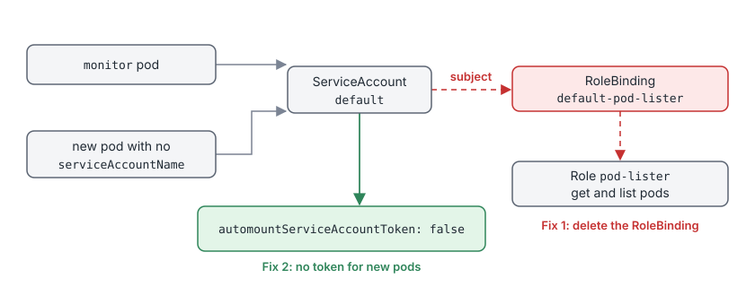
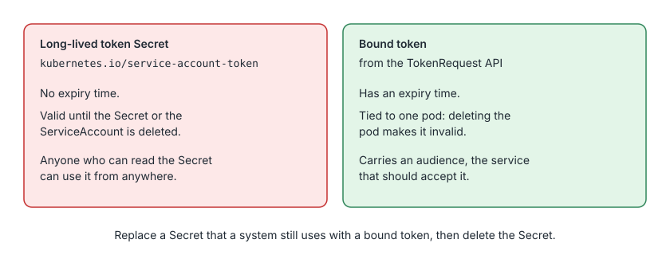

# The Default ServiceAccount And Unused Tokens

Two kinds of leftover identity cause most token problems. The first is the `default` ServiceAccount. It exists in every namespace, and every pod without a `serviceAccountName` uses it.

The second is the long-lived token Secret. An older cluster, a script or an operator created it for a ServiceAccount, and nobody deleted it. On this page, you take the permissions and the token away from the first, and you remove the second.

## The default ServiceAccount

Kubernetes creates a ServiceAccount called `default` in every namespace, and it creates it again if you delete it. You cannot remove it, so you must make it harmless. Two actions do that:

- Remove every RoleBinding and ClusterRoleBinding that names `default` as a subject. Those permissions reach every pod that does not name its own ServiceAccount.
- Set `automountServiceAccountToken: false` on `default`. Pods that use it then get no token, unless a pod asks for one.



The drawing shows both fixes on the playground objects. The RoleBinding gives `default` its permissions, and the mount setting decides whether new pods get a token.

Select the playground first:

<!-- astrona:playground:renew -->

```sh
export KUBECONFIG="$(astrona kubeconfig ats-033-playground-020-03)"
test "$(kubectl config current-context)" = "kind-astro-ats-033-playground-020-03" || exit 1
```

In the playground, someone bound a Role to `default` in `starfleet`. Show what the ServiceAccount can do, and which bindings name it:

```sh
kubectl auth can-i list pods --as=system:serviceaccount:starfleet:default -n starfleet
kubectl get rolebindings,clusterrolebindings --all-namespaces -o custom-columns=KIND:.kind,NAMESPACE:.metadata.namespace,NAME:.metadata.name,SUBJECTS:.subjects[*].name | grep -w default
```

The first answer is `yes`, and the second command lists the RoleBinding `default-pod-lister`. This means every pod in `starfleet` that names no ServiceAccount can now list pods, including a pod that an attacker creates.

Delete the binding. The Role it pointed to stays behind. Without a binding the Role is harmless, but you can delete it too:

```sh
kubectl -n starfleet delete rolebinding default-pod-lister
kubectl auth can-i list pods --as=system:serviceaccount:starfleet:default -n starfleet
```

The answer is now `no`. Next, turn off the token mount for the ServiceAccount. Save this as `serviceaccount-default.yaml`:

```yaml
apiVersion: v1
kind: ServiceAccount
metadata:
  name: default
  namespace: starfleet
automountServiceAccountToken: false
```

Apply it:

```sh
kubectl apply -f serviceaccount-default.yaml
```

New pods that use `default` now start without a token. A pod that needs a token must set `automountServiceAccountToken: true` itself, and that makes the need visible in a review. Running pods keep the token they have until they restart.

Repeat both actions in every namespace you own. The same goes for namespaces that you create later, so many teams add these steps to their namespace templates.

## Long-lived token Secrets

The `default` ServiceAccount is one leftover. Old token Secrets are the other. A Secret of type `kubernetes.io/service-account-token` holds a token that has no expiry time. Before version 1.24, the control plane filled such a Secret for every ServiceAccount.

Today, the control plane fills one only when someone creates the Secret by hand with the annotation `kubernetes.io/service-account.name`. But old clusters that were upgraded often still hold the old Secrets. The token stays valid until the Secret or the ServiceAccount is deleted. Anyone who can read the Secret, for example through the `get` verb on `secrets`, can use the token from anywhere.



The drawing compares the two kinds of token. The left one has none of the limits that the right one has.

List the token Secrets with a field selector on the Secret type:

```sh
kubectl get secrets --all-namespaces --field-selector type=kubernetes.io/service-account-token
```

The output contains `legacy-monitor-token` in `starfleet`. For each entry, decide whether any system still uses it:

- If a script or a CI (continuous integration) job needs a credential, replace the Secret with `kubectl create token` or with a projected token.
- If nothing uses it, delete it. The token stops working right away.

Delete the Secret in the playground, and then list the token Secrets again:

```sh
kubectl -n starfleet delete secret legacy-monitor-token
kubectl get secrets --all-namespaces --field-selector type=kubernetes.io/service-account-token
```

The second command no longer lists the Secret. Also check whether the ServiceAccount itself is still needed. You can delete a ServiceAccount that no pod uses and no binding names. Deleting it also makes every token that was issued for it invalid.

## A short review checklist

The steps above fix one namespace. To review any namespace, ask five questions:

- Does each workload use its own ServiceAccount?
- Does every pod that never calls the API run with `automountServiceAccountToken: false`?
- Does the `default` ServiceAccount have no bindings and no token mount?
- Do all remaining tokens expire?
- Are there ServiceAccounts that nobody uses?

Together, these questions turn a pile of identities into a list you can reason about.

You can now close the `default` ServiceAccount and remove tokens that never expire. Together with narrow RBAC (role-based access control) rules, each workload then holds one identity, a short-lived token and only the permissions it needs. What stays open is the work of keeping it that way, in every namespace, as new workloads arrive.

## Common pitfalls

> [!WARNING]
> - **Deleting the `default` ServiceAccount.** The controller creates it again with its defaults, so the change does nothing.
> - **Deleting a token Secret that a system still uses.** That system loses access right away. Find the user first.
> - **Fixing one namespace.** Every namespace has its own `default` ServiceAccount.
> - **Expecting running pods to lose their token.** Pods keep the token until they restart.
