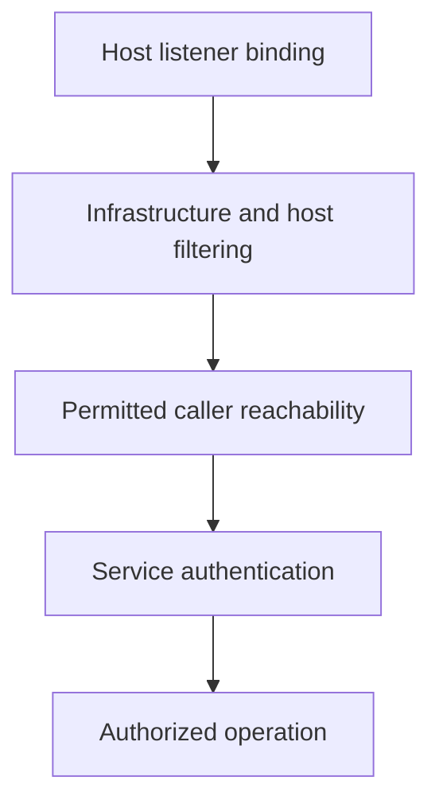

# Minimizing External Access To Host Services

A management service listens on all interfaces even though administrators use one protected network. Its exposure exceeds its operating requirement regardless of whether application Services are restricted.

## Learning objectives

- Map host listeners and required communication peers.
- Distinguish bind addresses, filtering and endpoint authorization.
- Evaluate ingress and egress rules without breaking dependencies.

## Before you start

This chapter is standalone reading material; no running cluster or installed tools are required. A Pod is the Kubernetes unit for running one or more containers, and a namespace groups namespaced objects. Treat the worked configurations as teaching examples rather than recorded observations from a provisioned environment.

## Responsible components and behavior

A node has network responsibilities beyond ordinary application traffic. It may communicate with API servers, peers, registries, storage systems and observability services. Minimizing external access means exposing only the paths required by those responsibilities, with the intended callers and security mechanisms. It does not mean blocking traffic indiscriminately until the node stops functioning.

## Inventory Listeners And Peers

Identify each host service, the addresses on which it listens, its protocol and its intended clients. A management endpoint bound to every interface can be reachable through public, private or overlay networks. A listener restricted to a particular address reduces exposure, but another proxy or forwarding rule may expose it indirectly. Review the complete path rather than only the process's bind address.

Create a communication model for control-plane, worker, administrative and external systems. Etcd should have a narrow set of authorized peers and clients. Kubelet access should follow supported control-plane and operational needs. Overlay networking may require node-to-node tunnel traffic. Storage and registry access can require egress to specific infrastructure. The exact addresses and ports depend on the deployment and selected components.

## Separate Reachability From Authority

A host firewall or cloud security group restricts who can reach an endpoint. TLS protects transport and can establish peer identity when configured appropriately. Endpoint authentication and authorization decide who may perform operations. These are complementary controls. A service reachable only from a private subnet can still be abused by a compromised system within that subnet if endpoint authorization is absent.

Conversely, strong endpoint authentication does not remove the value of reduced reachability. Restricting unnecessary callers lowers exposure to implementation defects and unwanted traffic. Match network rules to the documented caller relationships rather than rely on a vague assumption that all internal systems are trusted.

## Understand Stateful Filtering And Egress

Stateful filtering can allow return traffic for established connections while restricting new inbound connections. Rules must account for legitimate initiation direction and protocol behavior. A DNS request and its response are part of a necessary dependency, while an unsolicited management connection is a different relationship. Connection tracking and rule ordering can affect the result.

Egress matters because a compromised workload or host process may contact command-and-control infrastructure, metadata services or unauthorized repositories. Restricting outbound traffic requires an inventory of legitimate dependencies and a way to maintain changing destinations. DNS names, dynamic addresses, proxies and certificate validation introduce separate considerations. A broad outbound exception can defeat the intended boundary even when ingress is narrow.

## Evaluate A Change Scenario

Suppose control-plane-to-worker access is restricted after a security review. If the rule excludes the supported kubelet path, operations such as log retrieval may fail while existing application connections continue. That partial service does not prove the configuration is sound. Identify the required peer and operation, then narrow the rule to that relationship rather than restore unrestricted access.

Host firewall, cloud filtering and network-plugin rules can all participate in one connection. The first denying control may hide another misconfiguration. Review the chain in order and preserve the intended restriction while identifying the actual missing dependency.

## Preserve Complete Coverage

Durable rules must survive reboot and node replacement. IPv4 and IPv6 paths need consistent review, and host-networked containers can expose services outside ordinary Pod address assumptions. Overlay and encrypted traffic can present different visible outer endpoints to infrastructure filters. Record the intended boundary and verify the supported paths, including recovery access, instead of treating one successful connection or one blocked port as complete evidence.

## Work through the decision

Listener addresses determine which local interfaces accept connections. Host firewall and infrastructure rules then constrain reachable callers. Authentication decides which operations an accepted caller may perform. These controls act at different points and should be reviewed together.

An ordinary Pod NetworkPolicy is not a universal host-service firewall. Host-network workloads, node-local paths and implementation-specific enforcement can differ. Identify the real source and destination path before claiming a restriction applies. A configuration that blocks the current remote administration session can prevent recovery, so plan protected access and verification before changing host networking.

Reducing external exposure requires the actual host path and a preserved protected administration route.

Reducing external exposure requires the actual host path and a preserved protected administration route.

## Common pitfalls

> [!WARNING]
> A private listener is not an authenticated endpoint. Ingress, egress, return traffic, alternate address families and persistent configuration must all fit the required communication model.
