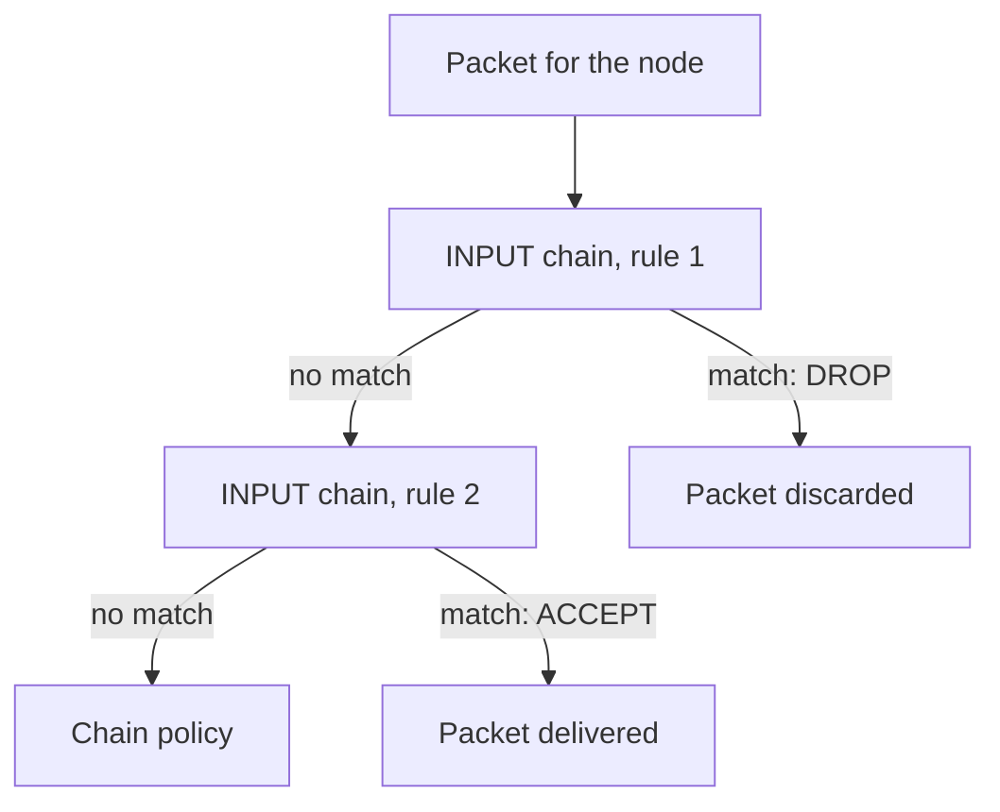

# Host Firewalls With iptables And ufw

Some services must listen on the node address, because other nodes or administrators use them. The kubelet on port 10250 is one example. For these services, a bind address cannot help, and the node needs a filter that accepts traffic from the callers it expects and drops the rest. Linux does this in the kernel with the **netfilter** framework. This part shows how the filter rules work, adds one rule to the playground node, and shows the timeout that a dropped packet produces.

## How netfilter and its tools relate

netfilter is the packet filter inside the Linux kernel. Tools write rules into it. `iptables` is the classic tool, and `nft` is the newer tool for the `nftables` rule format. A distribution may implement the `iptables` command on top of `nftables`. `ufw` (Uncomplicated Firewall) is a simpler front end on Debian-family systems that writes rules for you. All of them change the same kernel filter, so rules from different tools can interact.

A rule lives in a **chain**, which belongs to a **table**. The `filter` table has three chains. `INPUT` holds the rules for packets that are addressed to the node itself. `OUTPUT` holds the rules for packets that the node sends. `FORWARD` holds the rules for packets that pass through the node to another destination, such as pod traffic that the node routes. Each chain has a default **policy**, `ACCEPT` or `DROP`, that applies when no rule matches. Rules are checked from top to bottom, and the first matching rule decides.



The diagram shows that rule order matters and that the chain policy only applies when no rule matches.

## Read the current rules

Select the environment. Kubernetes components, mainly kube-proxy, already add many rules to a node, so first read what is there without changing anything:

<!-- astrona:playground:renew -->

```sh
export KUBECONFIG="$(astrona kubeconfig ats-033-playground-030-01)"
test "$(kubectl config current-context)" = "kind-astro-ats-033-playground-030-01" || exit 1
node_name="astro-ats-033-playground-030-01-control-plane"
run_on_node() { podman exec "$node_name" "$@"; }
run_on_node iptables --list INPUT --numeric --line-numbers
```

`--list INPUT` prints one chain, `--numeric` prints addresses and ports as numbers, and `--line-numbers` prefixes each rule with its position. The first line shows the chain name and its policy, for example `Chain INPUT (policy ACCEPT)`. The Kubernetes rules appear as jumps to chains whose names begin with `KUBE-`.

## Drop traffic to one port

The commands below need a listener on port 19091 of the control-plane node. The next pod runs Python's built-in web server there, in the network namespace of the node, and it listens on all interfaces.

Save this as `pod-exposed-server.yaml`:

```yaml
apiVersion: v1
kind: Pod
metadata:
  name: exposed-server
  namespace: starfleet
spec:
  restartPolicy: Never
  hostNetwork: true
  dnsPolicy: ClusterFirstWithHostNet
  nodeSelector:
    kubernetes.io/hostname: astro-ats-033-playground-030-01-control-plane
  tolerations:
  - key: node-role.kubernetes.io/control-plane
    operator: Exists
    effect: NoSchedule
  containers:
  - name: web
    image: docker.io/library/python:3.13-alpine
    command:
    - python
    - -m
    - http.server
    - '19091'
```

Apply it:

```sh
kubectl apply -f pod-exposed-server.yaml
```

Then check the result. Wait for the pod, read the node address, and confirm that a request from the `shuttle` pod works before any rule exists:

```sh
kubectl -n starfleet wait --for=condition=Ready pod/exposed-server --timeout=180s
NODE_IP="$(kubectl get node "$node_name" -o jsonpath='{.status.addresses[?(@.type=="InternalIP")].address}')"
kubectl -n starfleet exec shuttle -- wget -qO- -T 3 "http://$NODE_IP:19091/"
```

The request prints an HTML directory listing. Now insert a rule at the top of the `INPUT` chain that drops TCP packets to destination port 19091:

```sh
run_on_node iptables --insert INPUT 1 --protocol tcp --dport 19091 --jump DROP
run_on_node iptables --list INPUT --numeric --line-numbers
kubectl -n starfleet exec shuttle -- wget -qO- -T 3 "http://$NODE_IP:19091/"
```

The list now shows the new rule at position 1 with the target `DROP` and `dpt:19091`. The `wget` command waits for the three seconds you set with `-T 3` and then fails with a timeout, not with `Connection refused`. The listener still exists and the process is still running. The kernel discards the packets before they reach it, so the client gets no answer. Remove the rule by position, and the request works again:

```sh
run_on_node iptables --delete INPUT 1
kubectl -n starfleet exec shuttle -- wget -qO- -T 3 "http://$NODE_IP:19091/"
```

Deleting by position is easy to get wrong when other rules are added in between. A safer form repeats the rule with `--delete` instead of a number: `iptables --delete INPUT --protocol tcp --dport 19091 --jump DROP`.

## Allow a few callers and drop the rest

A real filter keeps access for known callers. The usual pattern puts `ACCEPT` rules for the allowed source addresses first and a `DROP` for the rest of the port after them. For example, two rules that allow the administration network `10.0.5.0/24` to reach port 22 and drop everyone else look like this:

```text
iptables --append INPUT --protocol tcp --dport 22 --source 10.0.5.0/24 --jump ACCEPT
iptables --append INPUT --protocol tcp --dport 22 --jump DROP
```

The order is what makes this work. If the `DROP` came first, the `ACCEPT` would never be checked. The same rules in `ufw` are `ufw allow from 10.0.5.0/24 to any port 22 proto tcp` and `ufw deny 22/tcp`, and `ufw default deny incoming` sets a default-deny policy. A default-deny policy is the safer baseline, because a new service stays closed until someone opens it. Before you set a default `DROP` on a remote node, add the rule that keeps your own SSH access, or the change cuts your own connection.

## Rules are not permanent by default

Rules that `iptables` adds live in the kernel and are lost at reboot. To keep them, a node needs a service that loads them at boot: `iptables-persistent` or `netfilter-persistent` on Debian family systems, the `nftables` service with `/etc/nftables.conf`, or `ufw`, which stores its rules and enables itself. Kubernetes rewrites its own chains (the ones that begin with `KUBE-`) as Services change, so do not edit those chains by hand. Put your own rules in your own chain or at the top of `INPUT`.

You have now seen a filter act independently of the service and read the symptom it creates, a timeout. A host firewall protects the node. Pod-to-pod traffic inside the cluster needs its own control, because pods talk to each other without ever reaching a node's `INPUT` chain.

## Common pitfalls

> [!WARNING]
> - **Putting a `DROP` before an `ACCEPT`.** The first match decides, so the allow rule never runs. Order the rules.
> - **Setting a default `DROP` policy over SSH without an allow rule.** You cut your own session. Add the allow rule first.
> - **Editing `KUBE-` chains.** Kubernetes regenerates them. Place your rules separately.
> - **Assuming rules survive a reboot.** They do not, unless a persistence service restores them.
> - **Mixing `ufw` and manual `iptables` rules.** Both write to the same kernel filter and can contradict each other. Pick one tool for a node.
