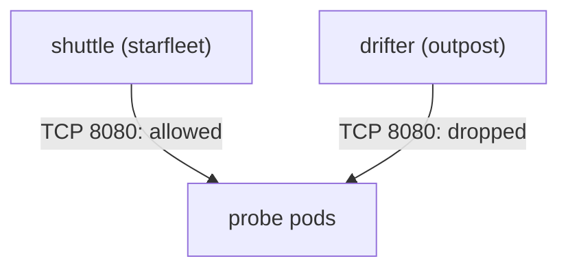

# NetworkPolicy For Pod Traffic

By default, every pod in a Kubernetes cluster can send traffic to every other pod, in any namespace. One compromised pod can then scan and attack the whole pod network. The host firewall of a node does not help here, because most pod-to-pod traffic never arrives at the `INPUT` chain of a node. Kubernetes controls this traffic with a NetworkPolicy. This part writes a policy that denies all ingress in a namespace, adds one allow rule, and tests both from two client pods.

## What a NetworkPolicy is and who enforces it

A **NetworkPolicy** is a namespaced Kubernetes object that selects pods and lists the traffic that those pods may receive (ingress) or send (egress). The API server only stores the object. The **CNI plugin** (Container Network Interface plugin, the component that sets up pod networking) enforces it on the nodes. If the plugin does not support NetworkPolicy, the objects exist and have no effect. This is the first thing to check when a policy seems to do nothing.

Four rules of the model matter for the exam:

- A pod that no NetworkPolicy selects accepts all traffic. Once any policy with `Ingress` in `policyTypes` selects a pod, that pod accepts only the ingress that some policy allows.
- Policies only add allowed traffic. There is no deny rule, and several policies on the same pod combine as a union.
- A rule's `from` can use `podSelector`, `namespaceSelector` and `ipBlock`. A `podSelector` alone matches pods in the policy's own namespace.
- The `ports` field names the port on the destination pod (the container port), not the port of a Service in front of it.

An empty `podSelector: {}` selects every pod in the namespace. A policy with that selector and no ingress rules is the standard **default deny**.

## The traffic before any policy

Select the environment. The `probe` pods listen on container port 8080, and the `probe` Service maps port 80 to it. Send a request from each client pod. `shuttle` is in `starfleet` and `drifter` is in `outpost`:

<!-- astrona:playground:renew -->

```sh
export KUBECONFIG="$(astrona kubeconfig ats-033-playground-030-01)"
test "$(kubectl config current-context)" = "kind-astro-ats-033-playground-030-01" || exit 1
kubectl -n starfleet exec shuttle -- wget -qO- -T 3 http://probe.starfleet.svc.cluster.local
kubectl -n outpost exec drifter -- wget -qO- -T 3 http://probe.starfleet.svc.cluster.local
```

Both requests print a line that starts with `version=v1`. Without a policy, the client in another namespace reaches the `probe` pods as easily as the client in the same namespace.

## Deny all ingress

Save this as `networkpolicy-default-deny-ingress.yaml`:

```yaml
apiVersion: networking.k8s.io/v1
kind: NetworkPolicy
metadata:
  name: default-deny-ingress
  namespace: starfleet
spec:
  podSelector: {}
  policyTypes:
  - Ingress
```

Apply it:

```sh
kubectl apply -f networkpolicy-default-deny-ingress.yaml
```

Then check the result. Run the two requests again. Each one is expected to fail, so run them on their own:

```sh
kubectl -n starfleet exec shuttle -- wget -qO- -T 3 http://probe.starfleet.svc.cluster.local
kubectl -n outpost exec drifter -- wget -qO- -T 3 http://probe.starfleet.svc.cluster.local
```

If the CNI plugin of the cluster enforces NetworkPolicy, both requests time out after three seconds, because the packets are dropped. A timeout and not a refusal is the typical sign of a policy. If both requests still print `version=v1`, the plugin of this cluster does not enforce the policy and nothing in the rest of this part will change the result.

## Allow one client to one port

The next policy selects the `probe` pods and allows ingress from pods labelled `app: shuttle` in the same namespace, on TCP port 8080. The label `app: shuttle` is set on the `shuttle` pod, and `app: probe` on the `probe` pods.

Save this as `networkpolicy-allow-shuttle-to-probe.yaml`:

```yaml
apiVersion: networking.k8s.io/v1
kind: NetworkPolicy
metadata:
  name: allow-shuttle-to-probe
  namespace: starfleet
spec:
  podSelector:
    matchLabels:
      app: probe
  policyTypes:
  - Ingress
  ingress:
  - from:
    - podSelector:
        matchLabels:
          app: shuttle
    ports:
    - protocol: TCP
      port: 8080
```

Apply it:

```sh
kubectl apply -f networkpolicy-allow-shuttle-to-probe.yaml
```

Then check the result. The request from `shuttle` should work again, and the request from `drifter` should still fail:

```sh
kubectl -n starfleet exec shuttle -- wget -qO- -T 3 http://probe.starfleet.svc.cluster.local
kubectl -n outpost exec drifter -- wget -qO- -T 3 http://probe.starfleet.svc.cluster.local
kubectl -n starfleet get networkpolicy
```

The first command prints `version=v1` again, because the traffic from `shuttle` to port 8080 of the `probe` pods is now the union of the deny-all policy (nothing) and the allow policy (this one client). The second still times out. The policy list shows both objects. The two policies together are the common pattern: deny everything, then allow each needed path by name.



The diagram shows the result: the policy admits one client and drops traffic from every other pod, including pods in other namespaces.

## Cross-namespace sources and egress

To allow a client from another namespace, a `from` entry needs a `namespaceSelector`. The automatic label `kubernetes.io/metadata.name` holds the namespace name, so `namespaceSelector: {matchLabels: {kubernetes.io/metadata.name: outpost}}` selects `outpost`. A subtle point is the difference between one `from` item with both selectors and two items. A single item with `namespaceSelector` and `podSelector` together means pods with that label in those namespaces (logical AND). Two separate items mean either source (logical OR).

Egress works the same way with `policyTypes: [Egress]` and `to`. A default-deny egress policy also blocks DNS, so a policy that denies egress usually allows UDP and TCP port 53 to the cluster DNS pods. Lastly, pods that use `hostNetwork: true` share the node's network, and most CNI plugins do not apply pod policies to them reliably. A host firewall or a bind address must protect that traffic.

You can now isolate pods from each other and test the result from two positions. What remains is the traffic that does not start inside the pod network: Services that publish a port on every node, and the ports of the control plane itself.

## Common pitfalls

> [!WARNING]
> - **Writing the Service port in `ports`.** A policy matches the container port of the destination pod. Port 80 on the Service does not match a pod that listens on 8080.
> - **Expecting a policy to work on any cluster.** The CNI plugin enforces it. If the plugin does not, the object has no effect.
> - **Using AND where you meant OR.** One `from` item with two selectors is AND. Two items are OR.
> - **Denying egress without allowing DNS.** Name lookups fail and every Service name stops working.
> - **Forgetting namespaces.** A `podSelector` alone matches the policy's own namespace only.
