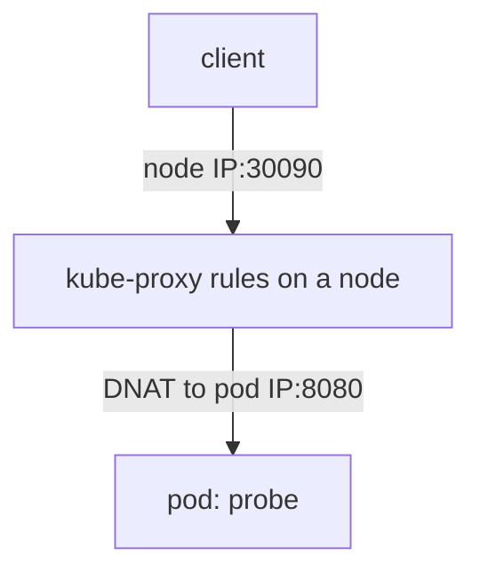

# Service Types And What They Open

A pod IP address changes every time a pod is replaced, so clients use a Service instead. The Service type then decides who can reach it. Most exposure in a cluster does not come from an attack on Kubernetes. It comes from a Service type that was set wider than the job needed. This part shows what each type opens, which component opens it, and how to find the Services that publish access.

## Three types, three reaches

A **Service** is a Kubernetes object that gives a set of pods one stable virtual address and port, and forwards traffic to the pods that its `selector` matches. The `type` field has three values that matter for exposure.

- `ClusterIP` is the default. The Service gets a virtual address that works inside the cluster only. A client outside the cluster has no route to it.
- `NodePort` is a `ClusterIP` Service that also opens one port on every node. The port comes from the range 30000 to 32767 unless the administrator changes the range of the API server. A client that can reach any node address on that port reaches the pods.
- `LoadBalancer` is a `NodePort` Service that also asks an external load balancer to forward traffic to the node ports. The load balancer is created by the cloud provider integration, a controller in the cluster that calls the cloud API. The external address appears in the field `status.loadBalancer.ingress`.

The types build on each other. A `LoadBalancer` Service also has a cluster address and a node port, so it can be reached the three ways. A fourth type, `ExternalName`, only returns a DNS name and opens nothing.

## Which component opens the port

The API server stores the Service, and it allocates the node port. The component that makes the port work is `kube-proxy`, which runs on every node. It watches Services and programs packet rules on the node (iptables or IPVS, depending on the mode). When a packet arrives at a node address and a node port, those rules rewrite its destination to the address of one of the pods.



The diagram shows that the node itself does the forwarding. This has a consequence that surprises many administrators: the port is open on every node, including nodes that run none of the Service pods. The node forwards the packet across the cluster network to a pod on another node.

## Find the Services that publish access

Start with an inventory. Select the environment and list the type and the node ports of every Service in the cluster. The option `-o custom-columns` prints the fields that you name.

<!-- astrona:playground:renew -->

```sh
export KUBECONFIG="$(astrona kubeconfig ats-033-playground-030-02)"
test "$(kubectl config current-context)" = "kind-astro-ats-033-playground-030-02" || exit 1
node_name="astro-ats-033-playground-030-02-control-plane"
worker_name="astro-ats-033-playground-030-02-worker"
kubectl get services -A -o custom-columns=NAMESPACE:.metadata.namespace,NAME:.metadata.name,TYPE:.spec.type,NODEPORT:.spec.ports[*].nodePort
```

Every row with a type other than `ClusterIP` needs an owner and a reason. In the playground, `probe-admin` is of type `NodePort` on port 30090, and `probe-edge` is of type `LoadBalancer`, which also has an allocated node port. The `kubernetes` and `kube-dns` Services in `kube-system` and `default` are `ClusterIP`.

## Prove that the port is open on every node

Read the addresses of both nodes, then send requests from the `drifter` pod in the `outpost` namespace. The pod is not on the control-plane node, and it sends its request from the pod network, as an ordinary client does.

```sh
CONTROL_IP="$(kubectl get node "$node_name" -o jsonpath='{.status.addresses[?(@.type=="InternalIP")].address}')"
WORKER_IP="$(kubectl get node "$worker_name" -o jsonpath='{.status.addresses[?(@.type=="InternalIP")].address}')"
kubectl -n outpost exec drifter -- wget -qO- -T 3 "http://$WORKER_IP:30090/"
kubectl -n outpost exec drifter -- wget -qO- -T 3 "http://$CONTROL_IP:30090/"
```

Both requests print a line that starts with `version=v1`. The `probe` pods run on the worker node, because the control-plane node has a taint that keeps ordinary pods away. The second request still works. The control-plane node has no `probe` pod, and its `kube-proxy` forwards the request to one on the worker node.

## Remove the exposure

If nobody needs the node port, the fix is to change the type back to `ClusterIP`. Save this as `service-probe-admin.yaml`:

```yaml
apiVersion: v1
kind: Service
metadata:
  name: probe-admin
  namespace: starfleet
spec:
  type: ClusterIP
  selector:
    app: probe
    release: probe
  ports:
  - name: http
    port: 80
    targetPort: http
```

The manifest has no `nodePort` field. Apply it:

```sh
kubectl apply -f service-probe-admin.yaml
```

Then check the result. The type changes, the node port is released, and the request that worked a moment ago fails. Run the request on its own, because it is expected to fail:

```sh
kubectl -n starfleet get service probe-admin
kubectl -n outpost exec drifter -- wget -qO- -T 3 "http://$WORKER_IP:30090/"
```

The `wget` command prints an error and exits with a nonzero status. Pods inside the cluster still reach the application through the name `probe-admin.starfleet`, because the `ClusterIP` address remains.

You now know what each type opens and how to take a node port away. The open question is the Services that must stay published: how to limit who reaches them and how the node treats a request.

## Common pitfalls

> [!WARNING]
> - **Thinking a NodePort listens only where the pods run.** `kube-proxy` opens the port on every node.
> - **Reading the cluster address as proof of safety.** A `LoadBalancer` Service also has a `ClusterIP` and a node port. Check the whole `spec`.
> - **Testing from the node itself.** A request from the node to its own address can pass when a request from another machine fails. Test from the position of the real client.
> - **Forgetting that a Service outlives its test.** A Service created for debugging stays until someone deletes it. List Services that are not `ClusterIP` on a schedule.
