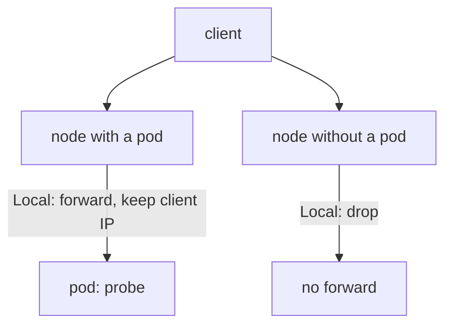

# Narrowing NodePorts And Load Balancers

Some Services must stay published. A public web application needs a way in. The goal then changes from removing the exposure to narrowing it: fewer clients, fewer paths, and no surprises about which source address the application sees. Two Service fields do this work, `externalTrafficPolicy` and `loadBalancerSourceRanges`. This part explains what each field changes, which component acts on it, and what happens when it is set wrongly.

## What externalTrafficPolicy decides

The field `externalTrafficPolicy` tells `kube-proxy` what to do with traffic that arrives at a node port or at a load balancer address. It has two values.

With `Cluster` (the default), a node accepts the packet and may forward it to a pod on any node. To make the reply return the same way, the node replaces the source address of the packet with its own address (source network address translation, SNAT). The application sees the node as the client, and the real client address is lost. Network rules in the application or in a NetworkPolicy cannot use it.

With `Local`, a node forwards the packet only to pods on the same node, and it keeps the original client address. A node with no ready pod of the Service drops the packet. The cluster also allocates a second port, `healthCheckNodePort`, on `LoadBalancer` Services. A load balancer calls it to learn which nodes have pods, and sends traffic only to those nodes.



The diagram shows the two nodes under the `Local` policy. This setting narrows the exposure in two ways. A request can only be answered by a node that runs a pod, and the application sees the true client address, which makes logging and address-based controls correct.

## What loadBalancerSourceRanges decides

The field `loadBalancerSourceRanges` is a list of client address ranges in CIDR notation (for example `203.0.113.0/24`). It applies to Services of type `LoadBalancer`. The cloud provider integration reads the list and configures the external load balancer or its firewall to accept only those ranges. On some setups `kube-proxy` also adds matching rules on the nodes. A request from an address outside the list is dropped. If the field is empty, the load balancer accepts clients from any address, which is the most common reason a "private" application is reachable from the internet.

Which component enforces the list depends on the platform, so the field is only a request until the platform acts on it. Read the documentation of your cloud provider before you rely on it.

## Create the Service and see the effect on one node

The playground already has the `probe-edge` Service of type `LoadBalancer`. Select the environment and read its fields:

<!-- astrona:playground:renew -->

```sh
export KUBECONFIG="$(astrona kubeconfig ats-033-playground-030-02)"
test "$(kubectl config current-context)" = "kind-astro-ats-033-playground-030-02" || exit 1
node_name="astro-ats-033-playground-030-02-control-plane"
worker_name="astro-ats-033-playground-030-02-worker"
kubectl -n starfleet get service probe-edge -o jsonpath='{.spec.externalTrafficPolicy}{"\n"}{.spec.loadBalancerSourceRanges}{"\n"}{.spec.ports[0].nodePort}{"\n"}{.status.loadBalancer}{"\n"}'
```

The first line is `Cluster`, because the field was not set and the API server filled in the default. The second line is empty, so any client range would be accepted. The third line is the node port that the API server allocated for the load balancer to use. The last line is empty: `kind` runs no cloud provider integration, so the `EXTERNAL-IP` stays `<pending>`.

Save this as `service-probe-edge.yaml`:

```yaml
apiVersion: v1
kind: Service
metadata:
  name: probe-edge
  namespace: starfleet
spec:
  type: LoadBalancer
  externalTrafficPolicy: Local
  loadBalancerSourceRanges:
  - 203.0.113.0/24
  selector:
    app: probe
    release: probe
  ports:
  - name: http
    port: 80
    targetPort: http
```

The range `203.0.113.0/24` is a documentation range, used here as an example of a client network. Apply it:

```sh
kubectl apply -f service-probe-edge.yaml
```

Then check the result. Read the node port, then request it on each node. Run the requests on their own, because one of them is expected to fail:

```sh
EDGE_PORT="$(kubectl -n starfleet get service probe-edge -o jsonpath='{.spec.ports[0].nodePort}')"
CONTROL_IP="$(kubectl get node "$node_name" -o jsonpath='{.status.addresses[?(@.type=="InternalIP")].address}')"
WORKER_IP="$(kubectl get node "$worker_name" -o jsonpath='{.status.addresses[?(@.type=="InternalIP")].address}')"
kubectl -n outpost exec drifter -- wget -qO- -T 3 "http://$WORKER_IP:$EDGE_PORT/"
kubectl -n outpost exec drifter -- wget -qO- -T 3 "http://$CONTROL_IP:$EDGE_PORT/"
```

The `probe` pods run on the worker node, so the request to the worker address prints a line that starts with `version=v1`. The control-plane node has no ready `probe` pod, so under `Local` its `kube-proxy` does not forward the request, and the second request times out. Before the change, both requests worked.

## Why the policy matters for security

Narrowing has limits. `loadBalancerSourceRanges` does nothing for a Service of type `NodePort`, because there is no load balancer. For a node port, the filter must be a firewall or a cloud security group on the nodes. The `Local` policy removes a forwarding hop but opens no new protection by itself. A node that has a pod still accepts any client that reaches it.

A second risk is a wrong change. After you set `Local`, a rolling update that leaves a node without a ready pod makes that node drop traffic, and a load balancer without the health check port sends traffic to it anyway. Plan the pod spread with the policy.

You now know the two fields that narrow a published Service and which component acts on each. The next question is how to publish many applications without opening a port for each of them.

## Common pitfalls

> [!WARNING]
> - **Setting `loadBalancerSourceRanges` on a `NodePort` Service.** Only a load balancer reads it. Filter node ports with a firewall.
> - **Assuming the load balancer enforces it everywhere.** The platform integration enforces the field. In `kind` nothing does.
> - **Using `Local` without pods on the receiving nodes.** A node without a ready pod drops the traffic.
> - **Reading the client address as proof of identity.** With `Cluster`, the application sees the node address. With `Local`, it sees the client address, which a client in the same network can still choose.
