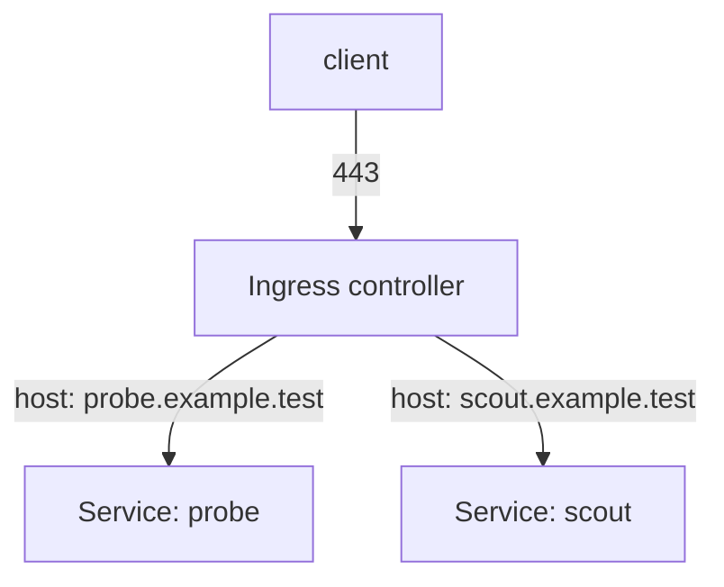

# Ingress As The Single Entry Point

A cluster that publishes ten applications with ten `NodePort` Services opens ten ports on every node. Each port needs its own firewall rule and its own review, and each application handles its own TLS (Transport Layer Security, the protocol that encrypts HTTP traffic). An Ingress reduces this to one entry point. This part explains what an Ingress is, which component enforces it, and how to audit a cluster for Services and Ingress objects that nobody planned.

## What an Ingress does

An **Ingress** is a Kubernetes object that lists HTTP and HTTPS routing rules: for a host name and a path, send the request to a Service and port. The object alone does nothing. An **Ingress controller** is a program that runs in the cluster, reads Ingress objects and applies them. It receives the traffic, ends TLS, and forwards each request to the right Service by its `ClusterIP`. The controller itself is the only workload that is published, through one `NodePort` or `LoadBalancer` Service.



The diagram shows one published port and many applications behind it. The applications keep type `ClusterIP`. Access control, TLS certificates and logging now sit in one place, and the firewall needs one rule.

This is a gain only if the other Services stay closed. An Ingress does not remove an old `NodePort` Service. That Service still opens its port on every node, and it bypasses every rule of the Ingress.

## Create an Ingress and see what it needs

The playground has no Ingress controller. Select the environment and save this as `ingress-probe.yaml`:

<!-- astrona:playground:renew -->

```sh
export KUBECONFIG="$(astrona kubeconfig ats-033-playground-030-02)"
test "$(kubectl config current-context)" = "kind-astro-ats-033-playground-030-02" || exit 1
```

```yaml
apiVersion: networking.k8s.io/v1
kind: Ingress
metadata:
  name: probe
  namespace: starfleet
spec:
  ingressClassName: nginx
  rules:
  - host: probe.example.test
    http:
      paths:
      - path: /
        pathType: Prefix
        backend:
          service:
            name: probe
            port:
              number: 80
```

The `ingressClassName` field names the controller that should handle the object. The backend is the `probe` Service of type `ClusterIP`. Apply it:

```sh
kubectl apply -f ingress-probe.yaml
```

Then check the result:

```sh
kubectl -n starfleet get ingress probe
kubectl get ingressclass
```

The API server accepts the Ingress. The `ADDRESS` column stays empty, and the list of ingress classes is empty, because no controller is installed. The object is a request that nothing has accepted, so it opens no port. This is the same lesson as the NetworkPolicy: the API server stores the object, and a controller acts on it.

## Audit the cluster for accidental exposure

A review of external access has four questions. Which Services publish a node port or a load balancer? Which Services carry a field `externalIPs`? Which Ingress objects exist, and who owns the controller? Which pods use `hostNetwork` or `hostPort`? The first three come from one command each. List the Services with the fields that matter:

```sh
kubectl get services -A -o custom-columns=NAMESPACE:.metadata.namespace,NAME:.metadata.name,TYPE:.spec.type,EXTERNAL-IPS:.spec.externalIPs,NODEPORT:.spec.ports[*].nodePort
kubectl get ingress -A
kubectl get pods -A -o custom-columns=NAMESPACE:.metadata.namespace,NAME:.metadata.name,HOSTNETWORK:.spec.hostNetwork
```

The field `externalIPs` is a list of addresses on which any node accepts traffic for the Service. It is an old feature, and a user who can create Services can use it to attract traffic for addresses the user does not own. A value in that column needs an explanation. The third command shows pods that share the network of their node. Their listeners are on the node, not behind a Service, so the review of ports on the node covers them.

Finally, remove the Ingress, since it was only an exercise:

```sh
kubectl -n starfleet delete ingress probe
```

You have followed Service exposure from the type of one Service to the audit of a whole cluster.

## Common pitfalls

> [!WARNING]
> - **Leaving the old `NodePort` Services after adding an Ingress.** They still open ports on every node and bypass the Ingress rules.
> - **Assuming an Ingress object means exposure.** Without a controller it does nothing. With a controller, it publishes the host and path at once.
> - **Forgetting the controller's own Service.** The Ingress controller needs one published Service. Restrict it with a firewall and `loadBalancerSourceRanges` where possible.
> - **Auditing Services only.** `externalIPs`, Ingress objects and host-network pods also open access.
