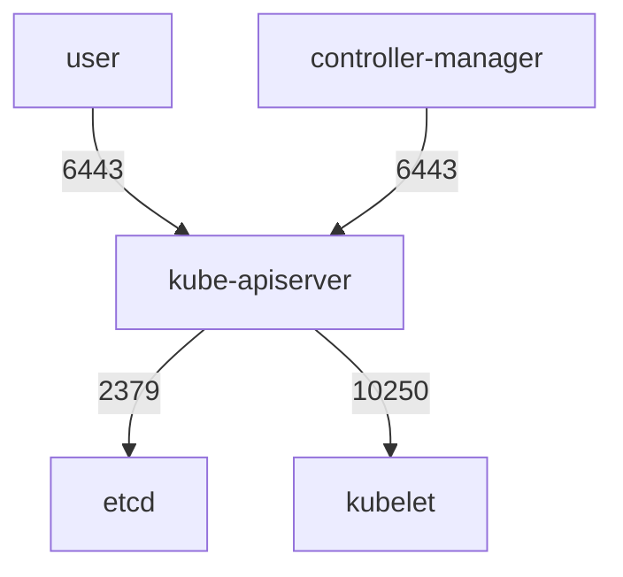

# Control-Plane Ports And Listeners

A firewall rule is only as good as the list of ports behind it, and the list comes from what the components actually listen on. This part names the ports of a Kubernetes control-plane node, says who should connect to each, and then reads the real listeners of a node with `ss`. The goal is to turn "the API server port is open" into a precise statement about address, port and caller.

## The ports and their callers

A kubeadm cluster, which is the layout that `kind` uses, runs the control-plane components as **static pods**. A static pod is a pod that the kubelet starts from a manifest file in `/etc/kubernetes/manifests`, without the API server. Each component opens its own ports.

| Port | Component | Callers that need it |
| --- | --- | --- |
| 6443 | kube-apiserver | Users, nodes, controllers, from known networks |
| 10250 | kubelet API (on every node) | The API server and monitoring |
| 2379 | etcd client port | The API servers only |
| 2380 | etcd peer port | The other etcd members only |
| 10257 | kube-controller-manager | Health checks and metrics, from the node |
| 10259 | kube-scheduler | Health checks and metrics, from the node |

The default bind address differs by component. The API server listens on all addresses (`--bind-address` defaults to `0.0.0.0`), since users and nodes connect from other machines. The kubelet also listens on all addresses. In a kubeadm cluster, the controller manager and the scheduler are started with `--bind-address=127.0.0.1`, so their ports accept only connections from the node itself. etcd listens on the loopback address and on the node address for clients (port 2379), and on the node address for peers (port 2380).

## Who does the work

Two layers limit a port. The bind address, set in the component's flags, decides on which interface the component listens. The network filter, a host firewall or a cloud security group, decides which source addresses may reach a listener that is open. A well-run cluster uses both, because a changed flag or a deleted firewall rule alone would reopen the port.



The diagram shows the expected paths. Only the API server connects to etcd and, for logs and exec, to the kubelet. Any other path to those ports is a finding.

## Read the listeners of the control-plane node

Select the environment and define a helper that runs a command inside the control-plane node container:

<!-- astrona:playground:renew -->

```sh
export KUBECONFIG="$(astrona kubeconfig ats-033-playground-030-03)"
test "$(kubectl config current-context)" = "kind-astro-ats-033-playground-030-03" || exit 1
node_name="astro-ats-033-playground-030-03-control-plane"
worker_name="astro-ats-033-playground-030-03-worker"
run_on_node() { podman exec "$node_name" "$@"; }
run_on_node ss -tlnp
```

The command `ss -tlnp` lists TCP listeners (`-t`), only in the listening state (`-l`), with numbers instead of names (`-n`) and the process of each socket (`-p`). The column `Local Address:Port` shows the bind address. A line with `127.0.0.1:10257` accepts connections from the node only. A line with `0.0.0.0:6443` or `*:6443` accepts connections on every interface. Look for the six ports of the table and note the address of each. To show only those lines, filter the output:

```sh
run_on_node ss -tlnp | grep -E ':(6443|10250|2379|2380|10257|10259) '
```

The API server and the kubelet use wildcard addresses. The controller manager and the scheduler use loopback addresses. If the scheduler showed a wildcard address instead, it would be a finding, since its port gives metrics to any caller that reaches it.

## Confirm the setting in the manifest

The listener shows the result, and the manifest shows the cause. Read the bind address flags of the two components that should stay local:

```sh
run_on_node grep -H 'bind-address' /etc/kubernetes/manifests/kube-controller-manager.yaml /etc/kubernetes/manifests/kube-scheduler.yaml
```

Each file has a line `--bind-address=127.0.0.1`. When you find a wide listener, correct the flag in the manifest. The kubelet watches the directory and restarts the static pod by itself.

## When a port is wider than its job

If a port must accept remote connections, such as 6443, the bind address is not the control and the network filter takes over. A host firewall rule that accepts port 6443 from the networks of administrators and nodes and drops the rest is the standard answer. In a cloud, the equivalent is a security group. Ports 2379 and 2380 get a rule that allows only the control-plane nodes. Port 10250 allows the control-plane nodes and the monitoring system.

You have mapped each port to a component, a caller and a bind address. The next question is what the API server does with a caller that does reach port 6443.

## Common pitfalls

> [!WARNING]
> - **Reading only the firewall.** A listener on `0.0.0.0` stays open to everything the firewall allows later. Check the bind address as well.
> - **Treating loopback as protection against local pods.** A pod with `hostNetwork: true` shares the node's loopback.
> - **Editing a static pod manifest in place without a copy.** A typo makes the component fail to start. Keep a copy outside the manifests directory first.
> - **Checking IPv4 only.** A component can also listen on `::`. Read every line of the `ss` output.
