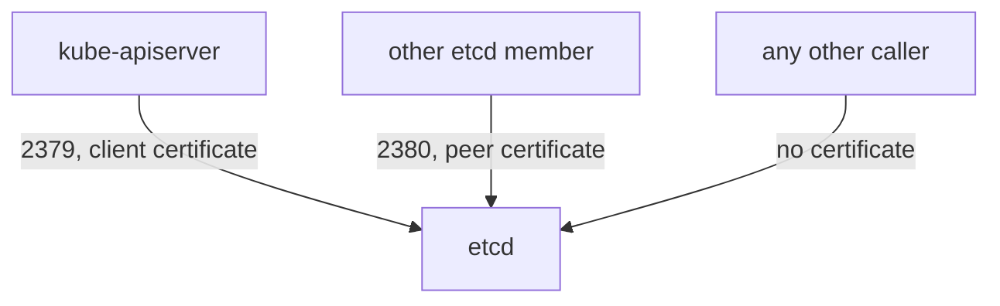

# etcd Client Access

etcd is the key-value database where the API server stores every object of the cluster, including every Secret. Anyone who can read etcd can read the Secrets of all namespaces. Anyone who can write to it can change the cluster without passing the API server, so no RBAC rule, admission check or audit log applies. This part explains the settings that protect etcd, reviews them on the control-plane node, and shows what a connection without a certificate gets.

## Who should talk to etcd

Only the API servers need the client port 2379. Only the other etcd members need the peer port 2380. No user, node or pod needs either. Two controls enforce this. The first is the network: a host firewall or security group that allows 2379 and 2380 from the control-plane nodes only. The second is TLS with client certificates. The setting `--client-cert-auth=true` makes etcd refuse a client that does not present a certificate signed by the authority in `--trusted-ca-file`. The setting `--peer-client-cert-auth=true` does the same for peers.

On the API server side, three flags point to the credentials: `--etcd-cafile`, `--etcd-certfile` and `--etcd-keyfile`. The API server is the one client that holds a certificate for etcd.



The diagram shows two allowed paths. A caller on the third path reaches the port and is rejected in the TLS handshake. This is a second control, and the network rule should still stop that caller before the handshake.

## Review the settings

Select the environment and read the flags of the etcd static pod:

<!-- astrona:playground:renew -->

```sh
export KUBECONFIG="$(astrona kubeconfig ats-033-playground-030-03)"
test "$(kubectl config current-context)" = "kind-astro-ats-033-playground-030-03" || exit 1
node_name="astro-ats-033-playground-030-03-control-plane"
podman exec "$node_name" grep -E 'listen-client-urls|listen-peer-urls|client-cert-auth|trusted-ca-file|data-dir' /etc/kubernetes/manifests/etcd.yaml
```

Four things matter in the result. `--listen-client-urls` lists the loopback address and the node address, so clients on other machines can connect when the network allows it. `--client-cert-auth=true` and `--peer-client-cert-auth=true` appear. `--trusted-ca-file` points to the etcd certificate authority, a separate authority from the cluster one. `--data-dir` names the directory that holds the database.

Then read the listeners and the permissions of the data directory:

```sh
podman exec "$node_name" ss -tlnp | grep -E ':(2379|2380|2381) '
podman exec "$node_name" stat -c '%a %U' /var/lib/etcd
```

Ports 2379 and 2380 appear with the node address, and port 2381, the metrics listener, with the loopback address. The `stat` command prints the mode and owner of the data directory, which should not be readable by other users.

## Try a connection without a certificate

From the control-plane node, ask etcd for its health first without credentials and then with the health check certificate that kubeadm creates:

```sh
podman exec "$node_name" curl -s --max-time 5 https://127.0.0.1:2379/health
podman exec "$node_name" curl -s --max-time 5 --cacert /etc/kubernetes/pki/etcd/ca.crt --cert /etc/kubernetes/pki/etcd/healthcheck-client.crt --key /etc/kubernetes/pki/etcd/healthcheck-client.key https://127.0.0.1:2379/health
```

The first command prints nothing and exits with a nonzero status, because etcd rejects the TLS handshake without a certificate. If it returned data, client certificate authentication would be off. The second command prints a short JSON document that reports the health as `true`. The certificate files are on the control-plane node, so reading them needs access to that node.

## What goes wrong

The common failures are wide network rules and shared credentials. A security group that opens 2379 to the whole virtual network lets any compromised node attempt the TLS handshake. A copy of the API server key on a backup server gives a second place from which the database can be read. Encryption at rest of Secrets in the API server limits the damage of a stolen database file, and the list of allowed callers should still stay as short as possible.

You have followed each control-plane port from the network rule to the authentication setting behind it. The pieces together give the layered picture that a review needs.

## Common pitfalls

> [!WARNING]
> - **Assuming that TLS replaces the firewall.** The handshake still reaches etcd for any caller who can open the port.
> - **Turning off `--client-cert-auth` to debug.** The database then accepts any client that reaches the port.
> - **Sharing the API server client key.** Each additional holder of the key can read and write every Secret.
> - **Opening 2379 to all nodes.** Only the API servers need it. Worker nodes do not.
