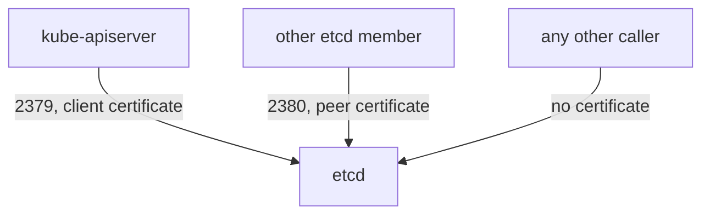

# etcd Client Access

etcd is the key-value database where the API server stores every object of the cluster, including every Secret. Anyone who can read etcd can read the Secrets of all namespaces. Anyone who can write to it can change the cluster without passing the API server, so no RBAC rule, admission check or audit log applies. This part explains the settings that protect etcd, reviews them on the control-plane node, and shows what a connection without a certificate gets.

## Who should talk to etcd

Only the API servers need the client port 2379. Only the other etcd members need the peer port 2380. No user, node or pod needs either. Two controls enforce this. The first is the network: a host firewall or security group that allows 2379 and 2380 from the control-plane nodes only. The second is TLS with client certificates. The setting `--client-cert-auth=true` makes etcd refuse a client that does not present a certificate signed by the authority in `--trusted-ca-file`. The setting `--peer-client-cert-auth=true` does the same for peers.

On the API server side, three flags point to the credentials: `--etcd-cafile`, `--etcd-certfile` and `--etcd-keyfile`. The API server is the one client that holds a certificate for etcd.



The diagram shows two allowed paths. A caller on the third path reaches the port and is rejected in the TLS handshake. This is a second control, and the network rule should still stop that caller before the handshake.

## Review the settings

Open a shell on the playground VM (virtual machine) and check that `kubectl` uses the playground cluster:

<!-- astrona:playground:renew -->

```sh
astrona ssh astro-ats-033-playground-030-03
kubectl config current-context
```

```text
kubernetes-admin@astro-ats-033-playground-030-03
```

The etcd manifest belongs to root, so read the flags of the etcd static pod with `sudo`:

```sh
sudo grep -E 'listen-client-urls|listen-peer-urls|client-cert-auth|trusted-ca-file|data-dir' /etc/kubernetes/manifests/etcd.yaml
```

```text
    - --client-cert-auth=true
    - --data-dir=/var/lib/etcd
    - --listen-client-urls=https://127.0.0.1:2379,https://10.0.2.15:2379
    - --listen-peer-urls=https://10.0.2.15:2380
    - --peer-client-cert-auth=true
    - --peer-trusted-ca-file=/etc/kubernetes/pki/etcd/ca.crt
    - --trusted-ca-file=/etc/kubernetes/pki/etcd/ca.crt
```

Four things matter in the result. `--listen-client-urls` lists the loopback address and the node address `10.0.2.15`, so clients on other machines can connect when the network allows it. `--client-cert-auth=true` and `--peer-client-cert-auth=true` appear. `--trusted-ca-file` points to the etcd certificate authority, a separate authority from the cluster one, and `--data-dir` names the directory that holds the database.

The flags say what etcd should do, and the listeners and file modes show what it does. Read them next:

```sh
sudo ss -tlnp | grep -E ':(2379|2380|2381) '
sudo stat -c '%a %U' /var/lib/etcd
```

```text
LISTEN 0      4096       127.0.0.1:2381       0.0.0.0:*    users:(("etcd",pid=1658,fd=11))
LISTEN 0      4096       127.0.0.1:2379       0.0.0.0:*    users:(("etcd",pid=1658,fd=7))
LISTEN 0      4096       10.0.2.15:2380       0.0.0.0:*    users:(("etcd",pid=1658,fd=3))
LISTEN 0      4096       10.0.2.15:2379       0.0.0.0:*    users:(("etcd",pid=1658,fd=6))
700 root
```

Port 2379 appears on the loopback address and on the node address, and port 2380 on the node address. Port 2381, the metrics listener, is on the loopback address only. The data directory has mode `700` and owner `root`, so no other user on the node can read the database files.

## Try a connection without a certificate

From the node, ask etcd for its health first without credentials, and print the exit status of `curl`:

```sh
curl -s --max-time 5 https://127.0.0.1:2379/health; echo "rc=$?"
```

```text
rc=60
```

`curl` prints nothing, and `echo` shows the exit status 60, which means it could not check the server certificate: etcd uses a certificate from its own authority, which the system does not trust. With `-k`, which skips that check, the exit status becomes 56, because etcd ends the TLS handshake when the client presents no certificate. If either request returned data, client certificate authentication would be off.

Now send the request with the health check certificate that kubeadm creates. Only root can read the certificate files, so this `curl` runs with `sudo`:

```sh
sudo curl -s --max-time 5 --cacert /etc/kubernetes/pki/etcd/ca.crt --cert /etc/kubernetes/pki/etcd/healthcheck-client.crt --key /etc/kubernetes/pki/etcd/healthcheck-client.key https://127.0.0.1:2379/health
```

```text
{"health":"true","reason":""}
```

etcd accepted the client certificate and reports the health as `true`. The `student` user cannot even list `/etc/kubernetes/pki/etcd` without `sudo` (`Permission denied`), so a client certificate for etcd needs root access to the node.

## What goes wrong

The common failures are wide network rules and shared credentials. A security group that opens 2379 to the whole virtual network lets any compromised node attempt the TLS handshake. A copy of the API server key on a backup server gives a second place from which the database can be read. Encryption at rest of Secrets in the API server limits the damage of a stolen database file, and the list of allowed callers should still stay as short as possible.

You have followed each control-plane port from the network rule to the authentication setting behind it. The pieces together give the layered picture that a review needs.

## Common pitfalls

> [!WARNING]
> - **Assuming that TLS replaces the firewall.** The handshake still reaches etcd for any caller who can open the port.
> - **Turning off `--client-cert-auth` to debug.** The database then accepts any client that reaches the port.
> - **Sharing the API server client key.** Each additional holder of the key can read and write every Secret.
> - **Opening 2379 to all nodes.** Only the API servers need it. Worker nodes do not.
