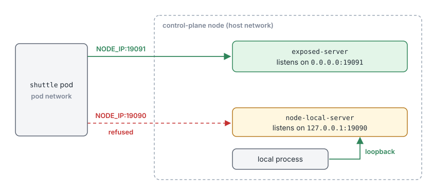
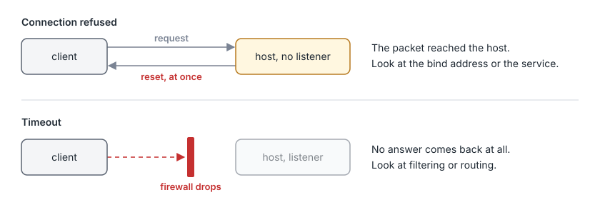

# Listeners And Bind Addresses

Every network service chooses an address and a port to wait on. That choice is the first and cheapest access control a service has, and it needs no firewall. A service that listens on the loopback address cannot receive a connection from any other machine, because the packets from other machines never reach it.

On this page, you start a service on all interfaces and then a second one on loopback, and you test both from a pod. You also learn to read a failed connection, because the error tells you which layer blocked it.

## Bind addresses

A **listener** is a socket that a process opened to wait for incoming connections. It is defined by an IP address and a TCP port. The IP address is the **bind address**. It decides on which of the node's network interfaces the process accepts connections:

- `127.0.0.1` (IPv4) and `::1` (IPv6) are loopback addresses. They exist inside the host only, so only processes on the same host can connect.
- The node's own address, for example `172.18.0.2`, accepts connections that arrive on that interface from the network.
- `0.0.0.0` means every IPv4 address of the host, and `::` means every IPv6 address. These are the widest choices.



The drawing shows the two listeners you create on this page. The listener on `0.0.0.0` answers requests that arrive on the node address, and the listener on `127.0.0.1` answers only processes on the same node.

To practise node listeners, you need a process that runs in the network of the node. A pod with `hostNetwork: true` does exactly that: it uses the network namespace of the node instead of its own. A process in such a pod that binds `0.0.0.0` listens on the node's real interfaces, just like a service installed on the node. A process in it that binds `127.0.0.1` listens on the node's loopback.

## Two reasons a connection fails

Before you test anything, you need to know how to read a failure. A TCP connection can fail in two ways, and each one has a different cause.

**Connection refused** means the packet reached the host, but the host had no listener on that address and port. The TCP stack of the host answered with a reset, so the error comes back immediately. A **timeout** means no answer came at all. A firewall that drops packets, a route that does not exist or a host that is down all produce a timeout.



The drawing compares the two failures. When you debug exposure, the error points you to a layer: a refusal points to the bind address or a stopped service, and a timeout points to filtering.

## Start a service on all interfaces

Now you can see a wide listener for yourself. First, select the environment and read the node's address, which the test requests use:

<!-- astrona:playground:renew -->

```sh
export KUBECONFIG="$(astrona kubeconfig ats-033-playground-030-01)"
test "$(kubectl config current-context)" = "kind-astro-ats-033-playground-030-01" || exit 1
node_name="astro-ats-033-playground-030-01-control-plane"
run_on_node() { podman exec "$node_name" "$@"; }
NODE_IP="$(kubectl get node "$node_name" -o jsonpath='{.status.addresses[?(@.type=="InternalIP")].address}')"
echo "$NODE_IP"
```

The last line prints the `InternalIP` of the control-plane node. Other machines and pods use this address to reach the node.

The next file defines a pod that runs Python's built-in web server on port 19091, in the network namespace of the control-plane node. The server has no `--bind` option, so it listens on all interfaces.

Save this as `pod-exposed-server.yaml`:

```yaml
apiVersion: v1
kind: Pod
metadata:
  name: exposed-server
  namespace: starfleet
spec:
  restartPolicy: Never
  hostNetwork: true
  dnsPolicy: ClusterFirstWithHostNet
  nodeSelector:
    kubernetes.io/hostname: astro-ats-033-playground-030-01-control-plane
  tolerations:
  - key: node-role.kubernetes.io/control-plane
    operator: Exists
    effect: NoSchedule
  containers:
  - name: web
    image: docker.io/library/python:3.13-alpine
    command:
    - python
    - -m
    - http.server
    - '19091'
```

The `nodeSelector` pins the pod to the control-plane node. The control-plane node has a taint, a mark that keeps ordinary pods away, and the toleration lets this pod run there anyway. Apply it:

```sh
kubectl apply -f pod-exposed-server.yaml
```

Then check the result. Wait for the pod, look at the listeners on the node, and send a request from the `shuttle` pod to the node address. The command `ss -tln` lists the TCP sockets that are listening, with numeric addresses:

```sh
kubectl -n starfleet wait --for=condition=Ready pod/exposed-server --timeout=180s
run_on_node ss -tln
kubectl -n starfleet exec shuttle -- wget -qO- -T 3 "http://$NODE_IP:19091/"
```

The `ss` output has a line for port 19091 whose local address is a wildcard (`0.0.0.0:19091` or `*:19091`). The `wget` request succeeds and prints an HTML directory listing.

So the service is reachable from a pod on the cluster network. This is the kind of exposure this module removes.

## Move the listener to loopback

For a service that only the node itself needs, the fix is a narrower bind address. The next pod starts the same server on port 19090 with `--bind 127.0.0.1`.

Save this as `pod-node-local-server.yaml`:

```yaml
apiVersion: v1
kind: Pod
metadata:
  name: node-local-server
  namespace: starfleet
spec:
  restartPolicy: Never
  hostNetwork: true
  dnsPolicy: ClusterFirstWithHostNet
  nodeSelector:
    kubernetes.io/hostname: astro-ats-033-playground-030-01-control-plane
  tolerations:
  - key: node-role.kubernetes.io/control-plane
    operator: Exists
    effect: NoSchedule
  containers:
  - name: web
    image: docker.io/library/python:3.13-alpine
    command:
    - python
    - -m
    - http.server
    - '19090'
    - --bind
    - 127.0.0.1
```

Apply it:

```sh
kubectl apply -f pod-node-local-server.yaml
```

Then check the result. First look at the listener, then send a request from outside, then one from inside. The request from `shuttle` is expected to fail, so run it on its own:

```sh
kubectl -n starfleet wait --for=condition=Ready pod/node-local-server --timeout=180s
run_on_node ss -tln
kubectl -n starfleet exec shuttle -- wget -qO- -T 3 "http://$NODE_IP:19090/"
kubectl -n starfleet exec node-local-server -- python -c "import urllib.request; print(urllib.request.urlopen('http://127.0.0.1:19090/', timeout=3).status)"
```

The listener for port 19090 shows the local address `127.0.0.1:19090`. The request from `shuttle` fails at once with `Connection refused`. The packet reached the node address, and no process listens on port 19090 at that address.

The last command runs inside the server pod. In that pod, loopback is the node's loopback, so the request reaches the server and prints `200`. The service works for local callers and is closed to the network, and no firewall was involved.

## Why binding is not the whole answer

A loopback bind address is a good start, but it has limits. It protects only against callers on the network. Any process on the node can still connect, including a compromised pod that runs with `hostNetwork: true`.

A bind address also lives in the service's own configuration. A configuration reload or a package update can reset it. For these reasons, a bind address is only the first layer. The second layer is a filter in the kernel that does not depend on the service at all.

You have now seen a listener on all interfaces, a listener on loopback, and the refusal that comes from the second. The open question is the service that must stay on the node address but should answer only a few callers.

## Common pitfalls

> [!WARNING]
> - **Checking only IPv4.** A service can listen on `::` as well as `0.0.0.0`. Read every line of the `ss` output.
> - **Testing from the node itself.** A request from the node to its own address passes through loopback rules. It can succeed when a request from another machine fails. Test from the caller's position.
> - **Reading every failure as a firewall.** `Connection refused` means a reachable host without a listener. Only a timeout points to filtering.
> - **Trusting the bind address as the only control.** Local processes can still connect, and the setting can change with a configuration reload.
