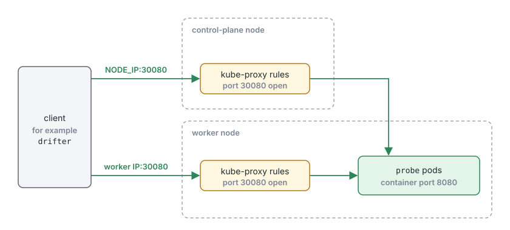
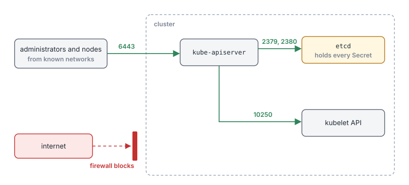

# NodePorts, Control-Plane Ports And API Access

Some access to a cluster is intended. Users reach applications through Services, and administrators reach the API server. These paths are also the ones an attacker tries first, so each one needs an owner and a reason.

On this page, you see how Kubernetes opens ports on nodes, which Service types publish an application outside the cluster, and which ports of the control plane and the nodes must stay reachable only from the right sources.

## Service types and who can reach them

A **Service** gives a group of pods a stable address. Its `type` decides how far that address reaches:

- `ClusterIP` (the default) is reachable inside the cluster only.
- `NodePort` opens the same port number on every node. The port comes from the range 30000 to 32767 by default.
- `LoadBalancer` asks the cloud provider for an external load balancer that forwards to the node ports.
- `ExternalName` returns a DNS name and exposes nothing.

The kube-proxy component on each node programs the packet rules that forward traffic for a Service. So a NodePort exists on every node, including nodes that run none of the Service's pods, and it accepts connections on every node address.



The drawing shows that the node port is open on both nodes. kube-proxy on the receiving node forwards the request to a `probe` pod, wherever that pod runs.

Two settings narrow this access. `externalTrafficPolicy: Local` sends traffic only to pods on the node that received it, and it keeps the original client address. `loadBalancerSourceRanges` lists the client address ranges that a cloud load balancer accepts.

An Ingress controller is the usual replacement for many NodePorts. It gives one entry point, with routing and TLS (Transport Layer Security, the encryption for HTTPS) in one place.

## Inventory the exposed Services

The first step in any review is a list of what is exposed today. Select the environment and list every Service with its type and node ports. The `custom-columns` output prints only the fields you choose. The command leaves out `--no-headers`, so the column titles stay:

<!-- astrona:playground:renew -->

```sh
export KUBECONFIG="$(astrona kubeconfig ats-033-playground-030-01)"
test "$(kubectl config current-context)" = "kind-astro-ats-033-playground-030-01" || exit 1
kubectl get services -A -o custom-columns=NAMESPACE:.metadata.namespace,NAME:.metadata.name,TYPE:.spec.type,PORTS:.spec.ports[*].nodePort
```

In a fresh playground, every Service is of type `ClusterIP`, so the `PORTS` column shows `<none>`. In a real cluster, each row with `NodePort` or `LoadBalancer` needs an owner. The next step creates one on purpose.

## Publish a Service and see the port on the node

To see what a NodePort opens, you create one for the `probe` pods.

Save this as `service-probe-nodeport.yaml`:

```yaml
apiVersion: v1
kind: Service
metadata:
  name: probe-nodeport
  namespace: starfleet
spec:
  type: NodePort
  selector:
    app: probe
    release: probe
  ports:
  - name: http
    port: 80
    targetPort: http
    nodePort: 30080
```

The `selector` matches the labels of the `probe` pods. Apply it:

```sh
kubectl apply -f service-probe-nodeport.yaml
```

Then check the result. Read the node address, then send a request from `drifter` to that address and the node port. The `drifter` pod is in another namespace and not on the control-plane node, so the request comes from the pod network:

```sh
NODE_IP="$(kubectl get node astro-ats-033-playground-030-01-control-plane -o jsonpath='{.status.addresses[?(@.type=="InternalIP")].address}')"
kubectl -n outpost exec drifter -- wget -qO- -T 3 "http://$NODE_IP:30080/"
```

The request prints a line that starts with `version=v1`. A client in a different namespace reached the application through a node address.

If a NetworkPolicy that selects the `probe` pods is active in `starfleet`, the request can time out instead. Policies apply to NodePort traffic after the node forwards it to the pod. Remove the exposure when you no longer need it:

```sh
kubectl -n starfleet delete service probe-nodeport
```

## The ports of the cluster itself

Services are not the only open ports. A Kubernetes cluster has a fixed set of ports for its own components, and each one has an expected set of callers.

| Port | Component | Who should reach it |
| --- | --- | --- |
| 6443 | kube-apiserver | Administrators, nodes, controllers, from known networks only |
| 2379 and 2380 | etcd | The API servers and the other etcd members only |
| 10250 | kubelet API | The API server and monitoring, never the internet |
| 10257 | kube-controller-manager | Local and health checks only |
| 10259 | kube-scheduler | Local and health checks only |
| 30000 to 32767 | NodePort range | Only where a NodePort Service is intended |



The drawing shows who should call which port. The etcd port is the most sensitive of the group, because etcd, the key-value store of the cluster, holds every Secret of the cluster.

In a real cluster, a firewall or cloud security group should accept port 6443 only from the networks of administrators and nodes. It should accept the other ports only from the control plane and the nodes.

The API server itself should have anonymous access turned off with `--anonymous-auth=false`. On some setups, this flag also stops unauthenticated health probes, so check the load balancer first. The kubelet should reject anonymous callers too.

## Check what the API server answers

A quick test of exposure is to ask the API server what an unauthenticated caller may do. The `curl` command below runs from your own shell against the address that `kubectl` uses, and it sends no credentials:

```sh
API_SERVER="$(kubectl config view --minify -o jsonpath='{.clusters[0].cluster.server}')"
curl --insecure --silent --max-time 5 "$API_SERVER/api/v1/namespaces"
```

A correctly secured API server answers with an error status object that says the user `system:anonymous` cannot list namespaces, or it refuses the request. A response that lists namespaces means anonymous users have read access. The `--insecure` option skips certificate checks, and it is acceptable only for this local check of your own playground.

You have followed network exposure through its layers: the bind address, the node firewall, the pod policy, and the Services and ports that publish access on purpose. Each layer stops a different traffic path, which is why a hardened cluster uses all of them.

## Common pitfalls

> [!WARNING]
> - **Leaving a NodePort Service behind.** It opens the port on every node. List Services of type `NodePort` and `LoadBalancer` regularly.
> - **Assuming a NodePort listens only on nodes with the pod.** kube-proxy opens it on every node.
> - **Exposing etcd or the kubelet API to a wide network.** Both give control over the cluster. Restrict ports 2379, 2380 and 10250 to the control plane and nodes.
> - **Forgetting `loadBalancerSourceRanges`.** Without it, a cloud load balancer accepts clients from any address.
