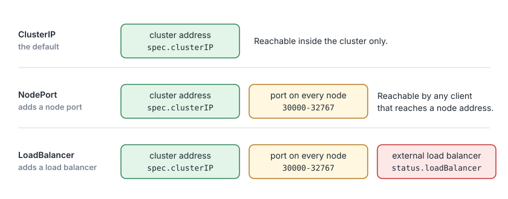
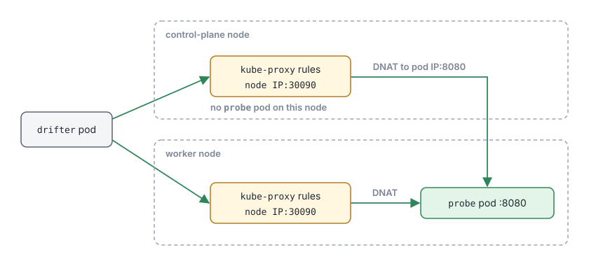

# Service Types And What They Open

A pod IP address changes every time the pod is replaced, so clients send their requests to a Service instead. The Service type then decides who can reach it. Most exposure in a cluster does not come from an attack on Kubernetes itself. It comes from a Service type that was set wider than the job needed.

On this page, you see what each type opens and which component opens it. Then you find the Services that publish access in the playground, and you close one of them.

## Three types, three reaches

A **Service** is a Kubernetes object that gives a set of pods one stable virtual address and port. It forwards traffic to the pods that its `selector` matches. The `type` field has three values that matter for exposure:

- `ClusterIP` is the default. The Service gets a virtual address that works inside the cluster only. A client outside the cluster has no route to it.
- `NodePort` is a `ClusterIP` Service that also opens one port on every node. The port comes from the range 30000 to 32767, unless the administrator changes the range of the API server. A client that can reach any node address on that port reaches the pods.
- `LoadBalancer` is a `NodePort` Service that also asks an external load balancer to forward traffic to the node ports. The cloud provider integration creates the load balancer. This integration is a controller in the cluster that calls the API of the cloud. The external address appears in the field `status.loadBalancer.ingress`.

The types build on each other. A `LoadBalancer` Service also has a cluster address and a node port, so a client can reach it in all three ways. A fourth type, `ExternalName`, only returns a DNS name and opens nothing.



The drawing shows how each type adds one more way in on top of the type before it.

## Which component opens the port

Knowing the types is not enough. You also need to know which part of the cluster makes the port work, because that part decides where the port is open.

The API server stores the Service, and it allocates the node port. The component that makes the port work is `kube-proxy`, which runs on every node. It watches Services and programs packet rules on its node, with iptables or IPVS depending on its mode. When a packet arrives at a node address and a node port, those rules rewrite its destination to the address of one of the pods. This rewrite of the destination address is called destination network address translation (DNAT).



The drawing shows that the node itself does the forwarding. This has a consequence that surprises many administrators: the port is open on every node, including nodes that run none of the Service pods. Such a node forwards the packet across the cluster network to a pod on another node.

## Find the Services that publish access

Now look at the playground. Start with an inventory: select the environment, then list the type and the node ports of every Service in the cluster. The option `-o custom-columns` prints only the fields that you name.

<!-- astrona:playground:renew -->

```sh
export KUBECONFIG="$(astrona kubeconfig ats-033-playground-030-02)"
test "$(kubectl config current-context)" = "kind-astro-ats-033-playground-030-02" || exit 1
node_name="astro-ats-033-playground-030-02-control-plane"
worker_name="astro-ats-033-playground-030-02-worker"
kubectl get services -A -o custom-columns=NAMESPACE:.metadata.namespace,NAME:.metadata.name,TYPE:.spec.type,NODEPORT:.spec.ports[*].nodePort
```

Every row with a type other than `ClusterIP` needs an owner and a reason. In the playground, `probe-admin` is of type `NodePort` on port 30090. `probe-edge` is of type `LoadBalancer`, so it also has an allocated node port. The `kubernetes` Service in `default` and the `kube-dns` Service in `kube-system` are of type `ClusterIP`.

## Prove that the port is open on every node

The inventory tells you which ports exist. Next, check where they answer. Read the addresses of both nodes, then send requests from the `drifter` pod in the `outpost` namespace. That pod is not on the control-plane node, and it sends its request from the pod network, as an ordinary client does.

```sh
CONTROL_IP="$(kubectl get node "$node_name" -o jsonpath='{.status.addresses[?(@.type=="InternalIP")].address}')"
WORKER_IP="$(kubectl get node "$worker_name" -o jsonpath='{.status.addresses[?(@.type=="InternalIP")].address}')"
kubectl -n outpost exec drifter -- wget -qO- -T 3 "http://$WORKER_IP:30090/"
kubectl -n outpost exec drifter -- wget -qO- -T 3 "http://$CONTROL_IP:30090/"
```

Both requests print a line that starts with `version=v1`. The `probe` pods run on the worker node, because the control-plane node has a taint that keeps ordinary pods away. Yet the second request still works. The control-plane node has no `probe` pod, so its `kube-proxy` rules forward the request to a pod on the worker node.

## Remove the exposure

If nobody needs the node port, the fix is to change the type back to `ClusterIP`. Save this as `service-probe-admin.yaml`:

```yaml
apiVersion: v1
kind: Service
metadata:
  name: probe-admin
  namespace: starfleet
spec:
  type: ClusterIP
  selector:
    app: probe
    release: probe
  ports:
  - name: http
    port: 80
    targetPort: http
```

The manifest has no `nodePort` field. Apply it:

```sh
kubectl apply -f service-probe-admin.yaml
```

Then check the result. The type changes, the API server releases the node port, and the request that worked a moment ago fails. Run the request on its own, because it is expected to fail:

```sh
kubectl -n starfleet get service probe-admin
kubectl -n outpost exec drifter -- wget -qO- -T 3 "http://$WORKER_IP:30090/"
```

The `wget` command prints an error and exits with a nonzero status. Pods inside the cluster still reach the application through the name `probe-admin.starfleet`, because the `ClusterIP` address remains.

You now know what each type opens, which component opens the port, and how to take a node port away. The open question is the Services that must stay published: how to limit who reaches them, and how a node treats a request for them.

## Common pitfalls

> [!WARNING]
> - **Thinking a NodePort listens only where the pods run.** `kube-proxy` opens the port on every node.
> - **Reading the cluster address as proof of safety.** A `LoadBalancer` Service also has a `ClusterIP` and a node port. Check the whole `spec`.
> - **Testing from the node itself.** A request from the node to its own address can pass when a request from another machine fails. Test from the position of the real client.
> - **Forgetting that a Service outlives its test.** A Service created for debugging stays until someone deletes it. List the Services that are not `ClusterIP` on a schedule.
