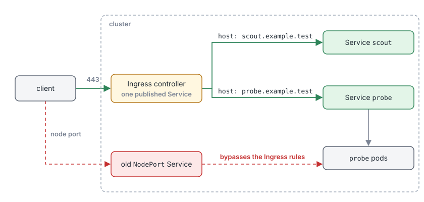
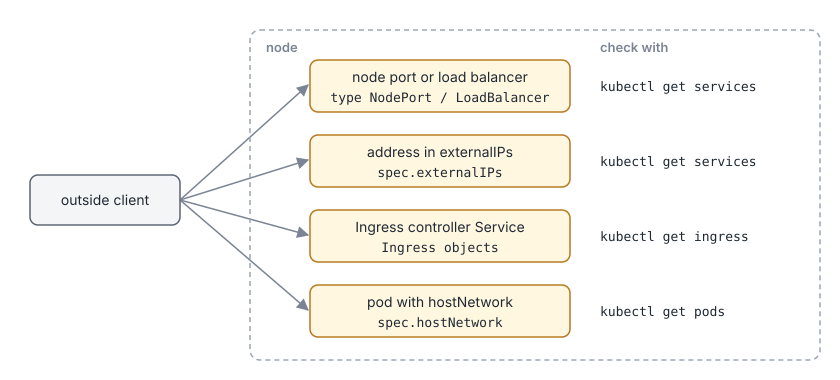

# Ingress As The Single Entry Point

A cluster that publishes ten applications with ten `NodePort` Services opens ten ports on every node. Each port needs its own firewall rule and its own review. Each application also handles its own TLS (Transport Layer Security, the protocol that encrypts HTTP traffic).

An Ingress reduces this to one entry point. On this page, you see what an Ingress is and which component enforces it. Then you audit the cluster for Services and Ingress objects that nobody planned.

## What an Ingress does

An **Ingress** is a Kubernetes object that lists HTTP and HTTPS routing rules. Each rule says: for this host name and this path, send the request to this Service and port. The object alone does nothing.

An **Ingress controller** is a program that runs in the cluster, reads Ingress objects and applies them. It receives the traffic, ends TLS, and forwards each request to the right Service by its `ClusterIP`. The controller itself is the only workload that is published, through one `NodePort` or `LoadBalancer` Service.



The drawing shows one published port and many applications behind it. The applications keep the type `ClusterIP`. Access control, TLS certificates and logging now sit in one place, and the firewall needs one rule.

This is a gain only if the other Services stay closed. An Ingress does not remove an old `NodePort` Service. That Service still opens its port on every node, and requests to it bypass every rule of the Ingress, as the red path in the drawing shows.

## Create an Ingress and see what it needs

The playground has no Ingress controller, which makes it a good place to see what the object does on its own. Select the environment:

<!-- astrona:playground:renew -->

```sh
export KUBECONFIG="$(astrona kubeconfig ats-033-playground-030-02)"
test "$(kubectl config current-context)" = "kind-astro-ats-033-playground-030-02" || exit 1
```

Save this as `ingress-probe.yaml`:

```yaml
apiVersion: networking.k8s.io/v1
kind: Ingress
metadata:
  name: probe
  namespace: starfleet
spec:
  ingressClassName: nginx
  rules:
  - host: probe.example.test
    http:
      paths:
      - path: /
        pathType: Prefix
        backend:
          service:
            name: probe
            port:
              number: 80
```

The `ingressClassName` field names the controller that should handle the object. The backend is the `probe` Service of type `ClusterIP`. Apply it:

```sh
kubectl apply -f ingress-probe.yaml
```

Then check the result:

```sh
kubectl -n starfleet get ingress probe
kubectl get ingressclass
```

The API server accepts the Ingress. The `ADDRESS` column stays empty, and the list of ingress classes is empty, because no controller is installed. The object is a request that nothing has accepted, so it opens no port. A NetworkPolicy works the same way: the API server stores the object, and a controller acts on it.

## Audit the cluster for accidental exposure

An Ingress object is only one of the ways traffic can reach a pod from outside. A review of external access asks four questions:

- Which Services publish a node port or a load balancer?
- Which Services carry the field `externalIPs`?
- Which Ingress objects exist, and who owns the controller?
- Which pods use `hostNetwork` or `hostPort`?



The drawing shows the four paths that the review covers on each node.

The first three questions come from one command each. List the Services with the fields that matter, then the Ingress objects, then the pods and their `hostNetwork` field:

```sh
kubectl get services -A -o custom-columns=NAMESPACE:.metadata.namespace,NAME:.metadata.name,TYPE:.spec.type,EXTERNAL-IPS:.spec.externalIPs,NODEPORT:.spec.ports[*].nodePort
kubectl get ingress -A
kubectl get pods -A -o custom-columns=NAMESPACE:.metadata.namespace,NAME:.metadata.name,HOSTNETWORK:.spec.hostNetwork
```

The field `externalIPs` is a list of addresses on which any node accepts traffic for the Service. It is an old feature. A user who can create Services can use it to attract traffic for addresses that the user does not own, so a value in that column needs an explanation.

The third command shows the pods that share the network of their node. Their listeners are on the node, not behind a Service, so the review of the ports on the node covers them.

Finally, remove the Ingress, since it was only an exercise:

```sh
kubectl -n starfleet delete ingress probe
```

You have now followed Service exposure from the type of one Service to the audit of a whole cluster. You know which component opens each path, how to close it, and how to narrow the ones that stay.

## Common pitfalls

> [!WARNING]
> - **Leaving the old `NodePort` Services after adding an Ingress.** They still open ports on every node and bypass the Ingress rules.
> - **Assuming an Ingress object means exposure.** Without a controller, it does nothing. With a controller, it publishes the host and path at once.
> - **Forgetting the controller's own Service.** The Ingress controller needs one published Service. Restrict it with a firewall and with `loadBalancerSourceRanges` where possible.
> - **Auditing Services only.** `externalIPs`, Ingress objects and host-network pods also open access.
