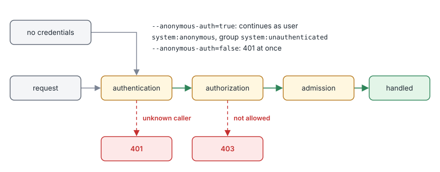
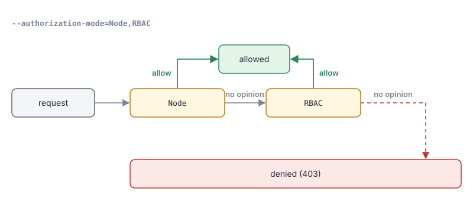

# API Server Authentication And Authorization

Port 6443 must stay reachable, so a network rule cannot be the only control on the API server. Users, nodes and controllers all need to connect. The control that remains sits inside the API server itself.

For every request, the API server answers two questions: who is the caller, and is the caller allowed to do this? This page follows a request through authentication and authorization. You read the flags that configure them, and you test the result with a request that carries no credentials.

## Authentication and authorization are separate steps

The API server handles each request in a fixed order:

1. **Authentication** decides who the caller is. It uses a client certificate, a bearer token or another authenticator.
2. **Authorization** decides whether that caller may perform the verb on the resource.
3. **Admission** then validates or changes the object.

A request that fails authentication gets status 401. A request that is authenticated but not authorized gets status 403.



The drawing shows where each status code comes from. It also shows the special path of a request with no credentials, which the next paragraph explains.

The flag `--anonymous-auth` controls what happens to a request with no credentials. When it is `true` (the default), the API server does not reject the request at authentication. It treats the caller as the user `system:anonymous` in the group `system:unauthenticated`, and authorization decides what that user may do. When it is `false`, such a request gets status 401 at once.

The flag `--authorization-mode` is an ordered list of authorizers. An authorizer is a module of the API server that allows a request, denies it, or has no opinion. The API server asks each authorizer in turn. The first one that allows or denies decides, and a request that no authorizer allows is denied.



The drawing shows the chain for the value `Node,RBAC`, which a kubeadm cluster uses. The two authorizers do different jobs:

- The `Node` authorizer allows each kubelet to read what its own pods need.
- `RBAC` (role-based access control) allows what Roles and ClusterRoles grant.

There is also the mode `AlwaysAllow`. It allows every request, so it must never run on a real cluster.

## What anonymous users can do by default

When anonymous requests are on, the important question is which ClusterRoles are bound to the group `system:unauthenticated`. In a default cluster, the ClusterRole `system:public-info-viewer` is bound to that group. It allows reading `/healthz`, `/livez`, `/readyz` and `/version`, and nothing else.

Load balancers and bootstrap tools use these paths. That is the reason the default stays on in many clusters. Anything an administrator binds to `system:unauthenticated` or `system:anonymous` adds to this list, so you must review those bindings.

## Read the flags

Now check the real settings. Open a shell on the playground VM (virtual machine) and check that `kubectl` uses the playground cluster:

<!-- astrona:playground:renew -->

```sh
astrona ssh astro-ats-033-playground-030-03
kubectl config current-context
```

```text
kubernetes-admin@astro-ats-033-playground-030-03
```

You work as the `student` user, and the node files belong to root. Read the relevant flags from the manifest of the API server with `sudo`:

```sh
sudo grep -E 'anonymous-auth|authorization-mode|bind-address|secure-port|client-ca-file' /etc/kubernetes/manifests/kube-apiserver.yaml
```

```text
    - --authorization-mode=Node,RBAC
    - --client-ca-file=/etc/kubernetes/pki/ca.crt
    - --requestheader-client-ca-file=/etc/kubernetes/pki/front-proxy-ca.crt
    - --secure-port=6443
```

When the manifest does not set a flag, no line appears for it, and the default applies. The output shows `--authorization-mode=Node,RBAC`, the client certificate authority file and the secure port 6443.

Two flags are missing. `--anonymous-auth` does not appear, so the default `true` applies. `--bind-address` does not appear either, so the API server listens on every address.

## Test with a request that has no credentials

The flags say what should happen, so now test what really happens. The kubeconfig file names the address of the API server. Read the address from it, then send requests to that address without any credential:

```sh
API_SERVER="$(kubectl config view --minify -o jsonpath='{.clusters[0].cluster.server}')"
echo "$API_SERVER"
curl --insecure --silent --max-time 5 "$API_SERVER/version"
```

```text
https://10.0.2.15:6443
{
  "major": "1",
  "minor": "35",
  "emulationMajor": "1",
  "emulationMinor": "35",
  "minCompatibilityMajor": "1",
  "minCompatibilityMinor": "34",
  "gitVersion": "v1.35.10",
  "gitCommit": "ae6fece6fea92ecfcccd13af7d5f2ea8cb9b33fe",
  "gitTreeState": "clean",
  "buildDate": "2026-10-27T12:02:53Z",
  "goVersion": "go1.26.10",
  "compiler": "gc",
  "platform": "linux/arm64"
}
```

The request returns the version information, because the ClusterRole `system:public-info-viewer` allows it. The `platform` line shows the processor type of your VM and can differ. The option `--insecure` skips the certificate check, which is acceptable only for a local check of your own playground.

Now ask for a list that the anonymous user has no right to read:

```sh
curl --insecure --silent --max-time 5 "$API_SERVER/api/v1/namespaces"
```

```text
{
  "kind": "Status",
  "apiVersion": "v1",
  "metadata": {},
  "status": "Failure",
  "message": "namespaces is forbidden: User \"system:anonymous\" cannot list resource \"namespaces\" in API group \"\" at the cluster scope",
  "reason": "Forbidden",
  "details": {
    "kind": "namespaces"
  },
  "code": 403
}
```

The API server accepted the request at authentication as `system:anonymous`. RBAC then refused it with code 403. A 401 would mean that authentication itself refused the caller.

You can send the same requests through `kubectl` as another user. The `--as` option makes `kubectl` impersonate a user. This means the API server handles the request as if that user sent it:

```sh
kubectl get namespaces --as=system:anonymous
kubectl get --raw /version --as=system:anonymous
```

The first command prints `Error from server (Forbidden): namespaces is forbidden: User "system:anonymous" cannot list resource "namespaces" in API group "" at the cluster scope`. The second prints the same version document as the `curl` request above.

If the first command printed a list of namespaces, an administrator would have bound a role to the anonymous user. The cluster would then be open to everyone who can reach port 6443.

The shorter command `kubectl auth can-i list namespaces --as=system:anonymous` does not work for this user. It prints `Error from server (Forbidden): selfsubjectaccessreviews.authorization.k8s.io is forbidden: User "system:anonymous" cannot create resource "selfsubjectaccessreviews" in API group "authorization.k8s.io" at the cluster scope`. The command sends a SelfSubjectAccessReview request as the impersonated user, and the anonymous user may not create one.

So test anonymous access with a real request instead, and read the bindings:

```sh
kubectl get clusterrolebinding system:public-info-viewer -o wide
```

```text
NAME                        ROLE                                    AGE     USERS   GROUPS                                         SERVICEACCOUNTS
system:public-info-viewer   ClusterRole/system:public-info-viewer   3m49s           system:authenticated, system:unauthenticated
```

This built-in binding gives the group `system:unauthenticated` read access to the information paths. Any other binding that names `system:anonymous` or `system:unauthenticated` is a finding.

## Changing the setting

Setting `--anonymous-auth=false` removes this kind of finding, but it has a cost. Two things depend on anonymous access:

- Health checks of a load balancer that call `/healthz` without credentials start to fail.
- The command `kubeadm join` reads the ConfigMap `cluster-info` in the namespace `kube-public` without credentials, so it needs anonymous access.

Check both before you change the flag. The change itself is an edit of the static pod manifest. After the edit, the kubelet restarts the API server pod.

You now know how the API server treats a caller with no credentials, and how to test it with a real request. The open question is the kubelet on every node, which has its own API and asks the same two questions.

## Common pitfalls

> [!WARNING]
> - **Setting `--anonymous-auth=false` without checking what depends on it.** Health checks and token-based joins may stop working.
> - **Granting a role to `system:unauthenticated` or `system:anonymous`.** The role then applies to everyone who reaches the port.
> - **Using `AlwaysAllow` for a quick test.** Every request, including anonymous ones, is then allowed.
> - **Confusing 401 and 403.** A 401 means the caller is not authenticated. A 403 means the caller is known and not allowed.
> - **Trusting `kubectl auth can-i --as=system:anonymous`.** It fails with `Forbidden` on the SelfSubjectAccessReview. Send a real request without credentials instead.
