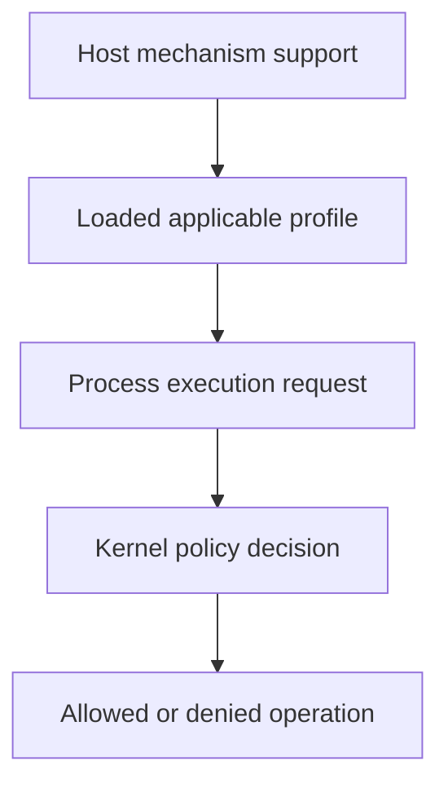

# Seccomp And AppArmor As Different Kernel Boundaries

A process can open a permitted file but attempts a disallowed system call. File-access policy and syscall filtering constrain different behavior, even when both protect the same container.

## Learning objectives

- Distinguish syscall filtering from resource-oriented mandatory access control.
- Interpret RuntimeDefault, Localhost and unconfined profile choices.
- Explain node prerequisites and container-level overrides.

## Before you start

This chapter is standalone reading material; no running cluster or installed tools are required. A Pod is the Kubernetes unit for running one or more containers, and a namespace groups namespaced objects. Treat the worked configurations as teaching examples rather than recorded observations from a provisioned environment.

## Responsible components and behavior

A container process uses the host kernel. Running as a non-root user and dropping capabilities reduce authority, but the process still invokes system calls and accesses resources. Seccomp and AppArmor impose additional kernel boundaries. Understanding their different mechanisms helps choose a profile and interpret a denial without confusing runtime security with Kubernetes API authorization.

## Seccomp Filters System Calls

Seccomp restricts which system calls a process may invoke and can make decisions using supported syscall arguments. A profile can allow expected calls while denying unnecessary kernel interfaces. This reduces reachable kernel functionality after an application compromise, although it does not remove every permitted way to misuse the application or its data.

Kubernetes describes seccomp selection through security-context fields. RuntimeDefault requests the runtime's default profile; its contents depend on the runtime. Localhost selects a profile available on the node. Unconfined requests no seccomp filtering for that selection. An omitted field must not be assumed to provide the same effective filtering in every deployment because kubelet and runtime configuration can influence defaults.

A Pod-level profile can provide a default for its containers, while a container-level setting can override the inherited choice. Review all relevant containers, including auxiliary processes, rather than read only the Pod-level declaration. Privileged execution also changes the effective security assumptions and must be considered separately.

## AppArmor Controls Resource Operations

AppArmor is a Linux security module that applies mandatory access rules to processes, including access to paths and other supported resources. A profile can restrict an application to its expected files and operations even when ordinary file permissions would permit more. It therefore answers a different question from seccomp: what resources may this process use, rather than only what syscall interface may it invoke?

Current Kubernetes APIs provide AppArmor profile fields with supported profile types. Older releases used annotations, so examples must match the intended platform. RuntimeDefault delegates to the runtime's default profile, while Localhost identifies a profile loaded on the node. The node must support and enable AppArmor. A custom profile declaration does not automatically install or load that profile across the cluster.

## Prerequisites Are Part Of Enforcement

Suppose a workload references a node-local profile but is placed on a node that lacks it. The container may fail to start rather than run under the intended confinement. Profile distribution and node eligibility must agree. A security-context field accepted by the API does not prove that every potential node can enforce it.

Custom profiles need knowledge of application behavior, including startup, normal operation and recovery. A policy based only on one observed request can omit a legitimate maintenance action. Conversely, copying an excessively broad profile merely to eliminate every denial gives away the protection the profile was meant to provide.

## Reason About Denials

A seccomp denial can appear as a failed system call or process termination depending on the profile's action. AppArmor denials can identify a prohibited resource operation in host security records. Correlate the process, container, active profile and attempted operation before attributing an application failure to another control.

If a file write is genuinely required, consider a narrow allowed path and a dedicated writable volume. Do not make the entire process unconfined to accommodate one temporary file. Kernel boundaries complement read-only roots, capability removal, user identity and admission policy. They do not validate image authenticity or limit Kubernetes RBAC by themselves.

## Work through the decision

Seccomp filters supported Linux system calls according to a selected profile. AppArmor applies mandatory access-control rules to supported process operations, commonly including file and execution behavior. Their enforcement depends on host support and the profile actually applied.

An object that names a profile does not prove the node loaded or supports it. Check the effective declaration and platform prerequisites before attributing a failure to the policy. A missing or overly restrictive profile can prevent legitimate execution, while a broad profile may provide little reduction. Preserve the application requirement and verify the intended restricted operation without treating either mechanism as a substitute for identity or minimal capabilities.

A profile is useful through its supported kernel enforcement and the specific behavior it restricts.

A profile is useful through its supported kernel enforcement and the specific behavior it restricts.

## Common pitfalls

> [!WARNING]
> A Localhost profile must exist on the execution node. RuntimeDefault is runtime-dependent, and AppArmor resource rules are not interchangeable with seccomp syscall filtering.
