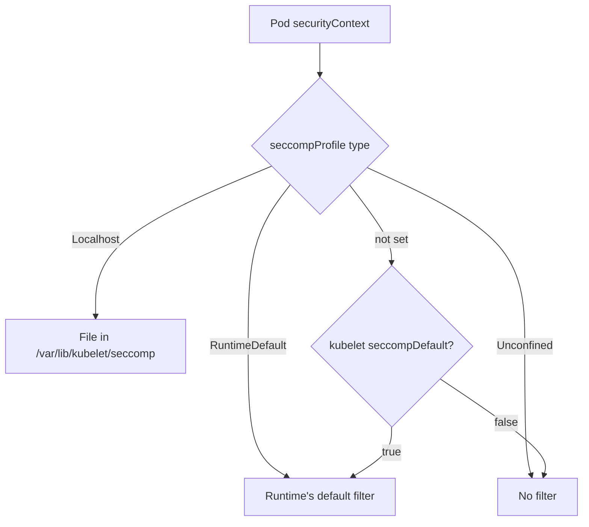

# Seccomp: Filtering System Calls

A program cannot touch hardware, files or the network on its own. It asks the kernel by making a **system call** (syscall), for example `openat` to open a file, `read` to read it or `mount` to attach a filesystem. The kernel offers several hundred syscalls, and a typical application uses a few dozen. The rest are unused attack surface: a kernel flaw in a rarely used syscall is reachable by any process that is allowed to call it. **seccomp** (secure computing mode) is a kernel feature that lets a process install a filter. The kernel checks every syscall of that process against the filter and allows it, rejects it with an error, or kills the process.

## How a filter behaves

A seccomp filter belongs to a process and is inherited by every child process. A process can add filters but never remove them, which is why a container runtime can install a filter before it starts the application and be sure that the application cannot lift it. A profile is a list of rules for syscall names, with a default action for names that no rule mentions. The actions you will meet are `SCMP_ACT_ALLOW`, `SCMP_ACT_ERRNO` (the syscall fails with an error code, and the process continues) and `SCMP_ACT_LOG` (the syscall is allowed and the kernel records it).

A seccomp filter does not look at which file or address a call uses. It only decides on the syscall and its numeric arguments. Decisions that depend on paths belong to AppArmor, which the next part covers.

## The three profile types in Kubernetes

Kubernetes selects a seccomp profile with the field `seccompProfile` in a securityContext. The field exists at pod level and at container level, and the container value overrides the pod value.

- `RuntimeDefault` uses the default profile of the container runtime. It blocks a set of dangerous or rarely needed syscalls and allows the ones normal applications use. It is the right starting point for almost every workload.
- `Localhost` uses a profile file that exists on the node. The field `localhostProfile` holds the path relative to the kubelet's seccomp directory, which is `/var/lib/kubelet/seccomp` by default. The file must exist on every node where the pod can run.
- `Unconfined` installs no filter. The process may call every syscall that the kernel offers. A privileged container also runs without a filter.

A pod that sets no `seccompProfile` runs as `Unconfined` unless the kubelet runs with the setting `seccompDefault: true`. With that setting the kubelet applies `RuntimeDefault` to every pod that does not choose a profile. The Pod Security Standards also care about this field: the `baseline` level rejects an explicit `Unconfined` profile, and the `restricted` level requires `RuntimeDefault` or `Localhost`.



The diagram shows how the kubelet resolves the profile: an explicit type wins, and an unset field falls back to the kubelet setting.

## Read the seccomp state of a process

Every process has a status file under `/proc`. The line `Seccomp:` shows the mode: `0` means no filter, `1` means the old strict mode, and `2` means a filter is installed. The line `NoNewPrivs:` shows `1` when the process, and everything it starts, can never gain privileges through setuid programs. The flag `allowPrivilegeEscalation: false` sets it.

Select the environment and start two pods that differ in the profile only:

<!-- astrona:playground:renew -->

```sh
export KUBECONFIG="$(astrona kubeconfig ats-033-playground-040-01)"
test "$(kubectl config current-context)" = "kind-astro-ats-033-playground-040-01" || exit 1
```

Save this as `pods-seccomp-compare.yaml`:

```yaml
apiVersion: v1
kind: Pod
metadata:
  name: seccomp-default
  namespace: starfleet
spec:
  restartPolicy: Never
  securityContext:
    seccompProfile:
      type: RuntimeDefault
  containers:
  - name: shell
    image: docker.io/library/busybox:1.37.0
    command:
    - sh
    - -c
    - sleep 3600
---
apiVersion: v1
kind: Pod
metadata:
  name: seccomp-unconfined
  namespace: starfleet
spec:
  restartPolicy: Never
  securityContext:
    seccompProfile:
      type: Unconfined
  containers:
  - name: shell
    image: docker.io/library/busybox:1.37.0
    command:
    - sh
    - -c
    - sleep 3600
```

Apply it and wait for both pods:

```sh
kubectl apply -f pods-seccomp-compare.yaml
kubectl -n starfleet wait --for=condition=Ready pod/seccomp-default pod/seccomp-unconfined --timeout=120s
```

Then compare the process state in both:

```sh
kubectl -n starfleet exec seccomp-default -- grep -E 'Seccomp|NoNewPrivs' /proc/1/status
kubectl -n starfleet exec seccomp-unconfined -- grep -E 'Seccomp|NoNewPrivs' /proc/1/status
```

The first pod reports `Seccomp: 2`, because the runtime installed its default filter. The second reports `Seccomp: 0`, which means the process can call every syscall. `NoNewPrivs` is `0` in both, because neither pod disables privilege escalation yet. Remove the pods when you are done:

```sh
kubectl -n starfleet delete pod seccomp-default seccomp-unconfined
```

## A custom profile with Localhost

The default profile is a compromise that suits most applications. A workload with a narrow job can use a stricter profile. The profile is a JSON file on the node. This one allows everything except the syscalls that create a directory, so a test is easy to read. A real profile does the opposite: it denies by default and lists the allowed syscalls.

Save this as `block-mkdir.json`:

```json
{
  "defaultAction": "SCMP_ACT_ALLOW",
  "syscalls": [
    {
      "names": ["mkdir", "mkdirat"],
      "action": "SCMP_ACT_ERRNO"
    }
  ]
}
```

Copy it into the seccomp directory of the node. `podman cp` copies a file into a container, and the directory must exist first. The playground has one node, so one copy is enough; in a cluster with several nodes you repeat these two commands on each node where the pod can run:

```sh
node_name="astro-ats-033-playground-040-01-control-plane"
podman exec "$node_name" mkdir -p /var/lib/kubelet/seccomp/profiles
podman cp block-mkdir.json "$node_name:/var/lib/kubelet/seccomp/profiles/block-mkdir.json"
```

Save this as `pod-seccomp-localhost.yaml`:

```yaml
apiVersion: v1
kind: Pod
metadata:
  name: seccomp-localhost
  namespace: starfleet
spec:
  restartPolicy: Never
  securityContext:
    seccompProfile:
      type: Localhost
      localhostProfile: profiles/block-mkdir.json
  containers:
  - name: shell
    image: docker.io/library/busybox:1.37.0
    command:
    - sh
    - -c
    - sleep 3600
```

Apply it and wait for the pod:

```sh
kubectl apply -f pod-seccomp-localhost.yaml
kubectl -n starfleet wait --for=condition=Ready pod/seccomp-localhost --timeout=120s
```

Then check the result. Run the directory creation on its own, because it is expected to fail:

```sh
kubectl -n starfleet exec seccomp-localhost -- grep Seccomp /proc/1/status
kubectl -n starfleet exec seccomp-localhost -- mkdir /tmp/newdir
```

The first command reports `Seccomp: 2`. The `mkdir` command is expected to fail with an `Operation not permitted` error, because the filter returns an error for the directory syscalls, even though the user is allowed to write in `/tmp`. The pod keeps running, which shows the difference between `SCMP_ACT_ERRNO` and a profile that kills the process. Remove the pod when you are done:

```sh
kubectl -n starfleet delete pod seccomp-localhost
```

You can now read and choose the seccomp profile of a workload. A syscall filter cannot say which file a process may open, so the second boundary has to restrict resources by name.

## Common pitfalls

> [!WARNING]
> - **Assuming containers have a filter by default.** Without `seccompProfile` or the kubelet setting `seccompDefault: true`, a pod runs without a filter.
> - **Putting the profile path in the wrong form.** `localhostProfile` is relative to the kubelet seccomp directory. Do not write the full path.
> - **Copying a profile to one node only.** A pod that uses `Localhost` fails on every node that lacks the file.
> - **Treating `Unconfined` as harmless.** It turns off the filter. Use it only where an owner has a documented reason.
