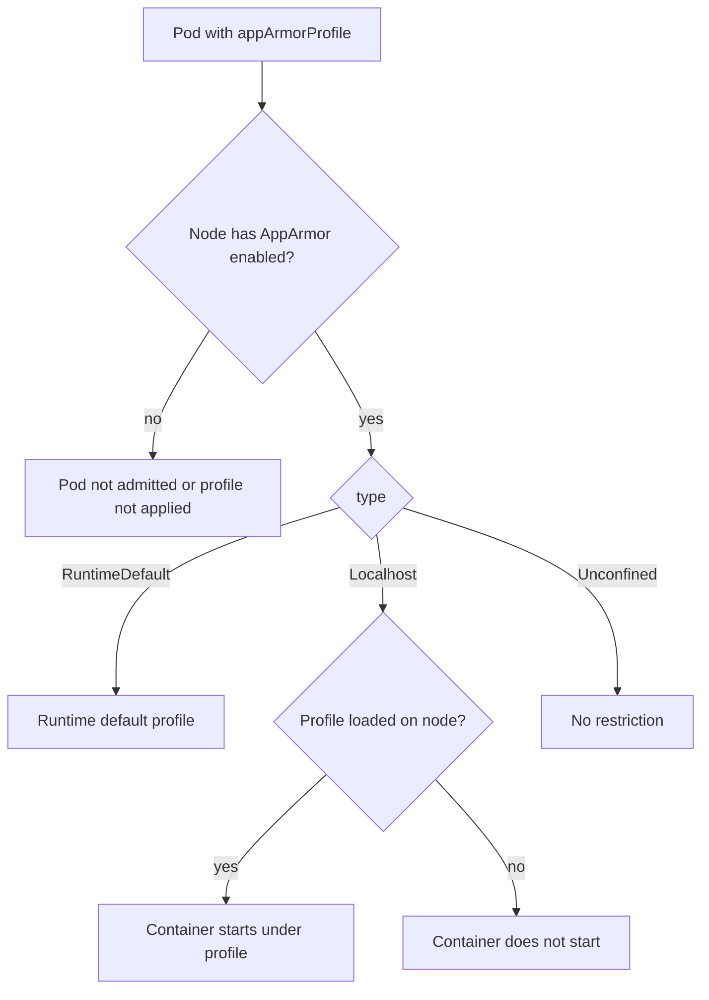

# AppArmor: Profiles For Files And Capabilities

Seccomp decides which syscalls a process may call, but it cannot say which file may be opened, because the path is an argument it does not inspect. **AppArmor** is a Linux security module (a kernel component that adds access rules on top of normal permissions) that fills this gap. It attaches a **profile** to a program. The profile lists the files and directories the program may read, write or execute, the Linux capabilities it may use and the network operations it may perform. Everything the profile does not allow is denied, even when the user is root and the file permissions would allow it. This type of control is called **mandatory access control**, because the process cannot change it.

## Profile modes and the tools

A profile runs in one of two modes. In **enforce** mode the kernel blocks the violations and logs them. In **complain** mode the kernel only logs them, which is useful while you write a profile and learn what the program needs. Profiles are text files, normally under `/etc/apparmor.d` on the node, and they must be loaded into the kernel before they apply.

- `apparmor_parser -r <file>` loads a profile into the kernel or replaces a profile that is already loaded.
- `aa-status` lists the loaded profiles, their modes and the processes that run under them.
- `/sys/module/apparmor/parameters/enabled` contains `Y` when the AppArmor module is active in the kernel.

## What the node must provide

A pod can only use AppArmor when four things are true on the node that runs it. The kernel has AppArmor enabled. The container runtime supports AppArmor. For a `Localhost` profile, the profile is loaded into the kernel of that node. The runtime also needs AppArmor for `RuntimeDefault`, because it loads its own default profile. Ubuntu and Debian kernels have AppArmor enabled by default, and distributions such as Fedora use SELinux instead.

A `kind` node is a container, and it uses the kernel of the machine that runs Podman. If that kernel has no AppArmor, no pod in the playground can use it, whatever the manifest says. The check is a single command, shown below.

## The Kubernetes field

Since Kubernetes v1.30 the profile is selected with the field `appArmorProfile` inside a securityContext, at pod level or at container level. The container value overrides the pod value. The older way, an annotation named `container.apparmor.security.beta.kubernetes.io/<container name>`, is deprecated and should not appear in new manifests. The field has three types, with the same meaning as for seccomp:

- `RuntimeDefault` applies the default profile of the container runtime.
- `Localhost` applies a profile that is already loaded on the node. The field `localhostProfile` holds the profile name, which is the name inside the profile file, not the file name.
- `Unconfined` applies no AppArmor restriction.

```yaml
securityContext:
  appArmorProfile:
    type: Localhost
    localhostProfile: k8s-deny-write
```

The kubelet checks the profile when it admits the pod. If a `Localhost` profile is not loaded on the node, the kubelet does not start the container.



The diagram shows where a pod stops: the node must support AppArmor, and a `Localhost` profile must be loaded before the container can start.

## Check AppArmor on the node

Select the environment and define the helper:

<!-- astrona:playground:renew -->

```sh
export KUBECONFIG="$(astrona kubeconfig ats-033-playground-040-01)"
test "$(kubectl config current-context)" = "kind-astro-ats-033-playground-040-01" || exit 1
node_name="astro-ats-033-playground-040-01-control-plane"
run_on_node() { podman exec "$node_name" "$@"; }
```

Ask the kernel whether AppArmor is active:

```sh
run_on_node cat /sys/module/apparmor/parameters/enabled
```

The answer `Y` means the module is active. If the file does not exist or contains `N`, AppArmor is not available in this playground, and the rest of this part is reading material. That is a normal result on a machine whose kernel uses another security module, and it does not mean that the playground is broken. If AppArmor is active, list the loaded profiles with `aa-status`. The tool may be missing inside the node image, and the output of the next command then tells you so:

```sh
run_on_node aa-status
```

## Write, load and use a profile

The next profile denies all writes to files under `/tmp` and allows everything else. It is small on purpose, so the effect is easy to see. Save it as `k8s-deny-tmp-write`:

```text
#include <tunables/global>

profile k8s-deny-tmp-write flags=(attach_disconnected) {
  #include <abstractions/base>

  file,
  network,
  capability,

  deny /tmp/** w,
}
```

The line `deny /tmp/** w,` forbids write access to every path under `/tmp`, and the three lines above it allow all other file, network and capability use. Load it on the node. This works only when the check above printed `Y` and the node image has `apparmor_parser`:

```sh
podman cp k8s-deny-tmp-write "$node_name:/etc/apparmor.d/k8s-deny-tmp-write"
run_on_node apparmor_parser -r /etc/apparmor.d/k8s-deny-tmp-write
```

Save this as `pod-apparmor-localhost.yaml`:

```yaml
apiVersion: v1
kind: Pod
metadata:
  name: apparmor-localhost
  namespace: starfleet
spec:
  restartPolicy: Never
  containers:
  - name: shell
    image: docker.io/library/busybox:1.37.0
    command:
    - sh
    - -c
    - sleep 3600
    securityContext:
      appArmorProfile:
        type: Localhost
        localhostProfile: k8s-deny-tmp-write
```

Apply it and wait for the pod:

```sh
kubectl apply -f pod-apparmor-localhost.yaml
kubectl -n starfleet wait --for=condition=Ready pod/apparmor-localhost --timeout=120s
```

Then check the result. The first command shows the profile that confines the main process. The second is expected to fail, so run it on its own:

```sh
kubectl -n starfleet exec apparmor-localhost -- cat /proc/1/attr/current
kubectl -n starfleet exec apparmor-localhost -- sh -c 'echo test > /tmp/file'
```

The first command prints the profile name `k8s-deny-tmp-write` followed by the mode in parentheses. The write is expected to fail with a `Permission denied` error, although `/tmp` is writable for the user and seccomp would have allowed the `openat` syscall. This is the difference between the two boundaries. Remove the pod with `kubectl -n starfleet delete pod apparmor-localhost` when you are done.

If AppArmor is not active in your playground, the pod does not start, and the next part shows how to read that symptom.

## Common pitfalls

> [!WARNING]
> - **Using the file name as the profile name.** `localhostProfile` takes the name written after the keyword `profile` inside the file.
> - **Loading the profile on one node only.** The profile must be loaded on every node where the pod can be scheduled, and a node restart removes loaded profiles unless a service loads them at boot.
> - **Assuming AppArmor exists everywhere.** A node with another security module, such as SELinux, cannot enforce an AppArmor profile.
> - **Writing a profile in enforce mode first.** Start in complain mode, read the log, and switch to enforce when the profile covers what the program does.
> - **Using the deprecated annotation.** Use the `appArmorProfile` field in new manifests.
