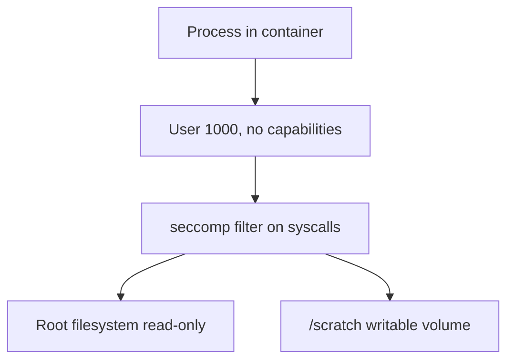

# The Restricted Security Context

Seccomp and AppArmor are two of several settings that reduce what a container can do. The Pod Security Standard named `restricted` collects them into one set of rules, and the container fields behind them fit in a short manifest. This part builds that manifest for a small workload that runs as a normal user, keeps its root filesystem read-only and writes only to a scratch volume, and then proves each setting from inside the container.

## The settings and what each one stops

- `runAsNonRoot: true` makes the kubelet refuse a container whose image would start as user ID 0. `runAsUser` and `runAsGroup` set the numeric IDs. A process that is not root has no write access to most of the filesystem and cannot use root-only operations.
- `allowPrivilegeEscalation: false` sets the `no_new_privs` flag, so a setuid program cannot gain more rights than its parent had.
- `capabilities.drop: ["ALL"]` removes every Linux capability, the units into which root power is split. Add back only what a workload provably needs.
- `readOnlyRootFilesystem: true` mounts the container's root filesystem read-only. An attacker cannot place a binary or edit a configuration file there. The application writes to a mounted volume such as an `emptyDir` instead.
- `seccompProfile` and `appArmorProfile` select the kernel filters from the previous two parts.
- `fsGroup` changes the group of the files in a mounted volume, so a non-root process can write to it. It is a pod-level field.

Settings at pod level apply to every container. A value at container level overrides the pod value, and fields such as `allowPrivilegeEscalation`, `capabilities` and `readOnlyRootFilesystem` exist at container level only.

## Build the manifest

Select the environment:

<!-- astrona:playground:renew -->

```sh
export KUBECONFIG="$(astrona kubeconfig ats-033-playground-040-01)"
test "$(kubectl config current-context)" = "kind-astro-ats-033-playground-040-01" || exit 1
```

Save this as `pod-restricted-reader.yaml`:

```yaml
apiVersion: v1
kind: Pod
metadata:
  name: restricted-reader
  namespace: starfleet
spec:
  restartPolicy: Never
  containers:
  - name: reader
    image: docker.io/library/busybox:1.37.0
    command:
    - sh
    - -c
    - sleep 3600
    securityContext:
      allowPrivilegeEscalation: false
      capabilities:
        drop:
        - ALL
      readOnlyRootFilesystem: true
    volumeMounts:
    - name: scratch
      mountPath: /scratch
  securityContext:
    runAsNonRoot: true
    runAsUser: 1000
    runAsGroup: 1000
    fsGroup: 1000
    seccompProfile:
      type: RuntimeDefault
  volumes:
  - name: scratch
    emptyDir: {}
```

The manifest has no `appArmorProfile`, because AppArmor needs a kernel that supports it, because the node must support it. On a node that supports it, add `appArmorProfile: {type: RuntimeDefault}` next to the seccomp profile at pod level.

Apply it:

```sh
kubectl apply -f pod-restricted-reader.yaml
```

## Prove each setting

Wait for the pod, then check the result from inside the container:

```sh
kubectl -n starfleet wait --for=condition=Ready pod/restricted-reader --timeout=180s
kubectl -n starfleet exec restricted-reader -- id -u
kubectl -n starfleet exec restricted-reader -- sh -c 'printf allowed > /scratch/result; cat /scratch/result'
kubectl -n starfleet exec restricted-reader -- grep -E 'Seccomp|NoNewPrivs|CapEff' /proc/1/status
```

The user ID is `1000`. The scratch write succeeds and prints `allowed`, because `fsGroup` made the volume writable for the group of the process. The status lines show `Seccomp: 2` for the installed filter, `NoNewPrivs: 1` for the disabled escalation and an effective capability set `CapEff` made of zeros, which means no capabilities are left.

The negative check comes last. It is expected to fail, so run it on its own:

```sh
kubectl -n starfleet exec restricted-reader -- sh -c 'printf denied > /root-file'
```

The command fails with an error that the filesystem is read-only. A read-only root filesystem and a writable volume exist side by side, because the volume is a separate mount. This pair is the usual way to keep an application running while its image stays unchangeable.



The diagram shows the layers from the process outwards: a weak identity, a filtered syscall surface and a filesystem where only one path accepts writes.

## Enforce it for a whole namespace

A manifest that sets these fields protects only the workloads that use it. Pod Security Admission applies the standard to a namespace. Its labels choose a level and a mode: `enforce` rejects violating pods, `audit` records them in the audit log and `warn` shows a warning to the client. To see which existing pods would violate the `restricted` level without blocking any, run a server-side dry run of the label:

```sh
kubectl label --dry-run=server --overwrite namespace starfleet pod-security.kubernetes.io/enforce=restricted
```

The API server prints warnings that name each pod in `starfleet` that would violate the level and the fields that cause it. The `probe` Deployment has no securityContext, so it is expected to appear there. Reading these warnings is the step before an `enforce` label, because the label does not remove running pods, but it blocks their next restart.

You can now write and verify the container-level settings that make up the restricted standard. The last part covers what happens when one of the kernel profiles in the manifest is wrong.

## Common pitfalls

> [!WARNING]
> - **Running as non-root and stopping there.** A non-root user with all capabilities and escalation allowed is not the restricted standard. Combine all the settings.
> - **Making the root filesystem read-only without a writable volume.** Applications that write temporary files crash. Mount an `emptyDir` for each path that needs writes.
> - **Forgetting `fsGroup`.** A new `emptyDir` is owned by root, so a non-root process cannot write to it without it.
> - **Putting container-only fields at pod level.** `allowPrivilegeEscalation`, `capabilities` and `readOnlyRootFilesystem` belong under `containers[].securityContext`.
> - **Applying an `enforce` label without a dry run.** Existing workloads fail to restart when they violate the level.
